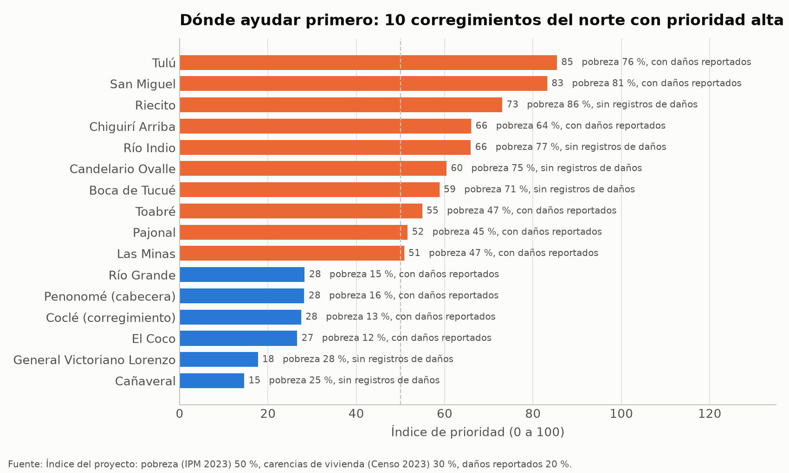
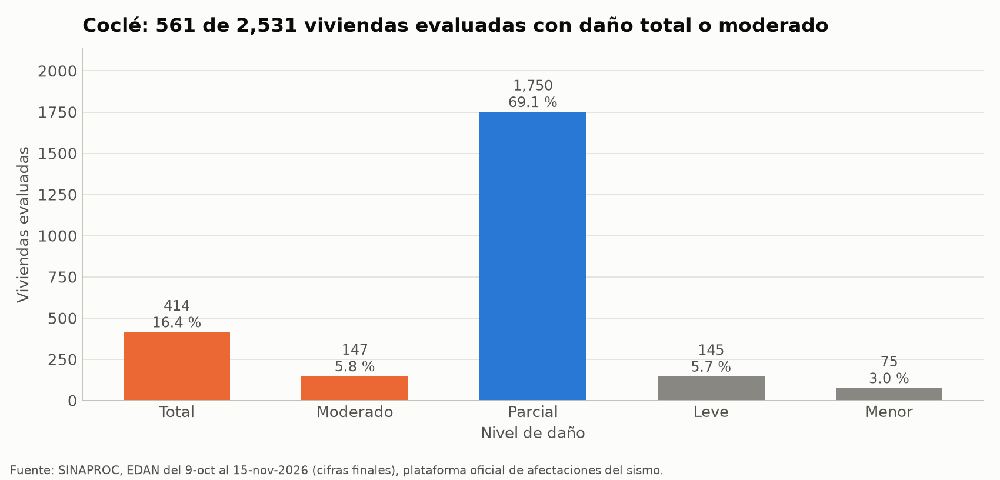
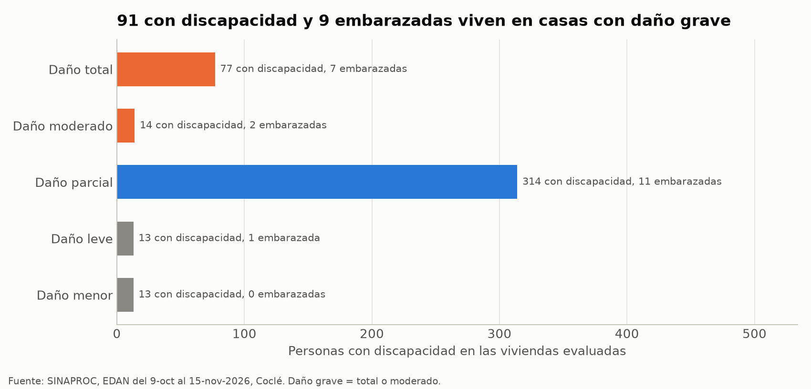
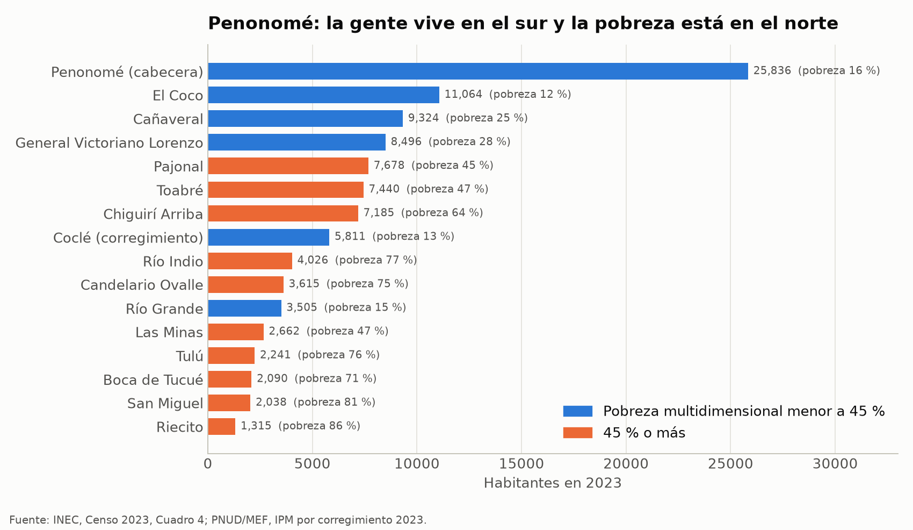

# Pulso Penonomé: el sismo de 2026 en Coclé y dónde ayudar primero

**Equipo RacoonCity** · Proyecto final del módulo de Python, Samsung Innovation Campus 2026 · Entregado el 24 de noviembre de 2026; revisado el 25 de noviembre para centrarlo en las afectaciones sociales del sismo.

**Pregunta:** ¿qué dejó el terremoto del 9 de octubre de 2026 en las personas y viviendas de Coclé, quiénes estaban más expuestos en Penonomé y dónde debería llegar primero la ayuda?

Empieza por el [análisis principal](analisis-penonome.ipynb) o lee el [estudio completo](documento/estudio-penonome.md).

## Planteamiento

Penonomé es la capital de Coclé: 104,326 habitantes en 16 corregimientos (INEC, Censo 2023). El 9 de octubre de 2026 un sismo de magnitud 7.5 según SINAPROC (7.7 según el USGS), con epicentro en Azuero, dañó la catedral, el mercado, el hospital, escuelas y viviendas. La evaluación de daños de SINAPROC cerró el 15 de noviembre con 2,531 viviendas evaluadas en Coclé, donde viven 10,199 personas.

El golpe llegó a un distrito que ya estaba frágil: el norte rural tiene pobreza multidimensional de hasta 86 % y más carencias de vivienda que el país. El problema es que la información está dispersa y en niveles distintos: SINAPROC publica el daño por provincia, y el Censo y el PNUD publican la pobreza y las carencias por corregimiento.

## Objetivos

**General:** analizar con datos oficiales verificados qué dejó el sismo en Coclé, quiénes estaban más expuestos en Penonomé y dónde ayudar primero.

**Específicos:**

1. Reunir y verificar las tablas oficiales del distrito y de Coclé (población, pobreza, vivienda y daños del sismo).
2. Medir qué dejó el sismo en las viviendas evaluadas de Coclé y quiénes viven en ellas (edad, discapacidad, embarazo).
3. Identificar a las personas y los servicios que necesitan atención primero, desde la salud pública.
4. Construir un índice de prioridad por corregimiento para orientar la ayuda.

## Herramientas

| Herramienta | Para qué |
|---|---|
| Python 3.14 | Lenguaje del proyecto |
| pandas | Carga, limpieza, uniones, tablas dinámicas y series temporales |
| matplotlib | Las siete gráficas del análisis y la presentación |
| csv y json | Lectura de datos sin pandas (anexo de las semanas 1 a 4) |
| openpyxl | Libro Excel del paquete de datos |
| JupyterLab | Notebooks ejecutados con sus resultados |
| Poetry | Dependencias y ambiente aislado del proyecto |
| Git y GitHub | Control de versiones y entrega |

## Resultado

El análisis sigue un flujo completo: fuentes, carga, limpieza con sumas de control, análisis, gráficas y decisión. Los hallazgos, en orden de importancia:

1. **La ayuda tiene que ir primero al norte.** Diez corregimientos con 40,290 habitantes tienen prioridad alta. Tulú, San Miguel, Riecito y Chiguirí Arriba encabezan con cualquier combinación de pesos.
2. **Las personas más vulnerables necesitan seguimiento propio.** En Coclé, 91 personas con discapacidad y 9 mujeres embarazadas viven en viviendas con daño total o moderado.
3. **El daño fue sobre todo parcial, pero no menor:** de 2,531 viviendas evaluadas, 561 (22.2 %) quedaron con daño total o moderado; además hay 40 escuelas y 2 hospitales afectados.
4. **La prensa mira la cabecera, pero la necesidad está en otra parte:** la cabecera tiene 28 de los 43 registros de daños y pobreza de 16 %.
5. **El sismo golpeó a un distrito frágil:** más carencias de vivienda que el país, sobre todo internet (41.9 % de viviendas sin internet frente a 30.3 %).
6. **Hoy, a mes y medio del sismo, la reconstrucción avanza lento:** 439 viviendas contratadas en Coclé y 67 en obra, 1,890 familias con ficha social del MIDES y ningún albergue activo.









## Limitaciones y ética

- SINAPROC publica la evaluación de daños por provincia: no se puede repartir por corregimiento, así que el índice usa los registros de prensa solo como sí o no.
- Los registros de daños por corregimiento salen de una compilación de prensa: son registros, no unidades dañadas, y faltan las zonas aisladas.
- La evaluación cuenta viviendas evaluadas, no todas las de la provincia.
- El índice depende de los pesos elegidos; se probó con otros pesos y se informa qué parte del ranking es estable.
- Los datos son agregados, sin información personal. Señalar corregimientos pobres busca priorizar la ayuda, no estigmatizarlos.

## Equipo RacoonCity

| Integrante | Rol |
|---|---|
| Integrante 1 | Líder del proyecto y coordinación del equipo |
| Integrante 2 | Investigación y verificación de datos |
| Integrante 3 | Desarrollo del código |
| Integrante 4 | Análisis de datos |
| Integrante 5 | Visualización y presentación |

## Estructura

```
analisis-datos-penonome/
├── README.md
├── analisis-penonome.ipynb      análisis principal: de las fuentes a la prioridad
├── datos/
│   ├── penonome/                tablas oficiales de Penonomé (Censo 2023 del INEC y pobreza del PNUD), verificadas
│   └── analisis/                tablas del sismo (evaluación de daños de SINAPROC, registros, réplicas, situación)
├── src/penonome/                código reutilizable: carga, modelos, estructuras, búsqueda, ordenamiento,
│                                análisis y pulso (gráficas e índice de prioridad)
├── notebooks/anexo-semanas/     lo aprendido en cada semana, aplicado a estos datos
├── documento/                   estudio completo y sus figuras (img/)
├── investigacion/               las 113 fuentes, las cifras clave verificadas y los informes de verificación
├── presentacion/                scripts que generan el PPT y el formulario de la entrega
├── pyproject.toml               dependencias del proyecto (Poetry)
└── poetry.lock                  versiones exactas instaladas
```

## Cómo levantarlo

El proyecto usa [Poetry](https://python-poetry.org/) y Python 3.14:

```bash
cd proyectos/analisis-datos-penonome
poetry install
poetry run jupyter lab analisis-penonome.ipynb
```

Para volver a generar todo después de cambiar un dato: `poetry run jupyter nbconvert --to notebook --execute --inplace analisis-penonome.ipynb`. Las gráficas se guardan en `documento/img/`.

## Anexo: lo aprendido en cada semana

| Semana | Temas del curso | Notebook |
|---|---|---|
| 1 | Listas, tuplas, listas bidimensionales, diccionarios (CRUD, JSON), conjuntos | [s01](notebooks/anexo-semanas/s01-listas-diccionarios-conjuntos.ipynb) |
| 2 | Funciones, recursividad, lambda/map/filter/reduce, clausuras, clases | [s02](notebooks/anexo-semanas/s02-funciones-clausuras-clases.ipynb) |
| 3 | Pilas, colas, búsqueda secuencial y binaria, tablas hash | [s03](notebooks/anexo-semanas/s03-pilas-colas-busqueda-hash.ipynb) |
| 4 | Burbuja, selección, inserción, fusión, quicksort, greedy, divide y vencerás | [s04](notebooks/anexo-semanas/s04-ordenamiento-greedy-divide-y-venceras.ipynb) |
| 5 | Programación dinámica, backtracking, módulos, Series y DataFrames | [s05](notebooks/anexo-semanas/s05-dinamica-backtracking-modulos-pandas.ipynb) |
| 6 | Datos ordenados, series temporales, mini proyecto de análisis | [s06](notebooks/anexo-semanas/s06-ordenacion-series-temporales.ipynb) |

Historial de verificación en `investigacion/verificaciones/`. Los archivos `.pptx` y `.docx` de la entrega no se publican porque la plantilla es material de Samsung.

[Proyectos](../README.md) | [Inicio del curso](../../00-inicio.ipynb)
