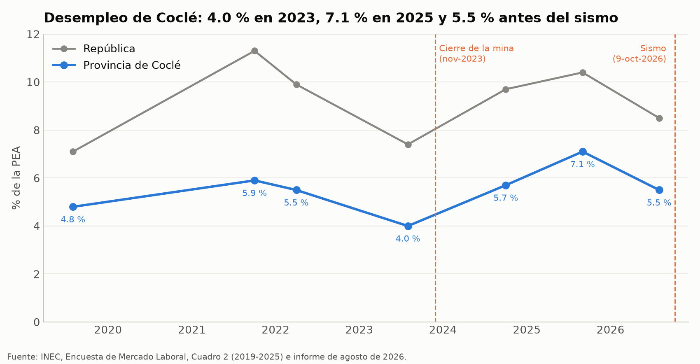

# Pulso Penonomé: dónde ayudar primero después del terremoto

**Equipo RacoonCity** · Proyecto final del módulo de Python, Samsung Innovation Campus 2026 · Entregado el 24 de noviembre de 2026.

**Pregunta:** ¿cómo estaba Penonomé antes del terremoto del 9 de octubre de 2026, qué le pasó y dónde debería llegar primero la ayuda?

Empieza por el [análisis principal](analisis-penonome.ipynb) o lee el [estudio completo](documento/estudio-penonome.md).

## Planteamiento

Penonomé es la capital de Coclé: 104,326 habitantes en 16 corregimientos (INEC, Censo 2023). El 9 de octubre de 2026 un sismo de magnitud 7.7 con epicentro en Azuero dañó su catedral, su mercado, su hospital, hoteles, comercios y 1,324 viviendas de la provincia (SINAPROC, 14 de octubre).

El golpe llegó a un distrito que ya estaba frágil. El desempleo de Coclé había subido de 4.0 % a 7.1 % tras el cierre de la mina de cobre, y el norte rural del distrito tiene pobreza multidimensional de hasta 86 %. La próxima encuesta de empleo con datos posteriores al sismo llega en 2027: hoy nadie puede medir el impacto directamente, y la información está dispersa en decenas de PDF del INEC, SINAPROC, la CSS, la ATP y la prensa.

## Objetivos

**General:** medir con datos oficiales verificados cómo estaba Penonomé antes del sismo, qué le pasó y dónde ayudar primero.

**Específicos:**

1. Reunir y verificar las tablas oficiales del distrito y de Coclé (población, pobreza, vivienda, empleo, economía y daños).
2. Analizar el antes y el después del sismo con un flujo completo de análisis de datos en Python.
3. Estimar qué puede pasar con el empleo, usando como referencia el sismo de Colombia de agosto de 2026.
4. Construir un índice de prioridad por corregimiento para orientar la ayuda.

## Herramientas

| Herramienta | Para qué |
|---|---|
| Python 3.14 | Lenguaje del proyecto |
| pandas | Carga, limpieza, uniones, `groupby` y series temporales |
| matplotlib | Las nueve gráficas del análisis y la presentación |
| csv y json | Lectura de datos sin pandas (anexo de las semanas 1 a 4) |
| openpyxl | Libro Excel del paquete de datos |
| JupyterLab | Notebooks ejecutados con sus resultados |
| Poetry | Dependencias y ambiente aislado del proyecto |
| Git y GitHub | Control de versiones y entrega |

## Resultado

El análisis sigue un flujo completo: fuentes, carga, limpieza con sumas de control, análisis, gráficas y decisión. Los hallazgos, en orden de importancia:

1. **La ayuda tiene que ir primero al norte.** Diez corregimientos con 40,290 habitantes tienen prioridad alta. Tulú, San Miguel, Riecito y Chiguirí Arriba encabezan con cualquier combinación de pesos.
2. **La prensa mira la cabecera, pero la necesidad está en otra parte:** la cabecera tiene 28 de los 43 registros de daños y pobreza de 16 %.
3. **El sismo golpeó a un distrito frágil:** más carencias que el país (41.9 % de viviendas sin internet frente a 30.3 %) y un empleo que venía del cierre de la mina.
4. **El impacto en el empleo llegará con rezago,** como en Colombia; para Coclé, 2026 podría cerrar entre 6.3 % y 8.5 % (escenarios, no pronósticos). Si no se resuelve, serían unos 4,300 desocupados más y no se volvería a 5.5 % antes de 2031.
5. **Hoy, a mes y medio del sismo, la reconstrucción avanza lento:** 439 viviendas contratadas en Coclé y 67 en obra, 1,890 familias con ficha social del MIDES y escuelas dañadas recién en demolición. El desempleo de las mujeres de Coclé (8.2 %) duplica al de los hombres.
6. **Verificar los datos cambia los resultados:** la limpieza encontró un valor de Colón copiado en la fila de Coclé.




## Limitaciones y ética

- No existe todavía una encuesta de empleo posterior al sismo: los escenarios son supuestos, no mediciones.
- Los daños por corregimiento salen de una compilación de prensa: son registros, no unidades dañadas, y faltan las zonas aisladas.
- El índice depende de los pesos elegidos; se probó con otros pesos y se informa qué parte del ranking es estable.
- Los datos son agregados, sin información personal. Señalar corregimientos pobres busca priorizar la ayuda, no estigmatizarlos.

## Equipo RacoonCity

| Integrante | Rol |
|---|---|
| Integrante 1 | Líder del proyecto y coordinación del equipo |
| Integrante 2 | Investigación y verificación de datos |
| Integrante 3 | Desarrollo del código |
| Integrante 4 | Análisis de datos |
| Integrante 5 | Visualización y presentación |

## Estructura

```
analisis-datos-penonome/
├── README.md
├── analisis-penonome.ipynb      análisis principal: de las fuentes a la prioridad
├── datos/
│   ├── penonome/                tablas oficiales de Penonomé y Coclé (INEC, CSS, ATP), verificadas
│   ├── comparacion-colombia/    desempleo de Colombia, pobreza por corregimiento y escenarios
│   └── analisis/                tablas propias del análisis (desempleo 2019-2026, daños, réplicas)
├── src/penonome/                código reutilizable: carga, modelos, estructuras, búsqueda, ordenamiento,
│                                análisis y pulso (gráficas e índice de prioridad)
├── notebooks/anexo-semanas/     lo aprendido en cada semana, aplicado a estos datos
├── documento/                   estudio completo y sus figuras (img/)
├── investigacion/               las 181 fuentes, las cifras clave verificadas y los informes de verificación
├── presentacion/                scripts que generan el PPT y el formulario de la entrega
├── pyproject.toml               dependencias del proyecto (Poetry)
└── poetry.lock                  versiones exactas instaladas
```

## Cómo levantarlo

El proyecto usa [Poetry](https://python-poetry.org/) y Python 3.14:

```bash
cd proyectos/analisis-datos-penonome
poetry install
poetry run jupyter lab analisis-penonome.ipynb
```

Para volver a generar todo después de cambiar un dato: `poetry run jupyter nbconvert --to notebook --execute --inplace analisis-penonome.ipynb`. Las gráficas se guardan en `documento/img/`.

## Anexo: lo aprendido en cada semana

| Semana | Temas del curso | Notebook |
|---|---|---|
| 1 | Listas, tuplas, listas bidimensionales, diccionarios (CRUD, JSON), conjuntos | [s01](notebooks/anexo-semanas/s01-listas-diccionarios-conjuntos.ipynb) |
| 2 | Funciones, recursividad, lambda/map/filter/reduce, clausuras, clases | [s02](notebooks/anexo-semanas/s02-funciones-clausuras-clases.ipynb) |
| 3 | Pilas, colas, búsqueda secuencial y binaria, tablas hash | [s03](notebooks/anexo-semanas/s03-pilas-colas-busqueda-hash.ipynb) |
| 4 | Burbuja, selección, inserción, fusión, quicksort, greedy, divide y vencerás | [s04](notebooks/anexo-semanas/s04-ordenamiento-greedy-divide-y-venceras.ipynb) |
| 5 | Programación dinámica, backtracking, módulos, Series y DataFrames | [s05](notebooks/anexo-semanas/s05-dinamica-backtracking-modulos-pandas.ipynb) |
| 6 | Datos ordenados, series temporales, mini proyecto de análisis | [s06](notebooks/anexo-semanas/s06-ordenacion-series-temporales.ipynb) |

Historial de verificación en `investigacion/verificaciones/`. Los archivos `.pptx` y `.docx` de la entrega no se publican porque la plantilla es material de Samsung.

[Proyectos](../README.md) | [Inicio del curso](../../00-inicio.ipynb)
