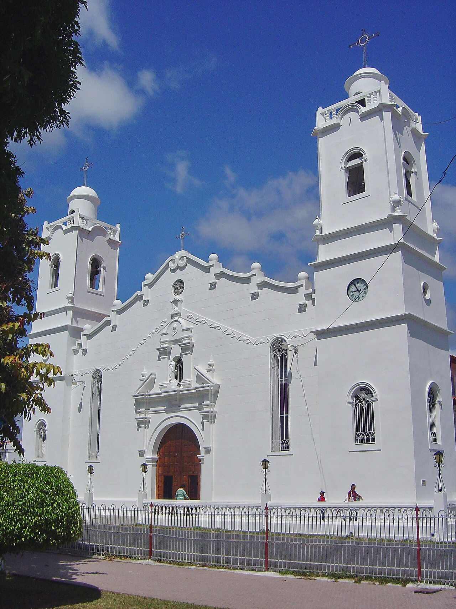
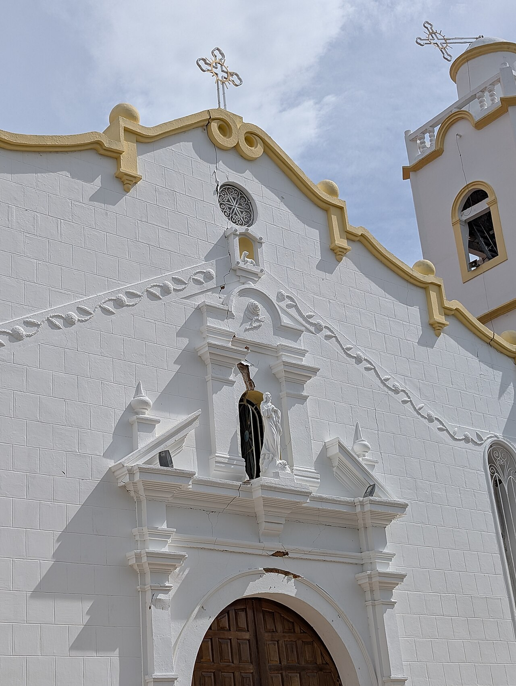
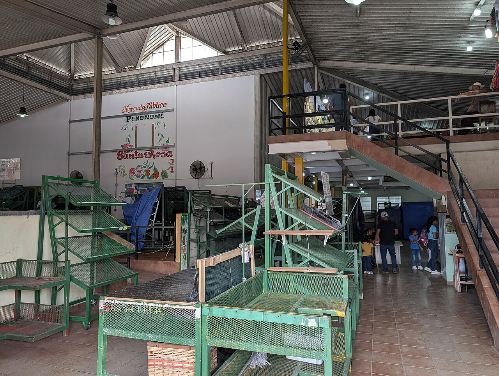
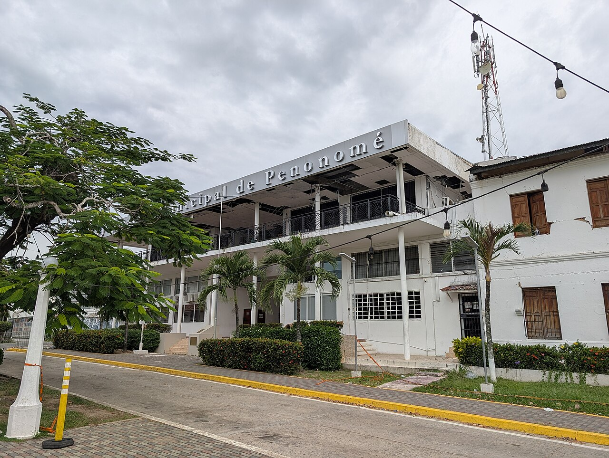
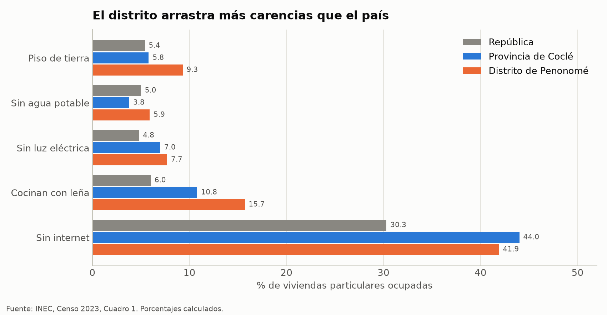
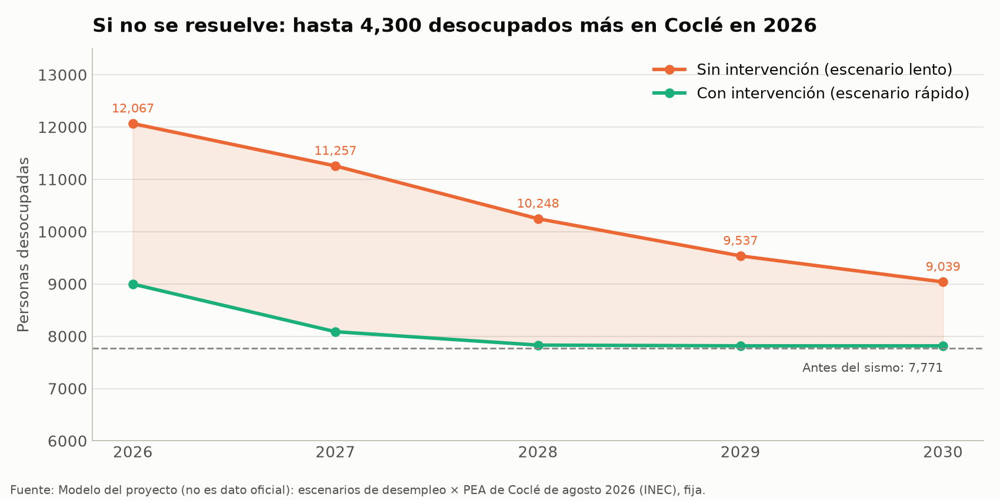

# Desempleo y economía de Penonomé (Coclé): línea de tiempo, impacto del terremoto y proyección

Equipo RacoonCity · 21 de noviembre de 2026, revisado el 24 de noviembre de 2026

**Índice**

1. [Resumen ejecutivo](#resumen-ejecutivo)
2. [Metodología y fuentes](#metodologia)
3. [Población actual de Penonomé](#poblacion)
4. [Los 16 corregimientos](#corregimientos)
5. [Estructura económica](#estructura-economica)
6. [Línea de tiempo 2016–2026](#linea-de-tiempo)
7. [El desempleo en cifras](#desempleo)
8. [El terremoto: antes y después](#terremoto)
9. [Análisis socioeconómico antes y después](#analisis-socioeconomico)
10. [Entidades públicas y privadas afectadas](#entidades-afectadas)
11. [Vivir con las réplicas](#replicas)
12. [Cronología día a día](#cronologia)
13. [Situación a noviembre de 2026](#situacion-noviembre-2026)
14. [Problemas de antes, de ahora y futuro](#problemas-y-futuro)
15. [Indicadores mensuales](#indicadores-mensuales)
16. [FODA y recomendaciones](#foda-y-recomendaciones)
17. [Plan de datos: fuentes, limpieza y proyección](#plan-de-datos)
18. [Limitaciones](#limitaciones)
19. [Referencias](#referencias)

(resumen-ejecutivo)=
## 1. Resumen ejecutivo

El terremoto del 9 de octubre de 2026 causó daños documentados en viviendas, comercios y servicios públicos de Coclé. La última encuesta laboral disponible es anterior al sismo, por lo que todavía no se puede cuantificar su impacto en el empleo de la provincia ni del distrito de Penonomé. Antes del terremoto, el desempleo de Coclé había pasado de 4.0% en 2023 a 7.1% en 2025, tras el cierre de la mina, y luego bajó a 5.5% en agosto de 2026. La serie no permite saber qué parte del aumento se debió al cierre.

**Propósito: mostrar lo que vive la gente del interior.** Los reportes documentan pérdidas de ventas entre trabajadores informales, unos 193,000 estudiantes sin clases presenciales en cuatro provincias centrales y viviendas dañadas en corregimientos rurales de Penonomé con pobreza alta. La reconstrucción genera demanda de obras; el acceso a las ayudas depende de cada programa. Véase [Quién gana y quién pierde](#quien-gana-y-quien-pierde) (sección 14).

- **Población:** el distrito tenía 104,326 habitantes en el Censo 2023 y el INEC lo estima en 111,457 para 2024 \[[INEC, Censo 2023](https://www.inec.gob.pa/archivos/P0705547520231109105354CUADRO%2010.pdf)\] \[[INEC, estimación 2024](https://www.inec.gob.pa/archivos/P0705547520260319141416b-Estimaci%C3%B3n%20proyecci%C3%B3n%20Distrito%202024.pdf)\].
- **Desigualdad interna:** en el centro urbano la pobreza multidimensional es 16%, pero en Riecito llega a 86% y en San Miguel a 81% \[[PNUD/MEF, IPM por corregimiento 2023](https://www.undp.org/sites/g/files/zskgke326/files/2024-05/undp-pa-correginf.pdf)\].
- **Pobreza provincial:** Coclé tiene 25.1% de pobreza general en 2025, frente a 21.9% nacional \[[MEF, Pobreza e Indigencia 2025](https://www.mef.gob.pa/wp-content/uploads/2026/08/MEF.Pobreza-e-Indigencia-Ano-2025.pdf)\].
- **Desempleo:** 4.0% en agosto de 2023, 7.1% en septiembre de 2025 y 5.5% en agosto de 2026 \[[INEC, EML 2023](https://www.inec.gob.pa/archivos/P030194820231201134046Cuadro%202.pdf)\] \[[INEC, EML 2025](https://www.inec.gob.pa/archivos/P0705547520260304100516Cuadro%202.pdf)\] \[[INEC, EML ago-2026](https://www.inec.gob.pa/archivos/P0705547520260929120433Informe%20de%20la%20Situaci%C3%B3n%20de%20Poblaci%C3%B3n%20Ocupada%20-%20Agosto%202026.pdf)\].
- **Calidad del empleo:** entre septiembre de 2025 y agosto de 2026, la informalidad no agrícola de Coclé subió de 56.9% a 59.5%. El subempleo invisible pasó de 9.0% a 20.0% en Coclé y de 10.8% a 20.2% en el país \[[INEC, EML ago-2026](https://www.inec.gob.pa/archivos/P0705547520260929120433Informe%20de%20la%20Situaci%C3%B3n%20de%20Poblaci%C3%B3n%20Ocupada%20-%20Agosto%202026.pdf)\].
- **Economía:** construcción (19.7%), gobierno (16.0%), industria (12.7%) y agro (11.5%) generan el 60% del PIB de Coclé \[[INEC, PIB Provincial 2018–2024](https://www.inec.gob.pa/archivos/P0705547520251118151612PRODUCTO%20INTERNO%20BRUTO%20PROVINCIAL%20A%20PRECIOS%20CORRIENTES%20Y%20EN%20MEDIDAS%20DE%20VOLUMEN%20ENCADENADAS%20CON%20A%C3%91O%20DE%20REFERENCIA%202018%20A%C3%91OS%202018-24.pdf)\]. El censo registra 23,446 ocupados en actividades agropecuarias en la provincia \[[INEC, Censo 2023, Cuadro 1](https://www.inec.gob.pa/archivos/P0705547520240202111515Cuadro%201.pdf)\].
- **Terremoto:** en su balance preliminar del 14 de octubre, SINAPROC registró 1,324 viviendas y 4,703 personas afectadas en Coclé, además de 7 hoteles, 2 hospitales, 32 centros educativos y 17 edificios de gobierno \[[SINAPROC, Comunicado #12](https://www.sinaproc.gob.pa/comunicado-oficial-12/)\]. No se verificó un balance provincial posterior comparable.
- **Escenarios para 2027:** el estudio plantea hipótesis según el avance de la reconstrucción, el crédito y la negociación de Cobre Panamá. No son proyecciones oficiales ni estimaciones del empleo perdido por el sismo (sección 14).

**Hallazgos del análisis del sismo (secciones 8 a 12)**

- **Dónde se reportaron daños:** la compilación de la sección 8 recoge casos en el centro comercial e institucional de Penonomé y en corregimientos rurales con alta pobreza previa. Sus registros no permiten saber en qué corregimiento hubo más daños.
- **Servicios públicos:** la luz volvió por completo el 15 de octubre y el agua se atiende con cisternas, pero las escuelas de Coclé siguen sin clases presenciales y el hospital de Aguadulce sigue cerrado en parte (sección 9).
- **Entidades afectadas:** Gobernación, Contraloría, juzgados, UTP y dos hospitales en el sector público; Hotel Dos Continentes, comercios de la avenida central, banca y unos 20 hospedajes en el privado (sección 10).
- **Réplicas:** el Instituto de Geociencias localizó 1,656 hasta el 17 de noviembre. Ese día se registraron ocho; el instituto esperaba actividad durante dos o tres meses más, con frecuencia decreciente (sección 11).
- **Cronología:** más de 60 noticias fechadas sobre Penonomé y Coclé del 9 de octubre al 21 de noviembre (sección 12).

**Hacia dónde va y cómo medirlo**

- **Futuro (sección 14):** Coclé llegó al sismo con alta informalidad y pobreza rural. La reconstrucción y el acceso al crédito son factores a seguir; aún falta medir su alcance y cómo evolucionan el empleo y los ingresos.
- **Seguimiento mensual (sección 15):** al cierre del estudio no había una medición oficial de empleo o pobreza posterior al sismo para Coclé. Mientras tanto, se pueden seguir los asegurados de la CSS, los desembolsos del programa de B/.310 millones en crédito y garantías, la recaudación y la ocupación hotelera. Algunos datos solo se publican a nivel nacional y hay que solicitar el desglose de Coclé.
- **Qué hacer (sección 16):** el FODA y las recomendaciones por actor proponen un tablero público de la reconstrucción por corregimiento, requisitos de crédito más simples para microempresas y un observatorio de datos de Penonomé.
- **Siguiente paso (sección 17):** catálogo de datos, flujo de limpieza en 9 pasos y método de proyección (contrafactual, escenarios y nowcasting).

(metodologia)=
## 2. Metodología y fuentes

Estudio descriptivo-longitudinal (2016–2026) con análisis de evento (antes y después del sismo) y proyección por escenarios. Prioridad de las fuentes: primero cuadros oficiales; la prensa solo para hechos que aún no tienen estadística oficial.

1. Variables: desempleo, ocupados, participación, informalidad, subempleo, PIB por sector, población, pobreza.
2. Datos oficiales descargados de INEC, MEF, SINAPROC, MINSA, PNUD y FMI (tabla abajo).
3. Impacto del sismo y de la mina: prensa nacional y gremios, siempre con enlace.
4. Depuración: si prensa e INEC difieren, prevalece el INEC; las cifras de SINAPROC se citan con el número del comunicado porque cambiaron con cada corte.
5. Análisis: tendencias, brecha Coclé–República, efecto empleo vs. efecto participación, comparación por corregimiento.
6. Proyección: escenarios con supuestos explícitos (sección 14).

**Cómo se construyeron las piezas propias del estudio**

- **Mapa:** los polígonos de los 16 corregimientos se descargaron del servicio cartográfico de la ANATI (capa de división político-administrativa) y se cruzaron con el IPM y con los daños reportados. La clasificación del panel "después" (daño y pobreza alta, cabecera, daño con pobreza baja, sin daño) es de elaboración propia.
- **Fotos:** se usaron solo imágenes con licencia libre de Wikimedia Commons, con su autor y licencia en el pie.
- **Cronología (sección 12):** se revisaron las noticias diarias de medios nacionales e informes oficiales del 9 de octubre al 21 de noviembre de 2026. Cada hecho lleva su fuente, y las fechas aproximadas están señaladas.
- **Indicadores mensuales (sección 15):** se buscaron series oficiales de la CSS, ATP, DGI, Banconal y MICI, y se indica cuándo el dato solo existe a nivel nacional o no es público.
- **Escenarios (sección 14) y FODA (sección 16):** son análisis propios basados en las cifras citadas, no proyecciones oficiales.

| Fuente | Institución | Qué aporta | Nivel |
| --- | --- | --- | --- |
| [Encuesta de Mercado Laboral 2019–2026](https://www.inec.gob.pa/archivos/P0705547520260929120433Informe%20de%20la%20Situaci%C3%B3n%20de%20Poblaci%C3%B3n%20Ocupada%20-%20Agosto%202026.pdf) | INEC | Desempleo, ocupados, informalidad, subempleo | Provincia |
| [PIB Provincial 2018–2024](https://www.inec.gob.pa/archivos/P0705547520251118151612PRODUCTO%20INTERNO%20BRUTO%20PROVINCIAL%20A%20PRECIOS%20CORRIENTES%20Y%20EN%20MEDIDAS%20DE%20VOLUMEN%20ENCADENADAS%20CON%20A%C3%91O%20DE%20REFERENCIA%202018%20A%C3%91OS%202018-24.pdf) | INEC | PIB y su composición por sector | Provincia |
| [Censo 2023, Cuadro 10](https://www.inec.gob.pa/archivos/P0705547520231109105354CUADRO%2010.pdf) | INEC | Población 2000, 2010, 2023 por corregimiento | Corregimiento |
| [Estimación de población 2024](https://www.inec.gob.pa/archivos/P0705547520260319141416b-Estimaci%C3%B3n%20proyecci%C3%B3n%20Distrito%202024.pdf) | INEC | Población actual estimada | Distrito |
| [Plan Estratégico Distrital de Penonomé 2024–2025](https://www.gacetaoficial.gob.pa/pdfTemp/30376_A/115045.pdf) | MEF / Municipio | Ingreso, actividad económica y diagnóstico local. El cuadro 25 (pág. 59 de la Gaceta) contiene el desglose provincial de ocupados por actividad. | Distrito, corregimiento y cuadros provinciales |
| [IPM por corregimiento 2023](https://www.undp.org/sites/g/files/zskgke326/files/2024-05/undp-pa-correginf.pdf) | PNUD / Gabinete Social / MEF | Pobreza multidimensional | Corregimiento |
| [Pobreza e Indigencia 2025](https://www.mef.gob.pa/wp-content/uploads/2026/08/MEF.Pobreza-e-Indigencia-Ano-2025.pdf) | MEF | Pobreza por ingreso 2024–2025 | Provincia |
| [ASIS Coclé 2024](https://minsa.gob.pa/sites/default/files/publicacion-general/resumen_cocle_asis_2024_region_de_salud_de_cocle.pdf) | MINSA | Contexto social y corregimientos pobres | Provincia |
| Comunicados [#5](https://www.sinaproc.gob.pa/comunicado-oficial-5/), [#7](https://www.sinaproc.gob.pa/comunicado-oficial-7/) y [#12](https://www.sinaproc.gob.pa/comunicado-oficial-12/) | SINAPROC | Daños del sismo | Provincia |
| [Artículo IV 2026](https://www.imf.org/es/news/articles/2026/10/06/cs-panama-staff-concluding-statement-of-the-2026-article-iv-mission) | FMI | Crecimiento nacional | País |

(poblacion)=
## 3. Población actual de Penonomé

Penonomé es un distrito en crecimiento: pasó de 72,448 habitantes en 2000 a 85,737 en 2010 y 104,326 en 2023 (+21.7% en 13 años), con 61.1 habitantes por km² \[[INEC, Censo 2023, Cuadro 10](https://www.inec.gob.pa/archivos/P0705547520231109105354CUADRO%2010.pdf)\]. La estimación oficial más reciente es **111,457 habitantes al 1 de julio de 2024** (56,633 hombres y 54,824 mujeres), el 39% de los 285,060 habitantes de Coclé \[[INEC, estimación 2024](https://www.inec.gob.pa/archivos/P0705547520260319141416b-Estimaci%C3%B3n%20proyecci%C3%B3n%20Distrito%202024.pdf)\]. El INEC publicó en mayo de 2026 las proyecciones revisadas por distrito: 113,409 habitantes en 2026.

| Indicador | Valor | Año | Fuente |
| --- | --- | --- | --- |
| Población estimada del distrito | 113,409 (2025: 112,470; 2024: 111,457) | 2026 | [INEC, proyecciones revisadas con el Censo 2023, Cuadro 12](https://www.inec.gob.pa/archivos/P0289562520260513151958Cuadro%2012.xlsx) |
| Población estimada de Coclé | 287,937 (2025: 286,586) | 2026 | [INEC, Cuadro 6](https://www.inec.gob.pa/archivos/P0579518620260513151728Cuadro%206.xlsx) |
| Población económicamente activa | 47,746 (44,720 ocupados, 3,026 desocupados) | 2023 | [INEC, Censo 2023, Cuadro 1](https://www.inec.gob.pa/archivos/P0705547520240202111515Cuadro%201.pdf) |
| Ingreso mediano mensual del hogar | B/.600 | 2023 | [Censo vía MEF](https://www.gacetaoficial.gob.pa/pdfTemp/30376_A/115045.pdf) |
| Viviendas particulares ocupadas con internet fijo o móvil | 58.1% (16,590 de 28,547) | 2023 | Cálculo sobre [INEC, Censo 2023, Cuadro 1](https://www.inec.gob.pa/archivos/P0705547520240202111515Cuadro%201.pdf) |
| Ocupados sin seguro social directo (informalidad aproximada) | \~53.7% | 2021 | [CSS vía MEF](https://www.gacetaoficial.gob.pa/pdfTemp/30376_A/115045.pdf) |
| Pobreza general / extrema, Coclé | 25.1% / 10.3% (2024: 28.0% / 9.6%) | 2025 | [MEF](https://www.mef.gob.pa/wp-content/uploads/2026/08/MEF.Pobreza-e-Indigencia-Ano-2025.pdf) |
| Pobreza general / extrema, nacional | 21.9% / 10.0% | 2025 | [MEF](https://www.mef.gob.pa/wp-content/uploads/2026/08/MEF.Pobreza-e-Indigencia-Ano-2025.pdf) |
| Índice de Desarrollo Humano, Penonomé | 0.722 (0.676 en 2010) | 2018 | [PNUD vía MEF](https://www.gacetaoficial.gob.pa/pdfTemp/30376_A/115045.pdf) |
| Balance preliminar del sismo, Coclé | 4,703 personas y 1,324 viviendas afectadas | 14-oct-2026 | [SINAPROC #12](https://www.sinaproc.gob.pa/comunicado-oficial-12/) |

**Cómo está hoy la población.** Coclé redujo su pobreza general de 28.0% a 25.1% entre 2024 y 2025, pero la pobreza extrema subió de 9.6% a 10.3% y sigue por encima del promedio nacional \[[MEF](https://www.mef.gob.pa/wp-content/uploads/2026/08/MEF.Pobreza-e-Indigencia-Ano-2025.pdf)\]. El MINSA cuenta 16 corregimientos de Coclé entre los 300 más pobres del país, ubicados en Penonomé, La Pintada, Olá, Natá y Antón \[[MINSA, ASIS Coclé 2024](https://minsa.gob.pa/sites/default/files/publicacion-general/resumen_cocle_asis_2024_region_de_salud_de_cocle.pdf)\]. El plan distrital identifica como problemas principales el agua potable insuficiente, puestos de salud cerrados, caminos en mal estado en el norte y una red de alcantarillado vieja \[[MEF, Plan Distrital](https://www.gacetaoficial.gob.pa/pdfTemp/30376_A/115045.pdf)\]. A eso se suma, desde octubre, el daño en viviendas del sismo (sección 8).

(corregimientos)=
## 4. Los sectores de Penonomé: sus 16 corregimientos

Penonomé son dos distritos en uno: un sur urbano y costero con pobreza baja, y un norte montañoso y rural donde la mayoría es pobre.

| Corregimiento | Población 2010 | Población 2023 | Habitantes por km² (2023) | Pobreza multidimensional 2023 (incidencia H) | Actividad productiva según el plan distrital |
| --- | --- | --- | --- | --- | --- |
| Penonomé (cabecera) | 21,748 | 25,836 | 484.2 | 16% | Construcción, comercio, gobierno y servicios |
| El Coco | 5,605 | 11,064 | 74.6 | 12% | Arroz |
| Cañaveral | 7,517 | 9,324 | 147.0 | 25% | Turismo (senderos, playas) |
| Gral. Victoriano Lorenzo | (creado en 2022) | 8,496 | 107.3 | 28% | Turismo (playas, cabañas) |
| Pajonal | 13,565 | 7,678 | 120.4 | 45% | Turismo y artesanía en piedra de jabón |
| Toabré | 10,203 | 7,440 | 38.4 | 47% | Agricultura (tomate, tubérculos, arroz, maíz) |
| Chiguirí Arriba | 10,018 | 7,185 | 69.1 | 64% | Agricultura y turismo |
| Coclé | 4,100 | 5,811 | 50.4 | 13% | Arroz y pesca artesanal (Puerto El Gago) |
| Río Indio | 5,240 | 4,026 | 18.8 | 77% | Sin dato en el plan |
| Candelario Ovalle | (creado en 2022) | 3,615 | 36.5 | 75% | Sin dato en el plan |
| Río Grande | 3,117 | 3,505 | 37.2 | 15% | Sin dato en el plan |
| Las Minas | (creado en 2022) | 2,662 | 37.5 | 47% | Sin dato en el plan |
| Tulú | 4,624 | 2,241 | 18.4 | 76% | Sin dato en el plan |
| Boca de Tucué | (creado en 2022) | 2,090 | 20.2 | 71% | Sin dato en el plan |
| San Miguel | (creado en 2022) | 2,038 | 20.4 | 81% | Sin dato en el plan |
| Riecito | (creado en 2022) | 1,315 | 15.8 | 86% | Sin dato en el plan |

Fuentes: [INEC, Censo 2023, Cuadro 10](https://www.inec.gob.pa/archivos/P0705547520231109105354CUADRO%2010.pdf) para población y densidad; [PNUD, Gabinete Social y MEF, IPM por corregimiento 2023](https://www.undp.org/sites/g/files/zskgke326/files/2024-05/undp-pa-correginf.pdf), cuadro de Coclé, para la proporción de personas en pobreza multidimensional (incidencia H); [Plan Estratégico Distrital](https://www.gacetaoficial.gob.pa/pdfTemp/30376_A/115045.pdf) para actividad productiva.

**Lectura.**

- **El crecimiento está en el sur.** El Coco casi duplicó su población entre 2010 y 2023 (5,605 → 11,064) y la cabecera concentra uno de cada cuatro habitantes \[[INEC](https://www.inec.gob.pa/archivos/P0705547520231109105354CUADRO%2010.pdf)\].
- **Los límites cambiaron:** la Ley 296 de 26 de abril de 2022 creó seis corregimientos y modificó el territorio de Pajonal, Toabré, Chiguirí Arriba, Río Indio y Tulú. Las diferencias con 2010 no permiten medir migración sin reconstruir la población con límites comparables \[[INEC](https://www.inec.gob.pa/archivos/P0705547520231109105354CUADRO%2010.pdf)\].
- **El norte es la zona más vulnerable:** el plan distrital señala bosques y fuentes de agua aptos para ecoturismo, pero también caminos en mal estado, ríos sin puentes y áreas sin electricidad \[[MEF](https://www.gacetaoficial.gob.pa/pdfTemp/30376_A/115045.pdf)\]. Allí el desempleo no se ve en las encuestas: se ve como pobreza y autoconsumo.
- **El sismo también llegó al norte:** hubo viviendas colapsadas en Chiguirí Arriba, Toabré (Sagrejá), Pajonal y San Miguel, donde más de 50 familias se refugiaron en un puesto de salud \[[Mapa del terremoto, compilación de TVN, Mi Favorita y otros](https://www.mapadelterremoto.com/panama/distrito/penonome)\].

(estructura-economica)=
## 5. Estructura económica: de dónde viene el ingreso

Coclé produjo B/.2,413.7 millones reales en 2024, cerca del 3% del PIB nacional, y creció 6.5% ese año tras caer 20.2% en 2020 \[[INEC, PIB Provincial 2018–2024](https://www.inec.gob.pa/archivos/P0705547520251118151612PRODUCTO%20INTERNO%20BRUTO%20PROVINCIAL%20A%20PRECIOS%20CORRIENTES%20Y%20EN%20MEDIDAS%20DE%20VOLUMEN%20ENCADENADAS%20CON%20A%C3%91O%20DE%20REFERENCIA%202018%20A%C3%91OS%202018-24.pdf)\]. El INEC no publica PIB por distrito, así que la provincia es el mejor dato disponible para Penonomé.

**Quién genera el dinero no es quién genera el empleo.** El Censo 2023 cuenta 103,514 ocupados en Coclé, de ellos 23,446 en actividades agropecuarias \[[INEC, Censo 2023, Cuadro 1](https://www.inec.gob.pa/archivos/P0705547520240202111515Cuadro%201.pdf)\]. El cuadro 25 del Plan Distrital recoge el resto del desglose.

| Sector | Ocupados en Coclé (Censo 2023) | % del empleo | % del PIB provincial 2024 |
| --- | --- | --- | --- |
| Agro, ganadería, silvicultura y pesca | 23,446 | 22.7% | 11.5% |
| Comercio | 14,536 | 14.0% | 5.7% |
| Industria manufacturera | 9,563 | 9.2% | 12.7% |
| Construcción | 8,402 | 8.1% | 19.7% |
| Administración pública | 7,050 | 6.8% | 16.0% (todo el gobierno y no de mercado) |
| Hoteles y restaurantes | 6,222 | 6.0% | 3.2% |
| Enseñanza | 5,023 | 4.9% | 0.2% (solo la privada) |

Fuentes: total de ocupados y agro, [INEC, Censo 2023, Cuadro 1](https://www.inec.gob.pa/archivos/P0705547520240202111515Cuadro%201.pdf); demás ramas de empleo, [Plan Distrital, cuadro 25, pág. 59 de la Gaceta](https://www.gacetaoficial.gob.pa/pdfTemp/30376_A/115045.pdf); PIB, [INEC](https://www.inec.gob.pa/archivos/P0705547520251118151612PRODUCTO%20INTERNO%20BRUTO%20PROVINCIAL%20A%20PRECIOS%20CORRIENTES%20Y%20EN%20MEDIDAS%20DE%20VOLUMEN%20ENCADENADAS%20CON%20A%C3%91O%20DE%20REFERENCIA%202018%20A%C3%91OS%202018-24.pdf). El PIB de 2024 es estimado. Porcentajes de empleo calculados sobre 103,514.

- **Agro y comercio** dan más de un tercio del empleo (36.7%) con solo 17% del PIB: son actividades de bajo ingreso y alta informalidad. Son también las que más pierden con sequías y con el cierre de locales tras el sismo.
- **Construcción y gobierno** aportan alrededor de 36% del PIB provincial. Un ejemplo de inversión pública en Penonomé es el nuevo Hospital Aquilino Tejeira de 256 camas \[[MINSA](https://www.minsa.gob.pa/centro-de-prensa/noticias/presidente-mulino-supervisa-avances-del-hospital-aquilino-tejeira-obra)\].
- **Energía:** el parque eólico Laudato Si’ de Penonomé tiene 86 aerogeneradores y una inversión reportada de US\$436 millones \[[La Estrella](https://www.laestrella.com.pa/vida-y-cultura/planeta/mwh-millon-laudato-armonia-ambiente-GVLE75976)\]. El rubro del INEC agrupa electricidad, gas, agua y saneamiento: pasó de 3.6% a 5.4% del PIB provincial entre 2018 y 2024, pero la publicación no separa el aporte del parque.
- **Turismo:** el plan distrital lo marca como la gran oportunidad sin desarrollar: Penonomé no tiene un plan maestro de turismo \[[MEF](https://www.gacetaoficial.gob.pa/pdfTemp/30376_A/115045.pdf)\].

*Nota:* el Censo cuenta ocupados de 10 años y más y la Encuesta de Mercado Laboral, de 15 y más, con otra metodología; por eso sus totales no coinciden.

(linea-de-tiempo)=
## 6. Línea de tiempo socioeconómica 2016–2026

| Fecha | Hecho | Efecto en Penonomé / Coclé | Fuente |
| --- | --- | --- | --- |
| 2016 | Inauguración del parque eólico Laudato Si’ en Penonomé | Nuevo sector energético | [La Estrella](https://www.laestrella.com.pa/panama/nacional/8-parque-eolico-energia-generara-AALE97046) |
| ago-2019 | Desempleo de Coclé en 4.8% (nacional 7.1%) | Punto de partida | [INEC](https://www.inec.gob.pa/archivos/P0579518620211215110510Cuadro%202.pdf) |
| 2020 | COVID-19: el PIB de Coclé cae 20.2% | Mayor caída del periodo | [INEC](https://www.inec.gob.pa/archivos/P0705547520251118151612PRODUCTO%20INTERNO%20BRUTO%20PROVINCIAL%20A%20PRECIOS%20CORRIENTES%20Y%20EN%20MEDIDAS%20DE%20VOLUMEN%20ENCADENADAS%20CON%20A%C3%91O%20DE%20REFERENCIA%202018%20A%C3%91OS%202018-24.pdf) |
| 2021 | El PIB de Coclé rebota 24.9% | Recuperación post-COVID | [INEC](https://www.inec.gob.pa/archivos/P0705547520251118151612PRODUCTO%20INTERNO%20BRUTO%20PROVINCIAL%20A%20PRECIOS%20CORRIENTES%20Y%20EN%20MEDIDAS%20DE%20VOLUMEN%20ENCADENADAS%20CON%20A%C3%91O%20DE%20REFERENCIA%202018%20A%C3%91OS%202018-24.pdf) |
| 2023 | El Niño reduce en \~1,000 ha el arroz secano en Coclé | Menos ingreso agrícola | [Panamá América](https://www.panamaamerica.com.pa/provincias/produccion-de-arroz-en-cocle-se-redujo-en-mil-hectareas-1226550) |
| ago-2023 | Desempleo de Coclé en 4.0%, 138,709 ocupados | Tasa más baja de los cortes incluidos en el estudio | [INEC](https://www.inec.gob.pa/archivos/P030194820231201134046Cuadro%202.pdf) |
| nov-2023 | Cierre de Cobre Panamá tras el fallo de la Corte Suprema | Cerca de la mitad de los trabajadores mineros eran de Coclé | [Panamá América](https://www.panamaamerica.com.pa/economia/el-cese-de-la-actividad-minera-elevo-el-desempleo-1239117) |
| ago-2024 | CoNEP estima 13,222 empleos coclesanos afectados por el cierre minero | Proyecta 13.1% de desempleo provincial | [Panamá América](https://www.panamaamerica.com.pa/economia/el-cese-de-la-actividad-minera-elevo-el-desempleo-1239117) |
| oct-2024 | Desempleo de Coclé sube a 5.7% | Primera medición de la serie tras el cierre minero | [INEC](https://www.inec.gob.pa/archivos/P0705547520260304100516Cuadro%202.pdf) |
| feb-2025 | Proveedores mineros de Coclé (76% del total) advierten que 42% podría cerrar | Golpe a empresas de La Pintada y Penonomé | [Panamá América](https://www.panamaamerica.com.pa/provincias/cocle-proveedores-de-la-mina-esperan-respuestas-1246250) |
| feb-2025 | Miles de extrabajadores y proveedores marchan en Penonomé para pedir la reapertura | Presión social local | [Mi Diario](https://midiario.com/nacionales/miles-de-panamenos-exigen-la-reapertura-de-la-mina-cobre) |
| sep-2025 | Desempleo de Coclé en 7.1% (10,165 personas), urbano 9.1% | Peor punto de la serie | [INEC](https://www.inec.gob.pa/archivos/P0705547520260304100516Cuadro%202.pdf) |
| ago-2026 | Desempleo de Coclé baja a 5.5%, pero la informalidad sube a 59.5% | Menor desempleo con mayor informalidad | [INEC](https://www.inec.gob.pa/archivos/P0705547520260929120433Informe%20de%20la%20Situaci%C3%B3n%20de%20Poblaci%C3%B3n%20Ocupada%20-%20Agosto%202026.pdf) |
| 2-oct-2026 | Se difunde el informe de la Comisión Interministerial: propone evaluar un acuerdo orientado al cierre ordenado, sin autorizar la reapertura | No implica reanudación de la extracción | [Telemetro](https://www.telemetro.com/c6093778) |
| 9-oct-2026 | Terremoto en Azuero: Mw 7.7 según el USGS; SINAPROC reportó magnitud 7.5 | Daños en el casco de Penonomé; emergencia nacional | [USGS](https://earthquake.usgs.gov/earthquakes/eventpage/us6000u18k), [SINAPROC #12](https://www.sinaproc.gob.pa/comunicado-oficial-12/) |
| nov-2026 | El gobierno anuncia negociaciones con First Quantum para evaluar una posible reapertura de Cobre Panamá | Sin fecha de reapertura ni cifra de empleo comprometida en la fuente | [Reporte Minero](https://reporteminero.cl/noticia/noticias/2026/11/panama-negocia-reapertura-cobre-panama-first-quantum) |

(desempleo)=
## 7. El desempleo en cifras: Coclé frente al país

La Encuesta de Mercado Laboral no publica una tasa para el distrito de Penonomé. La serie de Coclé sirve como referencia provincial, no como una medición del distrito. En los cortes de la tabla, Coclé se mantuvo por debajo del promedio nacional. El alza entre 2023 y 2025 ocurrió después del cierre minero; la serie no permite separar el efecto del cierre de otros cambios en el mercado laboral.

| Medición INEC | PEA Coclé | Ocupados | Desocupados | Desempleo Coclé | Participación Coclé | Desempleo República | Fuente |
| --- | --- | --- | --- | --- | --- | --- | --- |
| Ago 2026 | 142,130 | 134,359 | 7,771 | 5.5% | 64.0% | 8.5% | [INEC ago-2026](https://www.inec.gob.pa/archivos/P0705547520260929120433Informe%20de%20la%20Situaci%C3%B3n%20de%20Poblaci%C3%B3n%20Ocupada%20-%20Agosto%202026.pdf) |
| Sep 2025 | 143,191 | 133,026 | 10,165 | 7.1% | 69.1% | 10.4% | [INEC 2024–25](https://www.inec.gob.pa/archivos/P0705547520260304100516Cuadro%202.pdf) |
| Oct 2024 | 142,040 | 134,009 | 8,031 | 5.7% | 69.1% | 9.7% | [INEC 2024–25](https://www.inec.gob.pa/archivos/P0705547520260304100516Cuadro%202.pdf) |
| Ago 2023 | 144,483 | 138,709 | 5,774 | 4.0% | 70.7% | 7.4% | [INEC 2022–23](https://www.inec.gob.pa/archivos/P030194820231201134046Cuadro%202.pdf) |
| Abr 2022 | 141,149 | 133,413 | 7,736 | 5.5% | 69.5% | 9.9% | [INEC 2022–23](https://www.inec.gob.pa/archivos/P030194820231201134046Cuadro%202.pdf) |
| Oct 2021 | 135,336 | 127,344 | 7,992 | 5.9% | 67.3% | 11.3% | [INEC 2019–21](https://www.inec.gob.pa/archivos/P0579518620211215110510Cuadro%202.pdf) |
| Ago 2019 | 136,542 | 130,014 | 6,528 | 4.8% | 70.2% | 7.1% | [INEC 2019–21](https://www.inec.gob.pa/archivos/P0579518620211215110510Cuadro%202.pdf) |

**Análisis** (cálculos propios sobre la tabla):

- **Evolución tras el cierre minero:** de agosto de 2023 a septiembre de 2025, Coclé registró 5,683 ocupados menos (−4.1%) y 76% más desocupados, de 5,774 a 10,165. Son variaciones netas de la provincia, no un recuento de empleos perdidos por el cierre.
- **Cambios en los recuentos de 2026:** la diferencia de 2,394 desocupados menos coincide aritméticamente con 1,333 ocupados más y 1,061 personas menos en la población económicamente activa. El desempleo oculto pasó de 3,640 a 1,464; quienes declararon haberse cansado de buscar trabajo pasaron de 987 a 834. El INEC cambió el marco muestral: la población estimada de 15 años o más de Coclé subió de 207,110 a 222,190. Ese cambio de denominador explica la mayor parte de la diferencia aritmética entre las tasas de participación publicadas (69.1% y 64.0%); no permite concluir que la población haya dejado de buscar trabajo en esa proporción \[[INEC ago-2026, Cuadro 2](https://www.inec.gob.pa/archivos/P0705547520260929120433Informe%20de%20la%20Situaci%C3%B3n%20de%20Poblaci%C3%B3n%20Ocupada%20-%20Agosto%202026.pdf)\].
- **Calidad del empleo, septiembre de 2025 a agosto de 2026:** informalidad no agrícola, de 56.9% a 59.5%; subempleo visible, de 6.2% a 12.4%; subempleo invisible, de 9.0% a 20.0% (26,927 personas). El INEC llama subempleo invisible al trabajo de 40 horas o más con ingresos inferiores al mínimo. El indicador nacional también subió, de 10.8% a 20.2%. La informalidad no agrícola de Coclé quedó 13.7 puntos por encima de la nacional (45.8%) \[[INEC ago-2026](https://www.inec.gob.pa/archivos/P0705547520260929120433Informe%20de%20la%20Situaci%C3%B3n%20de%20Poblaci%C3%B3n%20Ocupada%20-%20Agosto%202026.pdf)\].
- **Urbano vs. rural:** en 2025 el desempleo urbano de Coclé fue 9.1% y el rural 5.8% \[[INEC 2024–25](https://www.inec.gob.pa/archivos/P0705547520260304100516Cuadro%202.pdf)\]. La encuesta no permite saber cuánto del desempleo urbano corresponde a la ciudad de Penonomé. La sección 4 describe por separado la pobreza en los corregimientos rurales.
- **Comparación regional, ago-2026:** Coclé 5.5%, Veraguas 8.1%, Herrera 4.5%, Los Santos 3.4% \[[La Estrella, con datos del INEC](https://www.laestrella.com.pa/panama/nacional/el-empleo-y-los-pequenos-negocios-los-otros-efectos-del-terremoto-DL26691460)\].

**Agosto de 2026 en detalle** (último dato antes del sismo, con marco muestral nuevo: comparar tasas, no niveles) \[[INEC, EML agosto 2026, Cuadro 3](https://www.inec.gob.pa/archivos/P0705547520260930152143Cuadro%203.xlsx)\] \[[Cuadro 26](https://www.inec.gob.pa/archivos/P053342420260930153335Cuadro%2026.xlsx)\] \[[Situación de la población ocupada](https://www.inec.gob.pa/archivos/P0705547520260929120433Informe%20de%20la%20Situaci%C3%B3n%20de%20Poblaci%C3%B3n%20Ocupada%20-%20Agosto%202026.pdf)\]:

- **Quién está sin trabajo:** el desempleo de las mujeres (8.2%) duplica al de los hombres (3.7%); el urbano es 6.0% y el rural 5.1%. La participación de las mujeres es 50.4%, frente a 77.8% en los hombres.
- **Cómo es el trabajo que hay:** 56,686 personas trabajan por cuenta propia, más que en empresas privadas (40,620); 59.5% del empleo no agrícola es informal; 20.0% de los ocupados tiene subempleo invisible y 43.1% trabaja 40 horas o más ganando menos del salario mínimo.
- **De qué trabajan:** agro 33,642 ocupados, comercio 18,630, manufactura 13,523, construcción 12,285 y hoteles y restaurantes 9,176.

(terremoto)=
## 8. El terremoto del 9 de octubre de 2026: Penonomé antes y después

El sismo ocurrió a las 12:56 p.m. (hora de Panamá), con epicentro en Azuero. El [USGS](https://earthquake.usgs.gov/earthquakes/eventpage/us6000u18k) registra Mw 7.7. El Instituto de Geociencias de la Universidad de Panamá informó inicialmente magnitud 7.2 \[[El Mundo](https://diario.elmundo.sv/el-mundo/un-terremoto-de-magnitud-7-7-sacude-a-panama-este-viernes)\]; en reportes posteriores, el instituto y [SINAPROC #12](https://www.sinaproc.gob.pa/comunicado-oficial-12/) citaron magnitud 7.5 \[[Revista Hacia la Luz, Universidad de Panamá](https://uphacialaluz.com/2026/11/17/instituto-de-geociencias-de-la-universidad-de-panama-registra-1656-replicas-asociadas-al-sismo-de-azuero/)\]. En Penonomé se reportaron colapsos parciales en la catedral, la Gobernación y un hotel de tres pisos \[[EFE vía Diario Libre](https://www.diariolibre.com/mundo/america-latina/2026/10/09/terremoto-panama-provoca-colapso-de-edificios-en-penonome/3683140)\]. El balance provincial de SINAPROC registró 17 personas con lesiones menores.

*Figura del original no recuperada (el documento original no está disponible para esta revisión). Las fotos de la sección «Fotos: Penonomé antes y después» muestran los mismos lugares. Pie de la figura original:* Fuentes: Catedral y Gobernación: MiCultura vía La Estrella; Hotel Dos Continentes: EFE e Infobae; Hospital: La Prensa; Mercado Público y avenida central: TVN (9-nov-2026); Contraloría, Órgano Judicial, UTP, estatua, museo y artesanías: compilación de mapadelterremoto.com (La Prensa, MiCultura, EFE y otros). Enlaces en la sección 12.

**Cómo crecieron las cifras oficiales en Coclé** (cada corte de SINAPROC suma lo evaluado hasta ese momento):

| Corte | Viviendas afectadas en Coclé | Otros daños en Coclé | Fuente |
| --- | --- | --- | --- |
| Comunicado #12 (14-oct, balance preliminar) | 1,324 (4,703 personas afectadas) | 7 hoteles, 2 hospitales, 32 centros educativos, 14 iglesias, 17 edificios de gobierno, 6 puentes peatonales, la Interamericana a la altura de Penonomé | [SINAPROC #12](https://www.sinaproc.gob.pa/comunicado-oficial-12/) |
| Comunicado #7 (11-oct, mediodía) | 229 | 6 hoteles, 2 hospitales, 32 centros educativos, 10 iglesias, 10 edificios de gobierno; albergue en el IFARHU de Penonomé | [SINAPROC #7](https://www.sinaproc.gob.pa/comunicado-oficial-7/) |
| Comunicado #5 (10-oct, 6:30 p.m.) | 149 | 6 hoteles, 12 centros educativos, 9 edificios de gobierno, 21 infraestructuras privadas, 1 puente peatonal en Penonomé; albergue en el IFARHU de Penonomé | [SINAPROC #5](https://www.sinaproc.gob.pa/comunicado-oficial-5/) |
| Gobernador, 10-oct | 86 viviendas, 137 incidencias, 17 lesionados | 3 hospitales (Antón, Penonomé, Aguadulce), 4 escuelas, 4 hoteles | [La Estrella](https://www.laestrella.com.pa/panama/nacional/cocle-reporta-137-incidencias-y-17-personas-lesionadas-tras-el-sismo-sin-perdidas-humanas-GP26389249) |

El comunicado #12 es un balance preliminar; no se encontró un corte provincial posterior de SINAPROC. Dos datos posteriores usan otras unidades y no lo sustituyen: al 25 de octubre el Miviot había evaluado más de 2,520 viviendas en Coclé \[[TVN](https://www.tvn-2.com/nacionales/provincias/avanza-reconstruccion-viviendas-afectadas-sismo-cocle_1_2267901.html)\], y al 9 de noviembre su plataforma sumaba 40,720 viviendas con daños totales o parciales en todo el país, sin desglose de Coclé en la nota \[[Panamá América](https://www.panamaamerica.com.pa/sociedad/miviot-contabiliza-mas-de-40-mil-viviendas-afectadas-por-el-sismo-y-avanza-en-la-reconstruccion-1281821)\].

**Registros dentro del distrito de Penonomé, por tipo.** Un mapa colaborativo que geolocaliza noticias y reportes oficiales cuenta 60 puntos en el distrito \[[mapadelterremoto.com](https://www.mapadelterremoto.com/panama/distrito/penonome)\]. Cada punto es un registro, no una unidad dañada: uno solo puede reunir varias viviendas o un corregimiento entero. El propio mapa advierte que 41 de sus puntos no tienen ubicación precisa. Clasificación propia de esos registros:

| Tipo | Puntos | Ejemplos |
| --- | --- | --- |
| Viviendas | 19 | Chiguirí Arriba, Toabré, Pajonal, Las Minas, Coclé (Puerto El Gago), casas de quincha del barrio San Antonio |
| Escuelas y educación | 8 | Federico Zúñiga, Simeon Conte, Carmen Conte Lombardo, Escuela Bilingüe Sagrejá, UTP |
| Patrimonio y templos | 7 | Catedral, capilla de San Antonio, estatua de Bolívar, museo, casa de don Simeón Conte |
| Gobierno | 6 | Gobernación, Municipio, Contraloría, Órgano Judicial, Dirección Regional de Educación, antiguo Correos |
| Comercio y hoteles | 5 | Hotel Dos Continentes, Mercado Público, Mercado de Artesanías, Iguana Mall, Apartahotel Dimashq |
| Infraestructura y servicios | 3 | Puente peatonal de la Interamericana, estación de Bomberos, Cruz Roja |
| Salud | 2 | Hospital Aquilino Tejeira, Policlínica de la CSS |
| Puntos de respuesta (albergues y acopio) | 9 | IFARHU, IMA, Centro Regional Universitario, aeropuerto |
| Descartado tras inspección | 1 | Nuevo Hospital Aquilino Tejeira, sin daños estructurales |

**Impacto en la economía local**

- **Comercio:** la Cámara de Comercio de Penonomé reportó minisúper, almacenes y ferreterías fuera de servicio en la avenida central \[[Metro Libre](https://www.metrolibre.com/economia/el-sector-comercial-retoma-operaciones-tras-sismo-MF26453186)\]. El 18 de octubre eran 20 los edificios con estructura comprometida en Penonomé \[[Telemetro](https://www.telemetro.com/nacionales/sismo-panama-aumentan-20-los-edificios-estructuras-comprometidas-penonome-n6095677)\].
- **Mercado y artesanos:** un artesano con 35 años en el mercado no pudo sacar su mercancía y vendió menos desde un puesto temporal, en plena temporada alta de fin de octubre \[[La Estrella](https://www.laestrella.com.pa/panama/nacional/el-empleo-y-los-pequenos-negocios-los-otros-efectos-del-terremoto-DL26691460)\].
- **Mipymes:** al 5 de noviembre, el MICI registraba 454 empresas en zonas afectadas. De las 362 contactadas, 75 (20.7%) reportaron alguna afectación. El diagnóstico inicial ubicó 312 mipymes en Coclé, Herrera, Los Santos y Veraguas; esa cifra indica dónde estaban las empresas identificadas, no cuántas sufrieron daños \[[Infobae](https://www.infobae.com/panama/2026/11/05/terremoto-en-panama-una-de-cada-cinco-empresas-evaluadas-reporto-afectaciones/)\].
- **Turismo:** la ATP reconoció afectaciones en Coclé, aunque más del 90% de los hoteles del país siguió operando \[[La Estrella](https://www.laestrella.com.pa/economia/panama-sigue-abierto-al-turismo-pese-al-terremoto-mas-del-90-de-los-hoteles-tienen-una-ocupacion-promedio-del-67-OB26505579)\]; el Dos Continentes será demolido \[[Infobae](https://www.infobae.com/panama/2026/11/05/terremoto-en-panama-una-de-cada-cinco-empresas-evaluadas-reporto-afectaciones/)\].
- **Respuesta financiera:** US\$310 millones para mipymes: US\$160 millones en crédito y US\$150 millones en un fondo de garantías \[[Infobae](https://www.infobae.com/panama/2026/11/05/terremoto-en-panama-una-de-cada-cinco-empresas-evaluadas-reporto-afectaciones/)\].
- **Reconstrucción:** el gobierno asignó US\$100 millones al inicio \[[Panamá América](https://www.panamaamerica.com.pa/economia/mef-gestionara-100-millones-mediante-fideicomiso-para-la-reconstruccion-y-descarta-impacto)\], pero las necesidades ya superan US\$193.8 millones en viviendas, hospitales, escuelas y carreteras \[[La Prensa](https://www.prensa.com/sociedad/reconstruccion-tras-el-terremoto-1938-millones-entre-casas-hospitales-y-carreteras/)\].

### Mapa: Penonomé antes y después, por corregimiento

El mapa original usaba los límites oficiales de los 16 corregimientos de ANATI. La tabla siguiente reproduce su clasificación; la pobreza de cada corregimiento está en la tabla de la sección 4.

*Mapa del original no recuperado; la tabla siguiente reproduce su clasificación. Pie del mapa original:* Límites: ANATI, capa oficial de corregimientos (servicio Mapa\_Web\_de\_Poblados\_MIL1, capa 10), consultada el 21-nov-2026. Pobreza: PNUD/MEF, IPM por corregimiento 2023. Daños: puntos de mapadelterremoto.com asignados por el nombre del lugar que da cada reporte (clasificación propia).

**Cómo leer la clasificación.** La situación de antes es la pobreza multidimensional de 2023 \[[PNUD/MEF](https://www.undp.org/sites/g/files/zskgke326/files/2024-05/undp-pa-correginf.pdf)\]. Después, cada corregimiento está clasificado según su pobreza previa y si tuvo daños reportados \[[mapadelterremoto](https://www.mapadelterremoto.com/panama/distrito/penonome)\]. Al cierre del estudio no había una medición oficial de pobreza posterior al sismo por corregimiento. Es una clasificación propia, no una nueva medición, y cuenta registros de prensa, no daños. Límites: [ANATI](https://sigigntg.anati.gob.pa/arcgisserver/rest/services/Mapa_Web_de_Poblados_MIL1/MapServer/layers).

| Situación después del sismo | Corregimientos | Qué significa |
| --- | --- | --- |
| Prioridad alta: daños reportados en zona pobre | Toabré (6 registros), San Miguel, Chiguirí Arriba, Tulú, Las Minas y Pajonal (1 cada uno) | Corregimientos con daños reportados en viviendas o escuelas y una incidencia de pobreza multidimensional de 45% a 81% antes del sismo. Un registro puede abarcar muchas casas: el de Las Minas recoge unas 20 viviendas destruidas y 129 sin inspeccionar, según un representante local |
| Centro urbano | Penonomé cabecera (28 registros) | Registros de comercio, mercado, hotel, gobierno, hospital y viviendas; es también la zona con más cobertura de prensa |
| Daños reportados con pobreza baja | Río Grande (2 registros), El Coco (1) y Coclé (1, Puerto El Gago) | Viviendas y escuelas con daños reportados en corregimientos con 12% a 15% de pobreza multidimensional |
| Sin registros, pobreza alta | Riecito, Río Indio, Candelario Ovalle, Boca de Tucué | La falta de registros no equivale a ausencia de daños: son zonas aisladas, con caminos en mal estado |
| Sin registros, pobreza baja | Cañaveral, Gral. Victoriano Lorenzo | Sin daños registrados en la compilación |

Puerto El Gago se cuenta en el corregimiento de Coclé, donde lo ubican el Plan Distrital y un informe oficial de 2020 \[[MINSEG](https://minseg.gob.pa/fuerza-de-tarea-conjunta-mantiene-acciones-de-socorro-a-afectados-por-eta)\]; el mapa lo rotula como El Coco. Los seis corregimientos de la primera fila suman 29,244 habitantes (Censo 2023) y ya tenían pobreza alta antes del sismo. Como los registros no miden cuántas viviendas se dañaron en cada lugar, conviene levantar allí primero el daño en vivienda, los ingresos y la escolaridad.

### Fotos: Penonomé antes y después

Las fotos de después fueron tomadas el 31 de octubre de 2026, tres semanas después del sismo. Todas tienen licencia libre de Wikimedia Commons.

*Catedral San Juan Bautista. Antes: [«Catedral de penonomé»](https://commons.wikimedia.org/wiki/File:Catedral_de_penonom%C3%A9.jpg), Editorpana, 2008, CC BY-SA 3.0. Después: [«Portada y fachada de la Catedral... afectada por el sismo»](https://commons.wikimedia.org/wiki/File:Portada_y_fachada_de_la_Catedral_de_San_Juan_Bautista_de_Penonom%C3%A9_afectada_por_el_sismo_de_7.7_del_9_de_octubre_de_2026.jpg), Luna Delgado, CC BY-SA 4.0. Ver también la [torre campanario colapsada](https://commons.wikimedia.org/wiki/File:Torre_campanario_colapsada_parcialmente_de_la_Catedral_de_San_Juan_Bautista_tras_el_sismo_de_7.7_del_9_de_octubre_de_2026.jpg).*

*Turismo y comercio. Izquierda: [Hotel Dos Continentes](https://commons.wikimedia.org/wiki/File:Colapso_total_del_Hotel_Dos_Continentes_en_Penonom%C3%A9_tras_el_sismo_de_7.7_del_9_de_octubre_de_2026.jpg), con su ala trasera colapsada y la zona cercada. Derecha: [Mercado Público](https://commons.wikimedia.org/wiki/File:Interior_vac%C3%ADo_y_puestos_desolados_en_el_Mercado_P%C3%BAblico_de_Penonom%C3%A9_tras_el_sismo_de_7.7_del_9_de_octubre_de_2026.jpg) con los puestos vacíos. Fotos: Luna Delgado, CC BY-SA 4.0.*

*Comercio y gobierno en el centro. Izquierda: [Almacén Flash](https://commons.wikimedia.org/wiki/File:Da%C3%B1os_estructurales_en_el_Almac%C3%A9n_Flash_en_el_centro_de_Penonom%C3%A9_tras_el_sismo_de_7.7_del_9_de_octubre_de_2026.jpg), con la fachada sin ventanales y en reparación. Derecha: [Alcaldía Municipal](https://commons.wikimedia.org/wiki/File:Da%C3%B1os_estructurales_en_el_edificio_de_la_Alcald%C3%ADa_Municipal_de_Penonom%C3%A9_tras_el_sismo_de_7.7_del_9_de_octubre_de_2026.jpg). Fotos: Luna Delgado, CC BY-SA 4.0.*

### Sectores económicos de Penonomé y Coclé: antes y después del sismo

Los reportes de daño se concentran en comercio, turismo y servicios públicos. El agro, el mayor empleador (22.7%), tiene daños reportados pero no un balance de pérdidas. La reconstrucción aumenta la demanda de obras.

| Sector | Antes del 9-oct-2026 | Después (octubre–noviembre 2026) | Balance |
| --- | --- | --- | --- |
| Comercio | 14,536 ocupados en Coclé (14.0% del empleo) y 5.7% del PIB \[[Censo vía MEF](https://www.gacetaoficial.gob.pa/pdfTemp/30376_A/115045.pdf)\] \[[INEC](https://www.inec.gob.pa/archivos/P0705547520251118151612PRODUCTO%20INTERNO%20BRUTO%20PROVINCIAL%20A%20PRECIOS%20CORRIENTES%20Y%20EN%20MEDIDAS%20DE%20VOLUMEN%20ENCADENADAS%20CON%20A%C3%91O%20DE%20REFERENCIA%202018%20A%C3%91OS%202018-24.pdf)\] | Minisúper, almacenes y ferreterías cerrados en la avenida central \[[Metro Libre](https://www.metrolibre.com/economia/el-sector-comercial-retoma-operaciones-tras-sismo-MF26453186)\]; mercado público cerrado un mes y reabierto el 9-nov \[[TVN](https://www.tvn-2.com/nacionales/mercado-penonome-reabre-puertas-vendedores_1_2270109.html)\]; más del 80% de comerciantes en revisión estructural \[[TVN](https://www.tvn-2.com/nacionales/comercios-penonome-aceleran-recuperacion-esperan-sismo_1_2270045.html)\] | Golpe fuerte y temporal; en recuperación para diciembre |
| Turismo, hoteles y artesanía | 6,222 ocupados en hoteles y restaurantes; 3.2% del PIB \[[Censo vía MEF](https://www.gacetaoficial.gob.pa/pdfTemp/30376_A/115045.pdf)\] | 7 hoteles afectados en Coclé \[[SINAPROC #12](https://www.sinaproc.gob.pa/comunicado-oficial-12/)\]; Hotel Dos Continentes será demolido \[[Infobae](https://www.infobae.com/panama/2026/11/05/terremoto-en-panama-una-de-cada-cinco-empresas-evaluadas-reporto-afectaciones/)\]; mercado de artesanías y museos cerrados \[[La Estrella](https://www.laestrella.com.pa/panama/nacional/sismo-en-panama-micultura-evalua-danos-en-iglesias-museos-y-edificios-patrimoniales-ED26439195)\]; vía Penonomé–El Valle cerrada por derrumbe el 18-oct \[[Telemetro](https://www.telemetro.com/nacionales/cierran-carretera-penonome-el-valle-anton-derrumbe-recomiendan-ruta-alterna-n6095672)\] | Golpe fuerte; pérdida de capacidad hotelera urbana |
| Agro | 23,446 ocupados (22.7%) \[[INEC, Censo 2023, Cuadro 1](https://www.inec.gob.pa/archivos/P0705547520240202111515Cuadro%201.pdf)\]; 11.5% del PIB provincial (sección 5) | Unidades agropecuarias rurales entre las afectadas \[[Infobae](https://www.infobae.com/panama/2026/11/05/terremoto-en-panama-una-de-cada-cinco-empresas-evaluadas-reporto-afectaciones/)\]; viviendas de productores dañadas en Toabré \[[mapadelterremoto](https://www.mapadelterremoto.com/panama/distrito/penonome)\]; alza de precios de productos agrícolas en el mercado \[[TVN](https://www.tvn-2.com/nacionales/mercado-penonome-reabre-puertas-vendedores_1_2270109.html)\] | Daños reportados; sin balance de pérdidas de producción |
| Gobierno y servicios públicos | 7,050 ocupados en administración pública \[[Plan Distrital, cuadro 25](https://www.gacetaoficial.gob.pa/pdfTemp/30376_A/115045.pdf)\]; gobierno y producción no de mercado, 16.0% del PIB (sección 5) | 17 edificios de gobierno afectados en Coclé \[[SINAPROC #12](https://www.sinaproc.gob.pa/comunicado-oficial-12/)\]: Gobernación, Contraloría (unos 150 funcionarios desplazados), Órgano Judicial, Municipio \[[mapadelterremoto](https://www.mapadelterremoto.com/panama/distrito/penonome)\] | Servicios interrumpidos; sin balance de empleo |
| Salud | Hospital Aquilino Tejeira y policlínica de la CSS en operación | Hospital evacuado y atención en carpas \[[La Prensa](https://www.prensa.com/sociedad/sin-evaluaciones-estructurales-penonome-comienza-a-tantear-la-normalidad/)\]; 2 hospitales afectados en Coclé \[[SINAPROC #12](https://www.sinaproc.gob.pa/comunicado-oficial-12/)\] | Servicio degradado |
| Educación | 5,023 ocupados en enseñanza \[[Censo vía MEF](https://www.gacetaoficial.gob.pa/pdfTemp/30376_A/115045.pdf)\] | 32 centros educativos afectados en Coclé \[[SINAPROC #12](https://www.sinaproc.gob.pa/comunicado-oficial-12/)\]; UTP regional cerrada hasta nuevo aviso \[[mapadelterremoto](https://www.mapadelterremoto.com/panama/distrito/penonome)\] | Clases interrumpidas |
| Construcción | 8,402 ocupados; 19.7% del PIB, el mayor sector \[[Censo vía MEF](https://www.gacetaoficial.gob.pa/pdfTemp/30376_A/115045.pdf)\] \[[INEC](https://www.inec.gob.pa/archivos/P0705547520251118151612PRODUCTO%20INTERNO%20BRUTO%20PROVINCIAL%20A%20PRECIOS%20CORRIENTES%20Y%20EN%20MEDIDAS%20DE%20VOLUMEN%20ENCADENADAS%20CON%20A%C3%91O%20DE%20REFERENCIA%202018%20A%C3%91OS%202018-24.pdf)\] | Necesidades nacionales de reconstrucción de más de US\$193.8 millones \[[La Prensa](https://www.prensa.com/sociedad/reconstruccion-tras-el-terremoto-1938-millones-entre-casas-hospitales-y-carreteras/)\]; obras de vivienda iniciadas en Chigoré \[[TVN](https://www.tvn-2.com/nacionales/provincias/temblor-en-panama-penonome-comienza-reconstruir-viviendas-reparar-negocio_1_2266987.html)\] | Gana demanda: empleo temporal |
| Energía (parque eólico) | 86 aerogeneradores, US\$436 millones de inversión \[[La Estrella](https://www.laestrella.com.pa/vida-y-cultura/planeta/mwh-millon-laudato-armonia-ambiente-GVLE75976)\] | No se encontraron reportes de daños en las fuentes revisadas | Sin cambio conocido |

**Fotos y videos del daño** (más material en los medios): video de EFE en Penonomé \[[Diario Libre](https://www.diariolibre.com/mundo/america-latina/2026/10/09/terremoto-panama-provoca-colapso-de-edificios-en-penonome/3683140)\], fotos del Hotel Dos Continentes \[[Infobae](https://www.infobae.com/panama/2026/11/05/terremoto-en-panama-una-de-cada-cinco-empresas-evaluadas-reporto-afectaciones/)\], calles y mercado al día siguiente \[[La Estrella](https://www.laestrella.com.pa/panama/nacional/penonome-entre-escombros-y-calles-vacias-PO26398689)\], comercios reabriendo \[[TVN](https://www.tvn-2.com/nacionales/comercios-penonome-aceleran-recuperacion-esperan-sismo_1_2270045.html)\].

(analisis-socioeconomico)=
## 9. Análisis socioeconómico de Coclé: antes y después del terremoto

El terremoto golpeó a una provincia que ya tenía más carencias que el promedio nacional en electricidad, internet y vivienda, más pobreza por ingresos y más informalidad, aunque con menos pobreza multidimensional que el país (9.9% frente a 12.4%, [MEF, IPM 2025](https://www.mef.gob.pa/wp-content/uploads/2026/08/Informe-del-Indice-de-Pobreza-Multidimensional-de-Panama2025.pdf)). Los servicios básicos (luz y agua) se recuperaron en días; la educación y la salud siguen afectadas un mes y medio después.

### Servicios públicos antes del sismo

*Figura generada por `analisis-penonome.ipynb`.* Fuente: INEC, Censo 2023, Cuadro 1 (viviendas particulares ocupadas con algunas características): República 1,201,809; Coclé 77,384; Penonomé 28,547 viviendas. Porcentajes calculados.

Coclé estaba mejor que el país en agua potable y saneamiento, pero peor en luz eléctrica (7.0% vs. 4.8%), internet (44.0% sin acceso vs. 30.3%) y uso de leña (10.8% vs. 6.0%) \[[INEC, Censo 2023](https://www.inec.gob.pa/archivos/P0705547520240202111515Cuadro%201.pdf)\]. En el distrito de Penonomé el piso de tierra (9.3%) y la leña (15.7%) son aún más comunes, por el peso del norte rural.

### Servicios públicos: antes y después

| Servicio | Antes del 9-oct-2026 | Inmediatamente después | A noviembre de 2026 |
| --- | --- | --- | --- |
| Electricidad | 7.0% de viviendas de Coclé sin luz \[[INEC](https://www.inec.gob.pa/archivos/P0705547520240202111515Cuadro%201.pdf)\] | Cortes de Naturgy en sectores de Coclé y otras 5 provincias \[[La Estrella](https://www.laestrella.com.pa/panama/nacional/sismo-provoca-afectaciones-electricas-en-varias-provincias-ensa-restablece-17-circuitos-en-colon-BC26354849)\]; al día siguiente, 97% restablecido, con Río Hato y Antón aún pendientes \[[Destino Panamá](https://destinopanama.com.pa/2026/10/naturgy-restablece-el-97-del-servicio-electrico-tras-el-sismo/)\] | Servicio completo desde el 15-oct \[[Destino Panamá](https://destinopanama.com.pa/2026/10/naturgy-completa-el-restablecimiento-del-suministro-electrico/)\]; la ASEP prohibió cortes por falta de pago durante 60 días en zonas afectadas de Coclé \[[Telemetro](https://www.telemetro.com/nacionales/asep-suspende-cortes-electricidad-60-dias-zonas-afectadas-el-terremoto-n6099122), [ASEP](https://asep.gob.pa/asep-establece-suspension-de-cortes-para-proteger-a-usuarios-del-servicio-electrico-afectados-por-el-sismo-del-9-de-octubre/)\] |
| Agua potable | 3.8% de viviendas sin agua potable \[[INEC](https://www.inec.gob.pa/archivos/P0705547520240202111515Cuadro%201.pdf)\]; el plan distrital ya señalaba suministro insuficiente y tanques en mal estado \[[MEF](https://www.gacetaoficial.gob.pa/pdfTemp/30376_A/115045.pdf)\] | Suministro afectado en distritos de Coclé, Herrera, Veraguas y Los Santos \[[Metro Libre](https://www.metrolibre.com/nacionales/tonosi-los-pozos-y-montijo-distritos-mas-afectados-por-falta-de-agua-CF26453045)\] | El IDAAN reportó 26 tanques con daños críticos en el país \[[Crítica](https://www.critica.com.pa/nacional/idaan-detecta-danos-criticos-en-26-tanques-de-agua-tras-el-terremoto-519729)\] y reparte más de 100,000 galones diarios con 19 carros cisterna \[[La Verdad](https://www.laverdadpa.com/idaan-distribuye-mas-de-100-mil-galones-de-agua-diarios-en-zonas-afectadas-por-el-terremoto/)\] |
| Salud | Hospital Aquilino Tejeira (Penonomé) y Rafael Estévez (Aguadulce) operando | Aquilino Tejeira evacuado, atención en hospital modular \[[Telemetro](https://www.telemetro.com/nacionales/minsa-reporta-67-instalaciones-salud-afectadas-terremoto-panama-n6094982)\]; unos 65 pacientes del Rafael Estévez entre el edificio y carpas \[[Telemetro](https://www.telemetro.com/nacionales/asi-avanza-la-ayuda-las-comunidades-afectadas-el-sismo-panama-n6094789)\] | La OPS/OMS evaluó que el Aquilino Tejeira puede seguir atendiendo \[[OPS](https://www.paho.org/es/noticias/27-10-2026-ocho-establecimientos-salud-evaluados-tras-terremoto-panama-reunen-condiciones)\]; el Rafael Estévez sigue con cierre parcial y refiere pacientes \[[Metro Libre](https://www.metrolibre.com/nacionales/hospitales-siguen-sus-jornadas-tras-sismo-MP26924282)\]; el 16-nov el Aquilino Tejeira se quedó sin electricidad por daños en su transformador y planta \[[En Segundos](https://ensegundos.com.pa/2026/11/17/hospital-aquilino-tejeira-queda-sin-electricidad-por-danos-en-transformador-y-planta-electrica)\] |
| Educación | Clases presenciales normales; año escolar hasta diciembre | 32 escuelas afectadas en Coclé \[[Telemetro](https://www.telemetro.com/nacionales/meduca-revela-danos-619-escuelas-el-terremoto-panama-35-ya-no-existen-n6095029)\]; Coclé quedó fuera del regreso a clases del 21-oct \[[Telemetro](https://www.telemetro.com/nacionales/meduca-anuncia-regreso-clases-el-21-octubre-12-regiones-educativas-panama-n6095685)\] | Unos 193,000 estudiantes de Coclé, Herrera, Los Santos y Veraguas siguen sin clases presenciales \[[TVN](https://www.tvn-2.com/videos/noticias/video-terremoto-panama-193-mil-estudiantes_8_2271438.html)\]; demolición de escuelas en Tulú, Sagrejá, Otoal, El Potrero y El Espabé \[[Panamá América](https://panamaamerica.com.pa/provincias/directora-regional-de-educacion-confirma-demolicion-de-escuelas-danadas-en-cocle-y-anuncia-nuevo-proyecto-para-san-isidro-1282294)\] |
| Vías y puentes | Caminos del norte de Penonomé ya en mal estado \[[MEF](https://www.gacetaoficial.gob.pa/pdfTemp/30376_A/115045.pdf)\] | 6 puentes peatonales y la Interamericana a la altura de Penonomé afectados \[[SINAPROC #12](https://www.sinaproc.gob.pa/comunicado-oficial-12/)\] | Límite de 5 toneladas en dos puentes Bailey de Cañaveral y El Copé \[[Telemetro](https://www.telemetro.com/nacionales/mop-restringe-circulacion-vehiculos-pesados-dos-puentes-cocle-el-terremoto-n6096048)\]; el MOP prevé más de US\$14 millones para vías y puentes del país \[[Panamá América](https://www.panamaamerica.com.pa/sociedad/mop-anuncia-mas-de-14-millones-para-reparar-carreteras-y-puentes-afectados-por-el-sismo-1282230)\] |
| Vivienda | 5.8% de viviendas de Coclé con piso de tierra; 9.3% en Penonomé \[[INEC](https://www.inec.gob.pa/archivos/P0705547520240202111515Cuadro%201.pdf)\] | 1,324 viviendas afectadas en Coclé en el balance preliminar del 14-oct \[[SINAPROC #12](https://www.sinaproc.gob.pa/comunicado-oficial-12/)\] | Demolición de casas colapsadas para reconstruirlas \[[Telemetro](https://www.telemetro.com/c6095213)\]; carpas familiares del MIDES en Coclé y Veraguas \[[Telemetro](https://www.telemetro.com/c6096585)\] |

### Indicadores socioeconómicos: antes y después

| Indicador | Antes del sismo | Después del sismo | Lectura |
| --- | --- | --- | --- |
| Desempleo, Coclé | 5.5% (ago-2026) \[[INEC](https://www.inec.gob.pa/archivos/P0705547520260929120433Informe%20de%20la%20Situaci%C3%B3n%20de%20Poblaci%C3%B3n%20Ocupada%20-%20Agosto%202026.pdf)\] | Sin medición oficial posterior disponible al cierre del estudio | Conviene seguir tanto los ingresos como el desempleo |
| Informalidad no agrícola, Coclé | 59.5% (ago-2026) \[[INEC](https://www.inec.gob.pa/archivos/P0705547520260929120433Informe%20de%20la%20Situaci%C3%B3n%20de%20Poblaci%C3%B3n%20Ocupada%20-%20Agosto%202026.pdf)\] | Informales sin ventas: mercado público cerrado un mes, artesanos fuera de sus puestos \[[La Estrella](https://www.laestrella.com.pa/panama/nacional/el-empleo-y-los-pequenos-negocios-los-otros-efectos-del-terremoto-DL26691460)\] | Los trabajadores informales no cuentan con seguro ni contrato; no hay medición de sus pérdidas (inferencia propia) |
| Subempleo invisible, Coclé | 20.0% de los ocupados (ago-2026; 20.2% en el país) \[[INEC](https://www.inec.gob.pa/archivos/P0705547520260929120433Informe%20de%20la%20Situaci%C3%B3n%20de%20Poblaci%C3%B3n%20Ocupada%20-%20Agosto%202026.pdf)\] | Sin dato | Es probable que aumente con la caída de ventas (inferencia propia) |
| Pobreza general / extrema, Coclé | 25.1% / 10.3% (2025) \[[MEF](https://www.mef.gob.pa/wp-content/uploads/2026/08/MEF.Pobreza-e-Indigencia-Ano-2025.pdf)\] | Sin dato; la medición de 2026 aún no se publica | Hubo daños reportados en corregimientos pobres del norte (sección 8) |
| Pobreza multidimensional, Penonomé | De 12% (El Coco) a 86% (Riecito) en 2023 \[[PNUD/MEF](https://www.undp.org/sites/g/files/zskgke326/files/2024-05/undp-pa-correginf.pdf)\] | Nuevas privaciones en vivienda, agua y educación para familias afectadas | Es probable que el IPM empeore en los corregimientos con daños (inferencia propia) |
| Personas afectadas, Coclé | — | 4,703 personas en el balance preliminar del 14-oct \[[SINAPROC #12](https://www.sinaproc.gob.pa/comunicado-oficial-12/)\] | Corte temprano; no se verificó un balance provincial posterior |
| Atención social | Programas regulares del MIDES | El MIDES activó la Ficha Básica de Emergencia Social para registrar a las familias afectadas \[[Telemetro](https://www.telemetro.com/nacionales/mides-activa-ficha-basica-emergencia-familias-afectadas-el-terremoto-n6096521)\] | Base para ayudas focalizadas |

### Síntesis del análisis

1. **Vulnerabilidad previa:** Coclé llegó al sismo con más pobreza (25.1% vs. 21.9% nacional), más informalidad (59.5% vs. 45.8%) y más carencias en luz, internet y vivienda que el país.
2. **Servicios básicos, recuperación rápida:** la electricidad volvió en menos de una semana; el agua tuvo cortes puntuales y se atiende con cisternas.
3. **Servicios sociales, recuperación lenta:** las escuelas de Coclé siguen sin clases presenciales y varias se demolerán para reabrir en marzo de 2027; el hospital de Aguadulce sigue parcialmente cerrado.
4. **Impacto económico por medir:** los reportes describen cierres en el comercio y los servicios del centro de Penonomé, ventas perdidas de trabajadores informales y viviendas dañadas en corregimientos pobres del norte. Falta un balance que permita comparar su magnitud.
5. **Lo que falta medir:** las próximas encuestas permitirán observar cambios en desempleo, ingresos y pobreza. Para estimar qué parte de esos cambios se debe al sismo hará falta una comparación que tenga en cuenta otros factores.

(entidades-afectadas)=
## 10. Entidades públicas y privadas afectadas en Coclé: dónde, cuánto y cómo están hoy

Los daños se concentraron en el casco de Penonomé (gobierno, comercio, hotel, mercado) y en Aguadulce (hospital, alcaldía, museo). En su balance del 14 de octubre, SINAPROC contaba en Coclé 7 hoteles, 2 hospitales, 32 centros educativos, 14 iglesias y 17 edificios gubernamentales afectados \[[SINAPROC #12](https://www.sinaproc.gob.pa/comunicado-oficial-12/)\]. No existe todavía un inventario oficial completo de empresas privadas dañadas: el MICI abrió un formulario el 12 de noviembre para que comercios e industrias de Coclé, Veraguas, Los Santos y Herrera reporten sus daños \[[MICI](https://mici.gob.pa/2026/11/12/mici-habilita-formulario-digital-para-registrar-comercios-e-industrias-afectados-por-el-sismo/)\].

### Entidades públicas

| Entidad | Lugar | Daño | Estado a noviembre de 2026 | Fuente |
| --- | --- | --- | --- | --- |
| Gobernación de Coclé | Penonomé | Colapso parcial; declarada zona insegura | Cerrada | [Panamá América](https://www.panamaamerica.com.pa/variedades/evaluan-danos-en-el-patrimonio-historico-tras-el-sismo-1267433) |
| Hospital Aquilino Tejeira (MINSA) | Penonomé | Grietas; evacuado a hospital modular | Atiende; la OPS/OMS confirmó que puede operar; sin electricidad desde el 16-nov por daño en transformador | [OPS](https://www.paho.org/es/noticias/27-10-2026-ocho-establecimientos-salud-evaluados-tras-terremoto-panama-reunen-condiciones), [En Segundos](https://ensegundos.com.pa/2026/11/17/hospital-aquilino-tejeira-queda-sin-electricidad-por-danos-en-transformador-y-planta-electrica) |
| Hospital Dr. Rafael Estévez (CSS) | Aguadulce | Grietas que crecieron con la réplica del 31-oct | Cierre parcial; refiere pacientes a otros hospitales | [Metro Libre](https://www.metrolibre.com/nacionales/hospitales-siguen-sus-jornadas-tras-sismo-MP26924282), [Metro Libre](https://www.metrolibre.com/nacionales/replica-de-59-mantiene-en-alerta-a-las-autoridades-evaluan-danos-en-hospitales-y-viviendas-IK26978527) |
| 32 escuelas oficiales (MEDUCA) | Toda la provincia | Daños de leves a graves | Sin clases presenciales; demolición en Tulú, Sagrejá, Otoal, El Potrero y El Espabé | [Telemetro](https://www.telemetro.com/nacionales/meduca-revela-danos-619-escuelas-el-terremoto-panama-35-ya-no-existen-n6095029), [Panamá América](https://panamaamerica.com.pa/provincias/directora-regional-de-educacion-confirma-demolicion-de-escuelas-danadas-en-cocle-y-anuncia-nuevo-proyecto-para-san-isidro-1282294) |
| Mercado Público (municipal) | Penonomé | Daños estructurales | Reabierto progresivamente desde el 9-nov | [TVN](https://www.tvn-2.com/nacionales/mercado-penonome-reabre-puertas-vendedores_1_2270109.html) |
| Alcaldía de Aguadulce | Aguadulce | Afectaciones en la infraestructura | Sin información de reapertura | [Defensoría vía mapadelterremoto](https://www.mapadelterremoto.com/panama/lugar/pa-320-alcaldia-de-aguadulce) |
| Contraloría regional | Penonomé | Base trasera dañada | Cerrada; unos 150 funcionarios desplazados | [La Prensa vía mapadelterremoto](https://www.mapadelterremoto.com/panama/distrito/penonome) |
| Órgano Judicial | Penonomé | Daño probablemente superficial | Cerrado; audiencias en el estacionamiento | [mapadelterremoto](https://www.mapadelterremoto.com/panama/distrito/penonome) |
| UTP, Centro Regional de Coclé | Penonomé | Afectaciones no detalladas | Cerrado hasta nuevo aviso | [mapadelterremoto](https://www.mapadelterremoto.com/panama/distrito/penonome) |
| Museos de Penonomé y Aguadulce (MiCultura) | Penonomé y Aguadulce | Grietas, vitrinas y piezas arqueológicas dañadas | Bajo seguimiento de MiCultura, que atiende 45 sitios en el país | [Panamá América](https://www.panamaamerica.com.pa/variedades/evaluan-danos-en-el-patrimonio-historico-tras-el-sismo-1267433), [MiCultura](https://micultura.gob.pa/2026/10/27/micultura-responde-a-la-emergencia-en-45-sitios-patrimoniales-y-culturales-afectados-por-el-sismo/) |
| Puentes Bailey de Cañaveral y El Copé (MOP) | Penonomé y Olá | Restricción de carga | Límite de 5 toneladas desde el 21-oct | [Telemetro](https://www.telemetro.com/nacionales/mop-restringe-circulacion-vehiculos-pesados-dos-puentes-cocle-el-terremoto-n6096048) |

### Entidades privadas y negocios

| Negocio o entidad | Lugar | Sector | Daño | Estado a noviembre de 2026 | Fuente |
| --- | --- | --- | --- | --- | --- |
| Hotel Dos Continentes | Penonomé | Hotelería | Colapso parcial | Será demolido | [Infobae](https://www.infobae.com/panama/2026/11/05/terremoto-en-panama-una-de-cada-cinco-empresas-evaluadas-reporto-afectaciones/) |
| Unos 20 hospedajes de Coclé | Penonomé, Antón, Río Hato, El Valle | Hotelería | Afectaciones de distinto nivel | Varios ya reabrieron; la mayoría de hoteles de playa de Río Hato y de El Valle funcionan | [TVN, Cámara de Turismo de Coclé](https://www.tvn-2.com/nacionales/hoteles-afectados-visitantes-empleos-camaras-turismo-panorama-sismo_1_2267824.html) |
| Hoteles de Playa Blanca y Farallón | Río Hato | Hotelería | Imágenes de daños en redes; las inspecciones hallaron daños menores o cosméticos | Operando | [El Siglo](https://elsiglo.com.pa/panama/nacionales/suspensiones-de-contrato-tras-el-terremoto-empresas-tramitan-solicitudes-ante-el-mitradel-CL26695878) |
| Comercios de la avenida central (minisúper, almacenes, ferreterías) | Penonomé | Comercio | Cierres; 20 edificios con estructura comprometida | Más del 80% en revisión; reaperturas antes de diciembre | [Metro Libre](https://www.metrolibre.com/economia/el-sector-comercial-retoma-operaciones-tras-sismo-MF26453186), [TVN](https://www.tvn-2.com/nacionales/comercios-penonome-aceleran-recuperacion-esperan-sismo_1_2270045.html) |
| Almacén Flash | Centro de Penonomé | Comercio | Daños estructurales en pisos superiores | En reparación (foto del 31-oct) | [Wikimedia Commons](https://commons.wikimedia.org/wiki/File:Da%C3%B1os_estructurales_en_el_Almac%C3%A9n_Flash_en_el_centro_de_Penonom%C3%A9_tras_el_sismo_de_7.7_del_9_de_octubre_de_2026.jpg) |
| Sucursal de Banistmo | Penonomé | Banca | Daños estructurales | Sin información | [Wikimedia Commons](https://commons.wikimedia.org/wiki/File:Da%C3%B1os_estructurales_en_la_sucursal_de_Banistmo_en_Penonom%C3%A9_tras_el_sismo_de_7.7_del_9_de_octubre_de_2026.jpg) |
| Iguana Mall | Penonomé | Comercio | Caída de cielo raso | Sin evaluación publicada | [mapadelterremoto](https://www.mapadelterremoto.com/panama/distrito/penonome) |
| Apartahotel Dimashq | Penonomé | Hotelería | Evacuado, daño lateral visible | Sin evaluación publicada | [mapadelterremoto](https://www.mapadelterremoto.com/panama/distrito/penonome) |
| Mercado de Artesanías | Penonomé | Artesanía | Grietas y mercancía perdida | Cerrado preventivamente | [La Estrella](https://www.laestrella.com.pa/panama/nacional/sismo-en-panama-micultura-evalua-danos-en-iglesias-museos-y-edificios-patrimoniales-ED26439195) |
| Catedral y 13 iglesias más | Penonomé, Antón, Aguadulce, Natá | Culto y turismo religioso | Torre colapsada en Penonomé; otras con grietas | Catedral cerrada; templos bajo evaluación | [SINAPROC #12](https://www.sinaproc.gob.pa/comunicado-oficial-12/), [MiCultura](https://micultura.gob.pa/2026/10/27/micultura-responde-a-la-emergencia-en-45-sitios-patrimoniales-y-culturales-afectados-por-el-sismo/) |
| Agroindustrias y mipymes (programas del MICI) | Coclé y otras 5 provincias | Agroindustria y comercio | Daños en plantas, menos ventas, falta de materia prima | 73 de 370 empresas contactadas reportaron pérdidas; 12 ajustaron personal (31 trabajadores); 39 casos priorizados | [La Estrella](https://www.laestrella.com.pa/amp/economia/sismo-deja-73-agroindustrias-con-danos-como-las-auxiliara-panama-EF27225537) |

### Dónde se concentró el impacto y cuánto pesa

| Sector | Lugares más afectados | Peso en Coclé | Nivel de impacto | Cómo está hoy |
| --- | --- | --- | --- | --- |
| Comercio | Avenida central y mercado de Penonomé | 14,536 ocupados; 5.7% del PIB | Alto | En recuperación |
| Hotelería y turismo | Penonomé (Dos Continentes), Farallón, El Valle | 6,222 ocupados; 3.2% del PIB | Alto en Penonomé, bajo en playas | Playas y El Valle operando; Penonomé pierde su hotel principal |
| Gobierno | Gobernación, Contraloría, juzgados, alcaldías | 7,050 ocupados; 16.0% del PIB | Alto en servicios, bajo en empleo | Oficinas cerradas o reubicadas |
| Salud | Hospitales de Penonomé y Aguadulce | Servicio esencial | Alto | Atención con restricciones |
| Educación | 32 escuelas y la UTP | 5,023 ocupados | Muy alto | Sin clases presenciales hasta 2027 en las escuelas a demoler |
| Agroindustria | Plantas en el interior | 12.7% del PIB (industria) | Moderado | Casos en atención del MICI |

Empleo y PIB: [Censo vía MEF](https://www.gacetaoficial.gob.pa/pdfTemp/30376_A/115045.pdf) y [INEC](https://www.inec.gob.pa/archivos/P0705547520251118151612PRODUCTO%20INTERNO%20BRUTO%20PROVINCIAL%20A%20PRECIOS%20CORRIENTES%20Y%20EN%20MEDIDAS%20DE%20VOLUMEN%20ENCADENADAS%20CON%20A%C3%91O%20DE%20REFERENCIA%202018%20A%C3%91OS%202018-24.pdf). El nivel de impacto es una valoración propia con base en las tablas anteriores. En Coclé algunas empresas pidieron suspensiones de contratos al Mitradel, pero el ministerio no dio cifras \[[El Siglo](https://elsiglo.com.pa/panama/nacionales/suspensiones-de-contrato-tras-el-terremoto-empresas-tramitan-solicitudes-ante-el-mitradel-CL26695878)\].

(replicas)=
## 11. Vivir con las réplicas

El Instituto de Geociencias localizó unas 1,690 réplicas hasta el 20 de noviembre, ya menos de 10 por día \[[La Prensa](https://www.prensa.com/sociedad/replicas-tras-el-terremoto-de-75-disminuyen-a-menos-de-10-por-dia/)\]; 1,656 hasta el 17 de noviembre. A mediados de mes se reportaban unas 20 al día; el 17 se registraron ocho \[[Destino Panamá](https://destinopanama.com.pa/2026/11/al-menos-20-replicas-sismicas-diarias-siguen-dandose-en-panama/)\] \[[Metro Libre](https://www.metrolibre.com/nacionales/azuero-acumula-1656-replicas-tras-el-terremoto-del-9-de-octubre-LD27429147)\]. El instituto esperaba que la actividad continuara dos o tres meses más, con frecuencia decreciente.

*Figura generada por `analisis-penonome.ipynb`.* Fuentes: Panamá América (10-oct, 135 réplicas); Infobae (16-oct, 746); La Estrella (2-nov, 1,271); Prensa Latina (6-nov, 1,452); Crítica (9-nov, 1,483); La Verdad (17-nov, 1,656); La Prensa (20-nov, unas 1,690), todas con datos del IGC-UP. El conteo crece también porque el IGC sigue localizando eventos a mano.

**Cómo lo vive la gente en Penonomé y Coclé**

- **Dormir afuera:** la primera noche muchos vecinos de Penonomé no durmieron o lo hicieron a la intemperie por las réplicas \[[El Universo, con EFE](https://www.eluniverso.com/internacional/latinoamerica/las-replicas-del-terremoto-en-panama-obligan-a-muchos-a-dormir-a-la-intemperie-nota/)\]. En Pajonal, una familia pasó la tarde en el portal, atenta a cada temblor \[[Panamá América](https://www.panamaamerica.com.pa/sociedad/penonome-entre-el-nerviosismo-y-la-esperanza-1267385)\].
- **Albergues:** más de 50 familias de Bajito de San Miguel se refugiaron en el puesto de salud \[[TVN](https://www.tvn-2.com/nacionales/damnificados-terremoto-cocle-improvisan-refugios-centro-salud-san-miguel_1_2265655.html)\]; en Penonomé se habilitó un albergue en el IFARHU \[[SINAPROC #5](https://www.sinaproc.gob.pa/comunicado-oficial-5/)\]. En todo el país, el MIDES contaba 5,735 personas en 154 albergues el 26 de octubre \[[Telemetro](https://www.telemetro.com/c6096585)\].
- **Salud en los albergues:** el MINSA detectó 200 casos gastrointestinales y vigila 54 albergues \[[Telemetro](https://www.telemetro.com/c6095779)\].
- **Salud mental:** el MINSA abrió atención psicológica por miedo, ansiedad y crisis de pánico en los centros de salud de Penonomé, Antón y Pocrí, de 7:00 a.m. a 3:00 p.m. \[[Telemetro](https://www.telemetro.com/nacionales/sismo-panama-minsa-habilita-atencion-psicologica-provincias-afectadas-n6094881)\], y una línea de contención emocional, 800-6467 \[[Telemetro](https://www.telemetro.com/c6096133)\].
- **Réplicas que siguen haciendo daño:** la de 5.9 del 31 de octubre agrandó las grietas del hospital de Aguadulce \[[Metro Libre](https://www.metrolibre.com/nacionales/replica-de-59-mantiene-en-alerta-a-las-autoridades-evaluan-danos-en-hospitales-y-viviendas-IK26978527)\]. Por eso muchas evaluaciones estructurales se repiten.
- **Deslizamientos:** el IGC identificó 12,251 deslizamientos con imágenes satelitales, sobre todo en Azuero \[[Crítica](https://www.critica.com.pa/nacional/un-mes-del-terremoto-se-contabilizan-1483-replicas-y-12-mil-deslizamientos-519581)\]; con las lluvias, es un riesgo para caminos y viviendas en zonas de ladera.

**Efecto socioeconómico de las réplicas:** prolongan el cierre de escuelas y edificios públicos, retrasan las reaperturas de comercios que esperan evaluación y mantienen a familias fuera de sus casas. Es un costo que no aparece en las cifras de daños, pero sí en ingresos perdidos, días sin clases y salud mental.

(cronologia)=
## 12. Cronología día a día: Penonomé y Coclé del 9 de octubre al 24 de noviembre de 2026

Noticias e informes oficiales sobre Penonomé y Coclé, en orden de fecha. Las fechas marcadas «aprox.» se calcularon por la fecha de publicación porque el artículo no da el día exacto. Los días que no aparecen son días en que no se encontraron noticias específicas de Penonomé o Coclé.

| Fecha | Hecho | Fuente |
| --- | --- | --- |
| 9-oct (vie) | A las 12:56 p.m. ocurre el terremoto. En Penonomé colapsan una torre de la Catedral, parte de la Gobernación y un hotel de tres pisos | [EFE vía Diario Libre](https://www.diariolibre.com/mundo/america-latina/2026/10/09/terremoto-panama-provoca-colapso-de-edificios-en-penonome/3683140) |
| 9-oct | Videos ciudadanos muestran el derrumbe de una parte del Hotel Dos Continentes | [La Nación](https://www.lanacion.com.ar/el-mundo/las-impactantes-imagenes-y-videos-del-terremoto-que-sacudio-a-panama-nid09102026/) |
| 9-oct | El COE reporta en Coclé derrumbe de fachadas de comercios, hospitales evacuados y 15 estudiantes con lesiones menores | [La Prensa](https://www.prensa.com/sociedad/terremoto-en-panama-balance-preliminar-de-danos-y-afectaciones/) |
| 9-oct | El presidente Mulino viaja a Penonomé a recorrer las zonas afectadas | [France 24](https://www.france24.com/es/am%C3%A9rica-latina/20261009-en-directo-el-fuerte-terremoto-en-panam%C3%A1-causa-da%C3%B1os-en-edificaciones-el-canal-no-se-vio-afectado) |
| 9-oct | Naturgy reporta cortes de luz en sectores de Coclé y otras cinco provincias | [La Estrella](https://www.laestrella.com.pa/panama/nacional/sismo-provoca-afectaciones-electricas-en-varias-provincias-ensa-restablece-17-circuitos-en-colon-BC26354849) |
| 9-10 oct | La primera noche, vecinos de Penonomé duermen a la intemperie por las réplicas | [El Universo, con EFE](https://www.eluniverso.com/internacional/latinoamerica/las-replicas-del-terremoto-en-panama-obligan-a-muchos-a-dormir-a-la-intemperie-nota/) |
| 10-oct (sáb) | El gobernador reporta en Coclé 137 incidencias, 86 viviendas dañadas y 17 lesionados, sin fallecidos | [La Estrella](https://www.laestrella.com.pa/panama/nacional/cocle-reporta-137-incidencias-y-17-personas-lesionadas-tras-el-sismo-sin-perdidas-humanas-GP26389249) |
| 10-oct | Penonomé amanece con calles vacías, el mercado cerrado y el hospital bajo evaluación | [La Estrella](https://www.laestrella.com.pa/panama/nacional/penonome-entre-escombros-y-calles-vacias-PO26398689) |
| 10-oct | El gobierno declara emergencia nacional y asigna US\$100 millones | [Agencia FE](https://www.agenciafe.com/nota/402980-Terremoto-en-Panama-destinaran-100-millones-de-dolares-para-la-reconstruccion) |
| 10-oct | Naturgy restablece la luz al 97% de los clientes; quedan pendientes Río Hato y Antón | [Destino Panamá](https://destinopanama.com.pa/2026/10/naturgy-restablece-el-97-del-servicio-electrico-tras-el-sismo/) |
| 10-oct | SINAPROC #5: 149 viviendas afectadas en Coclé y un puente peatonal dañado en Penonomé; albergue en el IFARHU | [SINAPROC](https://www.sinaproc.gob.pa/comunicado-oficial-5/) |
| 11-oct (dom) | SINAPROC #7: 229 viviendas afectadas en Coclé; albergues en el IFARHU de Penonomé y en Natá | [SINAPROC](https://www.sinaproc.gob.pa/comunicado-oficial-7/) |
| 11-oct | El Mitradel anuncia que su oficina subregional de Penonomé y la Oficina Especial de La Mina atenderán en la sede de la Ampyme | [Mitradel](https://www.mitradel.gob.pa/mitradel-reubica-temporalmente-oficinas-regionales-para-garantizar-la-atencion-tras-el-sismo/), [Telemetro](https://www.telemetro.com/nacionales/mitradel-cambia-temporalmente-la-atencion-tres-provincias-estas-son-las-nuevas-sedes-n6094863) |
| 12-oct (lun) | El informe preliminar de MiCultura identifica como inseguras la Catedral y la Gobernación; el mercado de artesanías de Penonomé permanece cerrado de manera preventiva | [La Estrella](https://www.laestrella.com.pa/panama/nacional/sismo-en-panama-micultura-evalua-danos-en-iglesias-museos-y-edificios-patrimoniales-ED26439195) |
| 12-oct | El MINSA mantiene atención psicológica en los centros de salud de Penonomé, Antón y Pocrí | [Telemetro](https://www.telemetro.com/nacionales/sismo-panama-minsa-habilita-atencion-psicologica-provincias-afectadas-n6094881) |
| 12-oct | Más de 50 familias de Bajito de San Miguel se refugian en el puesto de salud | [TVN](https://www.tvn-2.com/nacionales/damnificados-terremoto-cocle-improvisan-refugios-centro-salud-san-miguel_1_2265655.html) |
| 13-oct (mar) | El alcalde de Antón, Eric Domínguez, anuncia la reubicación de las oficinas municipales de Antón | [mapadelterremoto](https://www.mapadelterremoto.com/panama/distrito/anton) |
| 13-oct | La Cámara de Comercio de Penonomé reporta minisúper, almacenes y ferreterías cerrados en la avenida central | [Metro Libre](https://www.metrolibre.com/economia/el-sector-comercial-retoma-operaciones-tras-sismo-MF26453186) |
| 13-oct | Persisten afectaciones de agua en comunidades de Los Santos, Herrera, Veraguas y Coclé; el IDAAN reporta que las potabilizadoras de Coclé operan con normalidad | [Metro Libre](https://www.metrolibre.com/nacionales/tonosi-los-pozos-y-montijo-distritos-mas-afectados-por-falta-de-agua-CF26453045) |
| 13-oct | Evaluación preliminar: el edificio de la Gobernación tendría que ser demolido | [TVN](https://www.tvn-2.com/nacionales/provincias/temblor-panama-edificio-gobernacion-cocle-debe-ser-demolida_1_2265945.html) |
| 14-oct (mié) | SINAPROC #12, balance preliminar: 1,324 viviendas y 4,703 personas afectadas en Coclé | [SINAPROC](https://www.sinaproc.gob.pa/comunicado-oficial-12/) |
| 14-oct | La ministra de Cultura recorre Penonomé: un restaurador español evaluará el campanario | [TVN](https://www.tvn-2.com/nacionales/provincias/temblor-panama-especialista-espanol-evaluara-campanario-catedral-san-juan-bautista-penonome_1_2266058.html) |
| 14-oct | El MINSA prevé normalizar el Hospital Aquilino Tejeira entre el 14 y el 15 de octubre | [TVN](https://www.tvn-2.com/nacionales/provincias/temblor-panama-preve-restablecer-aquilino-tejeira-minsa_1_2266037.html) |
| 14-oct | Comienza la demolición de viviendas colapsadas en Coclé para reconstruirlas | [Telemetro](https://www.telemetro.com/c6095213) |
| 15-oct (jue) | Comienza la demolición de la torre izquierda de la Catedral; la otra torre también tiene fisuras | [TVN](https://www.tvn-2.com/nacionales/temblor-panama-demuelen-torre-danada-catedral-san-juan-bautsita-penonome_1_2266268.html), [La Prensa](https://www.prensa.com/sociedad/la-catedral-pierde-una-torre-y-el-mercado-su-ritmo-habitual/) |
| 15-oct | Naturgy termina de restablecer el servicio eléctrico | [Destino Panamá](https://destinopanama.com.pa/2026/10/naturgy-completa-el-restablecimiento-del-suministro-electrico/) |
| 16-oct (vie) | A una semana: los 89 arrendatarios del mercado centenario venden reubicados en la parte trasera y los laterales, a la espera de una evaluación oficial | [La Prensa](https://www.prensa.com/sociedad/la-catedral-pierde-una-torre-y-el-mercado-su-ritmo-habitual/) |
| 16-oct | El Instituto de Geociencias cuenta 746 réplicas | [Infobae](https://www.infobae.com/panama/2026/10/16/746-replicas-13-mil-damnificados-y-un-solo-muerto-oficial-el-terremoto-de-panama-que-no-cuadra-con-las-imagenes-de-pueblos-arrasados/) |
| 18-oct (dom) | Suben a 20 los edificios con estructura comprometida en Penonomé; cierran la carretera Penonomé–El Valle por un derrumbe | [Telemetro](https://www.telemetro.com/nacionales/sismo-panama-aumentan-20-los-edificios-estructuras-comprometidas-penonome-n6095677), [Telemetro](https://www.telemetro.com/nacionales/cierran-carretera-penonome-el-valle-anton-derrumbe-recomiendan-ruta-alterna-n6095672) |
| 19-oct (lun) | Reabren comercios de la avenida central tras adecuar sus estructuras | [Telemetro](https://www.telemetro.com/nacionales/comercios-penonome-comienzan-reabrir-el-terremoto-n6095753) |
| 19-oct | El MINSA detecta 200 casos gastrointestinales y vigila 54 albergues en el país | [Telemetro](https://www.telemetro.com/c6095779) |
| 19-oct | Empieza la construcción de tres casas en Chigoré para familias que perdieron la suya | [TVN](https://www.tvn-2.com/nacionales/provincias/temblor-en-panama-penonome-comienza-reconstruir-viviendas-reparar-negocio_1_2266987.html) |
| 21-oct (mié) | Vuelven las clases en 12 regiones, pero no en Coclé | [Telemetro](https://www.telemetro.com/nacionales/meduca-anuncia-regreso-clases-el-21-octubre-12-regiones-educativas-panama-n6095685) |
| 21-oct | El MOP limita a 5 toneladas dos puentes Bailey en Cañaveral y El Copé | [Telemetro](https://www.telemetro.com/nacionales/mop-restringe-circulacion-vehiculos-pesados-dos-puentes-cocle-el-terremoto-n6096048) |
| 21-oct | El Mitradel confirma pedidos de suspensión de contratos de empresas de Coclé, sin cifras | [El Siglo](https://elsiglo.com.pa/panama/nacionales/suspensiones-de-contrato-tras-el-terremoto-empresas-tramitan-solicitudes-ante-el-mitradel-CL26695878) |
| 22-oct (jue) | El MINSA habilita la línea de contención emocional 800-6467 | [Telemetro](https://www.telemetro.com/c6096133) |
| 25-oct (dom) | El MIDES activa la Ficha Básica de Emergencia Social para las familias afectadas | [Telemetro](https://www.telemetro.com/nacionales/mides-activa-ficha-basica-emergencia-familias-afectadas-el-terremoto-n6096521) |
| 25-oct | El Miviot ha evaluado más de 2,520 viviendas en Coclé; las inspecciones continúan | [TVN](https://www.tvn-2.com/nacionales/provincias/avanza-reconstruccion-viviendas-afectadas-sismo-cocle_1_2267901.html) |
| 25-oct | La Cámara de Turismo de Coclé cuenta unos 20 hospedajes afectados; la mayoría de playa y de El Valle funcionan | [TVN](https://www.tvn-2.com/nacionales/hoteles-afectados-visitantes-empleos-camaras-turismo-panorama-sismo_1_2267824.html) |
| 26-oct (lun) | El MIDES entrega carpas familiares en Coclé y Veraguas; hay 5,735 personas en 154 albergues en el país | [Telemetro](https://www.telemetro.com/c6096585) |
| 26-oct | El Tribunal Electoral de Coclé atiende temporalmente en el Centro Regional Universitario | [Telemetro](https://www.telemetro.com/nacionales/tribunal-electoral-habilita-sedes-provisionales-cuatro-provincias-danos-terremoto-n6096627) |
| 27-oct (mar) | La OPS/OMS confirma que el Hospital Aquilino Tejeira puede seguir atendiendo | [OPS](https://www.paho.org/es/noticias/27-10-2026-ocho-establecimientos-salud-evaluados-tras-terremoto-panama-reunen-condiciones) |
| 27-oct | MiCultura da seguimiento a 45 sitios patrimoniales, entre ellos la Catedral y museos de Coclé | [MiCultura](https://micultura.gob.pa/2026/10/27/micultura-responde-a-la-emergencia-en-45-sitios-patrimoniales-y-culturales-afectados-por-el-sismo/) |
| 27-oct | El comité posísmico de Coclé ya evaluó más del 80% de las estructuras afectadas de Penonomé | [TVN](https://www.tvn-2.com/nacionales/provincias/evaluan-ochenta-por-ciento-estructuras-afectadas-penonome-cocle-seguimiento-restauraciones-de-iglesias_1_2268284.html) |
| 31-oct (sáb) | Réplica de 5.9: agranda las grietas del Hospital Rafael Estévez de Aguadulce | [Metro Libre](https://www.metrolibre.com/nacionales/replica-de-59-mantiene-en-alerta-a-las-autoridades-evaluan-danos-en-hospitales-y-viviendas-IK26978527) |
| 31-oct | Se publican fotos con licencia libre de los daños en el centro de Penonomé | [Wikimedia Commons](https://commons.wikimedia.org/wiki/File:Colapso_total_del_Hotel_Dos_Continentes_en_Penonom%C3%A9_tras_el_sismo_de_7.7_del_9_de_octubre_de_2026.jpg) |
| 2-nov (lun) | 1,271 réplicas; el IGC observa una disminución progresiva en magnitud y frecuencia | [Destino Panamá](https://destinopanama.com.pa/2026/11/instituto-de-geociencias-contabiliza-1271-replicas-tras-terremoto-de-7-5-en-panama/) |
| 2-nov | El COE reporta 19,865 viviendas inspeccionadas en el país, 4,633 con daño total; en Coclé quedan 66 personas en albergues | [Crítica](https://www.critica.com.pa/nacional/terremoto-autoridades-revisan-casi-20-mil-casas-4633-estan-en-ruinas-519191) |
| 5-nov (jue) | El MICI cuenta 75 empresas afectadas; el Hotel Dos Continentes será demolido | [Infobae](https://www.infobae.com/panama/2026/11/05/terremoto-en-panama-una-de-cada-cinco-empresas-evaluadas-reporto-afectaciones/) |
| 6-nov (vie) | Se anuncian más de 300 viviendas a construir en Coclé | [Telemetro](https://www.telemetro.com/nacionales/sismo-panama-mas-300-viviendas-seran-construidas-cocle-n6097735) |
| 8-nov (dom) | Un mes del sismo en Coclé: 13 escuelas por demoler; la vía de Cerro La Cruz en El Valle sigue cerrada | [Telemetro](https://www.telemetro.com/nacionales/cocle-cumple-un-mes-del-terremoto-13-escuelas-demoler-y-miles-viviendas-afectadas-n6097819) |
| 9-nov (lun) | El mercado público de Penonomé retoma sus operaciones desde el 6-nov; vendedores reportan alza en productos agrícolas | [TVN](https://www.tvn-2.com/nacionales/mercado-penonome-reabre-puertas-vendedores_1_2270109.html) |
| 9-nov | Más del 80% de los comerciantes de Penonomé entregó documentos para revisión; buscan reabrir antes de diciembre | [TVN](https://www.tvn-2.com/nacionales/comercios-penonome-aceleran-recuperacion-esperan-sismo_1_2270045.html) |
| 9-nov | MICI, CONEP y Fedecámaras consolidan el inventario: 73 empresas con pérdidas | [La Estrella](https://www.laestrella.com.pa/amp/economia/sismo-deja-73-agroindustrias-con-danos-como-las-auxiliara-panama-EF27225537) |
| 9-nov | El Miviot suma 40,720 viviendas con daños totales o parciales en el país y atiende 67 casas en Penonomé, Natá y Aguadulce | [Panamá América](https://www.panamaamerica.com.pa/sociedad/miviot-contabiliza-mas-de-40-mil-viviendas-afectadas-por-el-sismo-y-avanza-en-la-reconstruccion-1281821) |
| 10-nov (mar) | Mulino admite que la reconstrucción costará más de US\$100 millones | [Eco TV](https://www.ecotvpanama.com/nacionales/reconstruccion-terremoto-azuero-superara-los-100-millones-advierte-mulino-n6098038) |
| 12-nov (jue) | El MICI abre un formulario para que comercios e industrias de Coclé, Veraguas, Los Santos y Herrera reporten daños | [MICI](https://mici.gob.pa/2026/11/12/mici-habilita-formulario-digital-para-registrar-comercios-e-industrias-afectados-por-el-sismo/) |
| 12-nov | El Miviot registra 24 contratos por US\$35 millones para 1,167 viviendas, incluidas en Coclé | [La Prensa](https://www.prensa.com/economia/miviot-registra-otros-24-contratos-por-35-millones-para-construir-viviendas-afectadas-por-el-sismo/) |
| 13-nov (vie) | El MIDES ofrece duplicado gratuito de cédula a beneficiarios que la perdieron en el sismo | [Telemetro](https://www.telemetro.com/c6098415) |
| 15-nov (dom) | Más de 1,500 réplicas; el IGC calcula dos o tres meses más | [Destino Panamá](https://destinopanama.com.pa/2026/11/al-menos-20-replicas-sismicas-diarias-siguen-dandose-en-panama/) |
| 16-nov (lun) | El Hospital Aquilino Tejeira se queda sin electricidad por daños en su transformador y planta | [En Segundos](https://ensegundos.com.pa/2026/11/17/hospital-aquilino-tejeira-queda-sin-electricidad-por-danos-en-transformador-y-planta-electrica) |
| 16-nov | El gobierno anuncia negociaciones con First Quantum sobre Cobre Panamá | [Reporte Minero](https://reporteminero.cl/noticia/noticias/2026/11/panama-negocia-reapertura-cobre-panama-first-quantum) |
| 17-nov (mar) | 1,656 réplicas localizadas | [La Verdad](https://www.laverdadpa.com/geociencias-de-la-universidad-de-panama-registra-1656-replicas-asociadas-al-sismo-de-azuero/) |
| 19-nov (jue) | Comienza la demolición del CEBG San Isidro en Tulú; siguen Sagrejá, Otoal, El Potrero y El Espabé | [Panamá América](https://panamaamerica.com.pa/provincias/directora-regional-de-educacion-confirma-demolicion-de-escuelas-danadas-en-cocle-y-anuncia-nuevo-proyecto-para-san-isidro-1282294) |
| 20-nov (vie) | La Iglesia presenta un comité de vigilancia para la restauración de la Catedral; ya escanearon el templo en 3D | [TVN](https://www.tvn-2.com/nacionales/provincias/iglesia-presenta-comite-dar-seguimiento-restauracion-catedral-san-juan-bautista_1_2272053.html) |
| 20-nov | Las necesidades de reconstrucción ya superan US\$193.8 millones | [La Prensa](https://www.prensa.com/sociedad/reconstruccion-tras-el-terremoto-1938-millones-entre-casas-hospitales-y-carreteras/) |
| 20-nov | La ASEP prohíbe cortar la luz por falta de pago durante 60 días en Coclé, Veraguas, Los Santos y Herrera; la resolución fue recurrida | [Telemetro](https://www.telemetro.com/nacionales/asep-suspende-cortes-electricidad-60-dias-zonas-afectadas-el-terremoto-n6099122) |
| 20-nov | El hospital Aquilino Tejeira recupera la electricidad; unos 11 pacientes habían sido trasladados | [Radio Panamá](https://x.com/radiopanama/status/2123566997170757696) |
| 20-nov | El IGC-UP contabiliza unas 1,690 réplicas, ya menos de 10 por día | [La Prensa](https://www.prensa.com/sociedad/replicas-tras-el-terremoto-de-75-disminuyen-a-menos-de-10-por-dia/) |
| 21-nov (sáb) | Balance nacional de SINAPROC (9-oct a 20-nov): 24,785 familias y 77,778 personas afectadas; no hay desglose de Coclé | [SINAPROC](https://www.sinaproc.gob.pa/sinaproc-mantiene-el-acompanamiento-a-las-familias-afectadas/) |
| 23-nov (lun) | La AMPYME entrega B/.4 millones de FIDEMICRO a cuatro entidades para prestar a mipymes afectadas, entre ellas Financiera Natá | [AMPYME](https://ampyme.gob.pa/?p=39763) |
| 23-nov | El MIDES y el Miviot unen sus registros para dar seguimiento a las familias afectadas | [MIDES](https://www.mides.gob.pa/2026/11/23/mides-miviot-articulan-ayuda-a-familias-afectadas-por-el-sismo/) |
| 23-nov | Primer acercamiento informativo entre el gobierno y Minera Panamá sobre el futuro de la mina; sin fecha de negociación | [Infobae](https://www.infobae.com/panama/2026/11/24/gobierno-y-minera-panama-realizan-primer-acercamiento-informativo-sobre-futuro-de-la-mina-de-cobre/) |
| 24-nov (mar) | En Chigoré (El Carmen, Penonomé) las viviendas reconstruidas reciben instalaciones sanitarias; las familias esperan mudarse antes de fin de año | [Panamá América](https://www.panamaamerica.com.pa/provincias/reconstruccion-de-viviendas-en-chigore-avanza-familias-esperan-regresar-pronto-sus-hogares-1282507) |

**Lo que muestra la cronología:** la primera semana fue de emergencia (daños, albergues, luz); la segunda y tercera, de evaluaciones y reubicación de oficinas públicas; desde el día 30, de reconstrucción (mercado, casas, demoliciones). Lo que sigue pendiente a hoy: la Gobernación, la Catedral, el Hotel Dos Continentes, las escuelas a demoler y el regreso a clases.

(situacion-noviembre-2026)=
## 13. Situación a noviembre de 2026

Penonomé está en recuperación comercial, pero con infraestructura pública todavía cerrada y sin una medición oficial del empleo posterior al sismo.

- **Comercio:** algunos locales reabrieron al tercer día \[[TVN](https://www.tvn-2.com/nacionales/provincias/temblor-en-panama-penonome-comienza-reconstruir-viviendas-reparar-negocio_1_2266987.html)\]; al 9 de noviembre más del 80% de los comerciantes había entregado documentación para revisar sus estructuras y buscan reabrir antes de diciembre \[[TVN](https://www.tvn-2.com/nacionales/comercios-penonome-aceleran-recuperacion-esperan-sismo_1_2270045.html)\].
- **Mercado Público:** volvió a operar dentro de su edificio, con vendedores que reportan alza en productos agrícolas \[[TVN](https://www.tvn-2.com/nacionales/mercado-penonome-reabre-puertas-vendedores_1_2270109.html)\].
- **Evaluación de estructuras:** el comité posísmico de Coclé ya revisó más del 80% de las estructuras afectadas del distrito \[[TVN](https://www.tvn-2.com/nacionales/provincias/evaluan-ochenta-por-ciento-estructuras-afectadas-penonome-cocle-seguimiento-restauraciones-de-iglesias_1_2268284.html)\].
- **Vivienda:** en Chigoré empezó la construcción de tres casas para familias que perdieron la suya \[[TVN](https://www.tvn-2.com/nacionales/provincias/temblor-en-panama-penonome-comienza-reconstruir-viviendas-reparar-negocio_1_2266987.html)\]; a nivel nacional el MIVIOT calcula hasta US\$81 millones para reconstruir 2,700 viviendas \[[La Prensa](https://www.prensa.com/economia/reconstruir-2700-viviendas-podria-costar-hasta-81-millones/)\].
- **Economía nacional:** en su declaración del 6 de octubre, anterior al sismo, el FMI proyectaba un crecimiento cercano a 5% en 2026 y de 4–5% a mediano plazo \[[FMI](https://www.imf.org/es/news/articles/2026/10/06/cs-panama-staff-concluding-statement-of-the-2026-article-iv-mission)\]. Después del terremoto, el MEF descartó un impacto macroeconómico grave; esa fue su evaluación, no una medición definitiva \[[Panamá América](https://www.panamaamerica.com.pa/economia/mef-gestionara-100-millones-mediante-fideicomiso-para-la-reconstruccion-y-descarta-impacto)\].
- **Mina:** el 16–17 de noviembre el presidente Mulino anunció negociaciones con First Quantum para evaluar la reapertura de Cobre Panamá \[[Reporte Minero](https://reporteminero.cl/noticia/noticias/2026/11/panama-negocia-reapertura-cobre-panama-first-quantum)\], con protestas ambientalistas convocadas en contra \[[La Nación](https://www.nacion.com/economia/panama-abre-dialogo-con-minera-canadiense-para/D5OYGQG7DRHK5MC62PGQ2KXOE4/story/)\].

- **Vivienda en Coclé:** el gobierno contrató la reconstrucción de 439 viviendas en Coclé (6 contratos, B/.12.68 millones, en Penonomé, Antón, La Pintada, Aguadulce, Natá y Olá) \[[La Prensa](https://www.prensa.com/economia/gobierno-contrata-a-17-empresas-por-905-millones-para-reconstruir-viviendas-aqui-el-detalle/)\]; al 9 de noviembre el Miviot tenía 67 en obra, entre ellas en El Carmen, El Bajito y Loma Grande \[[Miviot](https://www.miviot.gob.pa/en/blog/infomiviot-7/miviot-avanza-en-construccion-de-viviendas-en-provincias-afectadas-por-el-sismo-del-pasado-9-de-octubre-159)\].
- **Ayuda social:** el MIDES levantó 1,890 fichas sociales de emergencia en Coclé, de 8,082 en el país \[[MIDES](https://www.mides.gob.pa/2026/11/09/mas-de-8-mil-fichas-basicas-de-emergencia-social-para-identificar-las-necesidades-de-familias-afectadas-por-el-sismo/)\].
- **Escuelas:** unos 193,000 estudiantes de Coclé, Herrera, Los Santos y Veraguas seguían sin clases presenciales el 17 de noviembre \[[Panamá América](https://www.panamaamerica.com.pa/sociedad/unos-193-mil-estudiantes-siguen-sin-clases-presenciales-tras-el-sismo-1282184)\]; otra nota cuenta 89,000 afectados al 23 de noviembre \[[La Estrella](https://www.laestrella.com.pa/panama/nacional/escuelas-sin-reconstruir-y-44-mil-alumnos-con-bajo-rendimiento-el-desafio-educativo-tras-el-terremoto-JE27546384)\].
- **Empleo de la mina:** Cobre Panamá informó 2,175 contrataciones para las actividades autorizadas, 976 de Coclé y 248 de Penonomé \[[Cobre Panamá](https://cobrepanama.com/nota/mas-que-2158-empleos-trabajo-que-vuelve-a-mover-hogares-y-comunidades-5025)\] (cifra de la empresa).
- **Costo de vida:** la canasta básica del resto urbano, que incluye Penonomé, costó B/.351.15 en agosto de 2026, B/.16.57 más que un año antes \[[MEF](https://www.mef.gob.pa/wp-content/uploads/2026/11/MEF-DAES-Canasta-Basica-Familiar-de-Alimentos-AGOSTO-2026.pdf)\].

(problemas-y-futuro)=
## 14. Problemas de antes, problemas de ahora y cómo se ve el futuro

Coclé ya tenía empleo precario, pobreza alta en el norte y servicios débiles antes del terremoto. El sismo añadió daños en escuelas, hospitales, viviendas y edificios públicos. Tres factores condicionan lo que sigue: la negociación sobre la mina, la ejecución de la reconstrucción y la inversión en el norte rural (lectura propia; ninguno tiene todavía un efecto medido).

### Comparación por dimensión

| Dimensión | Antes del sismo | Ahora (noviembre 2026) | Escenario base 2027–2030 (ilustrativo) |
| --- | --- | --- | --- |
| Empleo | El desempleo pasó de 4.0% en 2023 a 7.1% en 2025, después del cierre minero. La serie no aísla su efecto (véanse los cuadros del INEC en la sección 7). | 5.5% en agosto, antes del sismo; sin medición posterior \[[INEC](https://www.inec.gob.pa/archivos/P0705547520260929120433Informe%20de%20la%20Situaci%C3%B3n%20de%20Poblaci%C3%B3n%20Ocupada%20-%20Agosto%202026.pdf)\] | Entre 5.8% y 6.5% en 2027 bajo los supuestos del escenario base, sin una reapertura plena de la mina |
| Calidad del empleo | Informalidad de 56.9% (2025) | 59.5%; subempleo invisible de 20.0% (20.2% en el país); mercado público cerrado un mes | Seguirá alta: la reconstrucción crea empleo temporal, no formal (inferencia propia) |
| Pobreza | 28.0% en 2024, mayor que el país \[[MEF](https://www.mef.gob.pa/wp-content/uploads/2026/08/MEF.Pobreza-e-Indigencia-Ano-2025.pdf)\] | 25.1% en 2025, pero pobreza extrema en alza (10.3%); 4,703 personas afectadas en el balance preliminar del 14-oct | Riesgo de frenar la baja de la pobreza en 2026–2027, sobre todo en el norte (inferencia propia) |
| Desigualdad territorial | Pobreza multidimensional de 16% en la cabecera y de hasta 86% en el norte rural \[[PNUD/MEF](https://www.undp.org/sites/g/files/zskgke326/files/2024-05/undp-pa-correginf.pdf)\] | Daños reportados en 6 corregimientos con 29,244 habitantes y tasas previas de 45% a 81% (sección 8) | Si la reconstrucción se concentra en el centro urbano, la brecha puede mantenerse |
| Agua y saneamiento | Suministro insuficiente, tanques en mal estado, alcantarillado viejo \[[MEF](https://www.gacetaoficial.gob.pa/pdfTemp/30376_A/115045.pdf)\] | Cortes puntuales; 26 tanques con daño crítico en el país; agua en cisternas \[[Crítica](https://www.critica.com.pa/nacional/idaan-detecta-danos-criticos-en-26-tanques-de-agua-tras-el-terremoto-519729)\] | Sigue siendo el principal déficit del plan distrital si no se invierte |
| Salud | Puestos de salud cerrados por falta de personal; hospital viejo \[[MEF](https://www.gacetaoficial.gob.pa/pdfTemp/30376_A/115045.pdf)\] | Aquilino Tejeira en hospital modular y sin luz el 16-nov; Rafael Estévez con cierre parcial | Nuevo Aquilino Tejeira: 256 camas y más de B/.214 millones de inversión \[[MINSA](https://www.minsa.gob.pa/centro-de-prensa/noticias/presidente-mulino-supervisa-avances-del-hospital-aquilino-tejeira-obra)\]. Entrega prevista el 22 de julio de 2027 \[[Contraloría](https://www.contraloria.gob.pa/galeria-fotografica/contralor-inspecciona-proyectos-hospitalario-y-cultural-en-penonome/)\] |
| Educación | Escuelas con infraestructura deficiente \[[MEF](https://www.gacetaoficial.gob.pa/pdfTemp/30376_A/115045.pdf)\] | 32 escuelas afectadas, 13 por demoler, sin clases presenciales \[[Telemetro](https://www.telemetro.com/nacionales/cocle-cumple-un-mes-del-terremoto-13-escuelas-demoler-y-miles-viviendas-afectadas-n6097819)\] | El MEDUCA prevé tener lista la mayoría de escuelas a demoler para el inicio de clases del 3 de marzo de 2027 \[[Panamá América](https://panamaamerica.com.pa/provincias/directora-regional-de-educacion-confirma-demolicion-de-escuelas-danadas-en-cocle-y-anuncia-nuevo-proyecto-para-san-isidro-1282294)\]; quedará un año escolar perdido en parte |
| Vivienda | 9.3% de viviendas de Penonomé con piso de tierra \[[INEC](https://www.inec.gob.pa/archivos/P0705547520240202111515Cuadro%201.pdf)\] | 1,324 viviendas afectadas en Coclé en el balance preliminar del 14-oct; más de 300 casas por construir \[[Telemetro](https://www.telemetro.com/nacionales/sismo-panama-mas-300-viviendas-seran-construidas-cocle-n6097735)\] | Casas nuevas de 43 m² con biodigestor \[[La Prensa](https://www.prensa.com/sociedad/secuelas-del-terremoto-9124-viviendas-golpeadas-y-varias-propuestas-para-reconstruir-azuero/)\]: algunas familias quedarán mejor que antes |
| Vías | Caminos del norte en mal estado, ríos sin puentes | Puentes con límite de carga; vía a El Valle con derrumbes | El MOP tiene 22 proyectos de emergencia por US\$21.8 millones en el país \[[La Prensa](https://www.prensa.com/sociedad/reconstruccion-tras-el-terremoto-1938-millones-entre-casas-hospitales-y-carreteras/)\] |
| Comercio y turismo | Comercio y hoteles perdiendo peso en el PIB (2018–2024); sin plan maestro de turismo | Centro comercial golpeado; Penonomé pierde su hotel principal; playas y El Valle operando | Recuperación del comercio en 2027; el turismo de Penonomé depende de restaurar la Catedral y reponer hotelería |
| Gobierno e instituciones | Gobierno como empleo formal más estable (16% del PIB) | Gobernación, Contraloría, juzgados y alcaldías reubicados | Nuevas sedes: la Gobernación tendría que demolerse \[[TVN](https://www.tvn-2.com/nacionales/provincias/temblor-panama-edificio-gobernacion-cocle-debe-ser-demolida_1_2265945.html)\], lo que es también inversión en construcción |
| Economía provincial | PIB de Coclé creció 6.5% en 2024 sin crear empleo suficiente | Las cuatro provincias afectadas, con 7.7% del PIB nacional, podrían perder hasta US\$2,000 millones, cerca de un tercio de su PIB anual: es el techo que dieron economistas de la UP, no una estimación central \[[Infobae, economistas de la UP](https://www.infobae.com/panama/2026/11/12/terremoto-en-panama-puede-generar-un-deficit-de-hasta-usd-2000-millones-estiman-economistas/)\] | Coclé es la única de las cuatro con condiciones para recuperarse a mediano plazo, por depender menos de subsidios: 21% frente a 31% de Los Santos \[[Infobae](https://www.infobae.com/panama/2026/11/12/terremoto-en-panama-puede-generar-un-deficit-de-hasta-usd-2000-millones-estiman-economistas/)\] |
| Riesgo sísmico | No se consideraba un riesgo central | 1,656 réplicas; más de 12,000 deslizamientos en la región | Las réplicas seguirán dos o tres meses \[[Destino Panamá](https://destinopanama.com.pa/2026/11/al-menos-20-replicas-sismicas-diarias-siguen-dandose-en-panama/)\]; la reconstrucción debería aplicar normas sismorresistentes |

### Escenarios a 2027 y 2030

*Escenarios ilustrativos, no pronósticos ni estimaciones del efecto del sismo.* Con una población económicamente activa (PEA) fija en 142,130, unos 1,400 desocupados más o menos cambian la tasa en alrededor de un punto porcentual. Si cambia la participación laboral, esa equivalencia no basta para proyectar la tasa.

| Escenario | Desempleo Coclé 2027 | Desempleo Coclé 2030 | Pobreza general Coclé | Supuestos |
| --- | --- | --- | --- | --- |
| Optimista | 4.5–5.0% | 4.0–4.5% | Retoma la baja de 2025 (hacia 22–23% en 2030) | La mina reabre de forma escalonada en 2027, con unos 3,000 empleos directos de residentes de Coclé (supuesto: la mitad de los 6,000 empleos directos que el gobierno atribuía a la mina); el hospital abre en 2027; la reconstrucción se ejecuta a tiempo; el turismo se recupera |
| Base | 5.8–6.5% | 5.0–6.0% | Se estanca en 25–27% en 2026–2027 y baja despacio | La negociación minera avanza sin operación plena; la reconstrucción da empleo temporal; la informalidad sigue cerca de 60% |
| Pesimista | 7.0–8.0% | 6.5–7.5% | Sube a 27–30% | La negociación fracasa o hay conflicto social; los fondos se demoran; cierran mipymes afectadas; las escuelas no están listas en marzo |

Por qué estos supuestos: el presupuesto de 2027 aprobado es de US\$35,111.75 millones, con 36.6% para inversión \[[La República](https://www.larepublica.co/globoeconomia/asamblea-nacional-de-panama-aprueba-el-presupuesto-general-de-2027-por-mas-de-35-000-millones-4515312)\], y el FMI proyecta un crecimiento nacional de 4–5% a mediano plazo \[[FMI](https://www.imf.org/es/news/articles/2026/10/06/cs-panama-staff-concluding-statement-of-the-2026-article-iv-mission)\]. Hay recursos; el riesgo es la ejecución, como advirtió la Cámara de Comercio \[[Infobae](https://www.infobae.com/panama/2026/11/09/camara-de-comercio-exige-que-la-reconstruccion-tras-el-terremoto-en-panama-sea-una-prioridad-inmediata/)\]. Los rangos de desempleo y pobreza son supuestos del estudio: no salen de un modelo ni de un efecto medido del sismo. El escenario optimista supone una reapertura que ninguna fuente anuncia: el informe de la Comisión Interministerial plantea un cierre ordenado y la negociación no tiene fechas (sección 6). Los 6,000 empleos directos son la cifra que el gobierno atribuía a la mina \[[La Nación](https://www.nacion.com/economia/panama-abre-dialogo-con-minera-canadiense-para/D5OYGQG7DRHK5MC62PGQ2KXOE4/story/)\]; la proporción de Coclé viene de la estimación gremial citada en la sección 6.

**Si no se resuelve el problema** (modelo del proyecto, no dato oficial). Si la respuesta no llega al norte rural e informal (escenario lento), Coclé tendría unos 12,067 desocupados en 2026, 4,296 más que antes del sismo, y todavía 9,039 en 2030, sin volver a 5.5 %. Con una recuperación como la de Colombia (escenario rápido) se volvería a ese nivel en 2028. La diferencia entre los dos caminos suma unos 11,600 años-persona de desempleo de 2026 a 2030. El cálculo multiplica cada tasa por la fuerza laboral de Coclé de agosto de 2026 (142,130 personas), que se mantiene fija.

*Figura generada por `analisis-penonome.ipynb`.*

### Hitos que definirán el futuro

1. **Diciembre 2026:** modelos 3D de la Catedral y la capilla de San Antonio para definir su restauración \[[TVN](https://www.tvn-2.com/nacionales/provincias/iglesia-presenta-comite-dar-seguimiento-restauracion-catedral-san-juan-bautista_1_2272053.html)\].
2. **Enero–febrero 2027:** fin esperado de las réplicas, según el plazo de dos a tres meses del IGC.
3. **3 de marzo de 2027:** inicio del año escolar con las escuelas reconstruidas.
4. **2027:** primera Encuesta de Mercado Laboral y medición de pobreza posteriores al sismo.
5. **22 de julio de 2027:** entrega del nuevo Hospital Aquilino Tejeira.
6. **Sin fecha:** decisión sobre Cobre Panamá. Su efecto en el empleo de Coclé dependerá de si hay reapertura, de su escala y de su calendario.

(quien-gana-y-quien-pierde)=
### Quién gana y quién pierde: lo que vive la gente del interior

El propósito de este estudio es que se vea lo que vive la gente del interior. Detrás de cada cifra hay vendedores que pasaron un mes sin vender, niños que no han vuelto al aula y familias del norte que duermen en carpas. Esta tabla resume a quién perjudica el terremoto y a quién puede beneficiar la reconstrucción.

| Área | Efecto | Qué le pasa a la gente | Dato y fuente |
| --- | --- | --- | --- |
| Trabajadores informales y vendedores | Perjudica | Sin contrato ni seguro, se quedaron sin ingresos: el mercado público estuvo cerrado un mes y los artesanos fuera de sus puestos | 59.5% de informalidad no agrícola y 20.0% de subempleo invisible en Coclé, ago-2026 ([INEC](https://www.inec.gob.pa/archivos/P0705547520260929120433Informe%20de%20la%20Situaci%C3%B3n%20de%20Poblaci%C3%B3n%20Ocupada%20-%20Agosto%202026.pdf)); ([La Estrella](https://www.laestrella.com.pa/panama/nacional/el-empleo-y-los-pequenos-negocios-los-otros-efectos-del-terremoto-DL26691460)) |
| Estudiantes y sus familias | Perjudica | Siguen sin clases presenciales y pierden parte del año escolar; los padres buscan quién cuide a los hijos | 193,000 estudiantes sin clases presenciales en cuatro provincias ([TVN](https://www.tvn-2.com/videos/noticias/video-terremoto-panama-193-mil-estudiantes_8_2271438.html)); 13 escuelas por demoler en Coclé ([Telemetro](https://www.telemetro.com/nacionales/cocle-cumple-un-mes-del-terremoto-13-escuelas-demoler-y-miles-viviendas-afectadas-n6097819)) |
| Familias pobres del norte rural | Perjudica | Algunas perdieron su vivienda o sufrieron daños; el MIDES entregó carpas | Daños reportados en 6 corregimientos con 29,244 habitantes y pobreza multidimensional de 45% a 81% antes del sismo (sección 8; [PNUD/MEF](https://www.undp.org/sites/g/files/zskgke326/files/2024-05/undp-pa-correginf.pdf)); carpas del MIDES ([Telemetro](https://www.telemetro.com/c6096585)) |
| Pacientes | Perjudica (corto plazo) | Atención en hospital modular o referidos a otro hospital; el 16-nov el Aquilino Tejeira se quedó sin luz | ([Metro Libre](https://www.metrolibre.com/nacionales/hospitales-siguen-sus-jornadas-tras-sismo-MP26924282)); ([En Segundos](https://ensegundos.com.pa/2026/11/17/hospital-aquilino-tejeira-queda-sin-electricidad-por-danos-en-transformador-y-planta-electrica)) |
| Comercio, hoteles y turismo de Penonomé | Perjudica | El centro comercial perdió clientes; la ciudad perdió su hotel principal y la Catedral está dañada | 28 de los 43 registros ubicados por corregimiento corresponden a la cabecera (sección 8). El 20.7% reportado por [Infobae](https://www.infobae.com/panama/2026/11/05/terremoto-en-panama-una-de-cada-cinco-empresas-evaluadas-reporto-afectaciones/) corresponde a empresas contactadas por el MICI en varias provincias, no a Penonomé. |
| Consumidores | Perjudica | Pagan más por los productos agrícolas en el mercado | Vendedores reportan alza de precios ([TVN](https://www.tvn-2.com/nacionales/mercado-penonome-reabre-puertas-vendedores_1_2270109.html)) |
| Servicios del Estado | Perjudica | Gobernación, Contraloría y juzgados reubicados: trámites más lentos | La Gobernación tendría que demolerse ([TVN](https://www.tvn-2.com/nacionales/provincias/temblor-panama-edificio-gobernacion-cocle-debe-ser-demolida_1_2265945.html)) |
| Construcción | Beneficia | Más demanda de obra en casas, escuelas, vías y sedes públicas; el empleo que genera es sobre todo temporal | Hasta US\$81 millones para reconstruir 2,700 viviendas en el país ([La Prensa](https://www.prensa.com/economia/reconstruir-2700-viviendas-podria-costar-hasta-81-millones/)); 22 proyectos de emergencia del MOP por US\$21.8 millones ([La Prensa](https://www.prensa.com/sociedad/reconstruccion-tras-el-terremoto-1938-millones-entre-casas-hospitales-y-carreteras/)) |
| Familias que reciben casa nueva | Beneficia | Algunas quedarán mejor que antes del sismo | Más de 300 casas por construir en Coclé ([Telemetro](https://www.telemetro.com/nacionales/sismo-panama-mas-300-viviendas-seran-construidas-cocle-n6097735)); casas de 43 m² con biodigestor ([La Prensa](https://www.prensa.com/sociedad/secuelas-del-terremoto-9124-viviendas-golpeadas-y-varias-propuestas-para-reconstruir-azuero/)) |
| Mipymes formales | Beneficia, si cumplen requisitos | Acceso a crédito y garantías; falta saber cuántos negocios informales pueden cumplir los requisitos | US\$310 millones: 160 en crédito y 150 en garantías ([Infobae](https://www.infobae.com/panama/2026/11/05/terremoto-en-panama-una-de-cada-cinco-empresas-evaluadas-reporto-afectaciones/)) |
| Salud a mediano plazo | Beneficia (no por el sismo) | El nuevo hospital ya estaba en obra; reemplazará al hospital dañado | 256 camas y B/.214 millones de inversión ([MINSA](https://www.minsa.gob.pa/centro-de-prensa/noticias/presidente-mulino-supervisa-avances-del-hospital-aquilino-tejeira-obra)); entrega en 2027 ([Contraloría](https://www.contraloria.gob.pa/galeria-fotografica/contralor-inspecciona-proyectos-hospitalario-y-cultural-en-penonome/)) |

**Balance (lectura propia).** Los perjuicios documentados recaen en trabajadores informales, estudiantes y familias de corregimientos pobres del norte; no hay datos para comparar su magnitud con la de otros grupos. La reconstrucción aumenta la demanda de obras, y las ayudas pasan por requisitos: crédito para empresas formales y registro en la Ficha Básica de Emergencia Social del MIDES ([Telemetro](https://www.telemetro.com/nacionales/mides-activa-ficha-basica-emergencia-familias-afectadas-el-terremoto-n6096521)). Si la reconstrucción se concentra en el centro de Penonomé, la brecha con el norte puede crecer.

**Por qué importa.** La evaluación inicial del MEF sobre el impacto macroeconómico no mide las pérdidas locales (sección 13). En las zonas afectadas se documentaron interrupciones de ingresos, clases y atención médica, además de daños en viviendas. Todavía falta medir su alcance en el empleo y la pobreza de Coclé.

### Conclusión

Coclé sale del terremoto con los mismos problemas de fondo y daños nuevos. Según los economistas citados en la tabla anterior, es la provincia afectada con mejores condiciones para recuperarse. Todavía no hay datos para saber cómo cambiaron el desempleo y la pobreza. A mediano plazo, el nuevo hospital y la reconstrucción de viviendas y escuelas pueden mejorar los servicios de Penonomé; una reapertura minera sigue siendo incierta. Que esa mejora llegue al norte rural depende de que la inversión también se dirija allí, donde la pobreza es mayor y los daños están menos documentados (lectura propia).

(indicadores-mensuales)=
## 15. Indicadores mensuales para medir el impacto

Al cierre del estudio no se había publicado una encuesta de empleo o pobreza con datos de Coclé posteriores al sismo. La tabla reúne indicadores para seguir la recuperación: último dato público, nivel geográfico y entidad a la que se puede pedir el desglose.

| Indicador | Qué mide | Último dato público | Frecuencia y nivel disponible | Dónde pedirlo |
| --- | --- | --- | --- | --- |
| Asegurados cotizantes activos de la CSS en Coclé | Empleo formal | 58,113 activos y 194,358 personas protegidas en Coclé (2025) ([INEC, Seguridad Social 2025, Cuadro 2](https://www.inec.gob.pa/archivos/P07055475202611231301362.xlsx)); 58,473 activos y 194,403 personas protegidas (2024) ([INEC, Compendio Seguridad Social 2024](https://www.inec.gob.pa/archivos/P0705547520251209092432COMPENDIO%20BOLETIN%20DE%20SEGURIDAD%20SOCIAL%202024.pdf)); 57,363 activos en 2016 ([INEC](https://www.inec.gob.pa/archivos/P8401421-02.pdf)); 49,918 en 2020, 55,177 en 2021 y 63,162 en 2022 según el ASIS ([MINSA, Cuadro 2, pág. 38 del PDF](https://minsa.b-cdn.net/sites/default/files/publicacion-general/asis_de_cocle_2024_modificado_final_1.pdf#page=38)); el ASIS y el INEC pueden no usar la misma definición, así que no conviene encadenar ambas series | Anual por provincia. La CSS tiene el dato mensual, pero no lo publica | CSS, Dirección Nacional de Planificación, por solicitud de acceso a la información (Ley 6 de 2002) |
| Variación nacional de asegurados activos | Destrucción o creación de empleo formal | De 1,162,595 a 1,154,606 cotizantes activos entre 2024 y 2025 (−7,989): el sector público perdió 33,026 y el privado sumó 25,037 ([INEC, Seguridad Social 2025, Cuadros 1 y 4](https://www.inec.gob.pa/archivos/P07055475202611231303074.xlsx)). El INEC revisó en esa publicación la serie desde 2021. Una columna de opinión había citado −12,853 con datos de la CSS ([La Prensa](https://www.prensa.com/opinion/caida-de-asegurados-activos-en-la-css-y-efecto-chiquita/)) | Informes puntuales de la CSS a la Asamblea | CSS; series 2019–2022 por sector en [Datos Abiertos](https://www.datosabiertos.gob.pa/dataset/?organization=caja-de-seguro-social&tags=asegurados) |
| Ocupación hotelera | Demanda turística | 66.0% en abril de 2026 ([ATP](https://www.atp.gob.pa/wp-content/uploads/2026/06/WEB-resumen-estadistico-enero-a-abril.pdf)), 67.7% en julio ([ATP](https://www.atp.gob.pa/wp-content/uploads/2026/09/Resumen-WEB-enero-a-julio-2026.pdf)), 64.0% en agosto ([ATP](https://www.atp.gob.pa/wp-content/uploads/2026/10/WEB-enero-a-agosto-2026.pdf)) y 55.9% en septiembre de 2026 ([ATP](https://www.atp.gob.pa/wp-content/uploads/2026/11/WEB-enero-a-septiembre-2026.pdf)) | Mensual, solo nacional. No hay cifra pública para Coclé | ATP, Departamento de Estadística |
| Estado de los hoteles tras el sismo | Oferta turística operativa | La ATP informó que los hoteles sin daños graves siguen operando; entre los hoteles con daños nombró El Sitio y Dos Continentes en Coclé, Playa Venao en Los Santos y Mikonos en Santiago ([TVN](https://www.tvn-2.com/nacionales/temblor-hoteles-cocle-herrera-santos-operan-normalidad_1_2266055.html)) | Puntual | ATP |
| Crédito para mipymes afectadas | Acceso a financiamiento | B/.310 millones: B/.160 millones del programa de crédito (B/.100 millones de inmediato) más el Fondo de Garantía ([Banconal](https://www.banconal.com.pa/programa-y-fondo-para-impulsar-mipymes-por-b-310-millones/)); 19 instituciones financieras participan ([La Prensa](https://www.prensa.com/economia/activan-creditos-para-mipymes-mici-reporta-65-empresas-afectadas/)) | Monto anunciado. **No se publican desembolsos** ni su reparto por provincia | Banconal, MEF y AMPYME |
| Empresas afectadas | Daño al tejido empresarial | Al 21-oct: 65 con afectaciones entre 315 contactadas, 226 sin afectaciones mayores y 24 pendientes ([La Prensa](https://www.prensa.com/economia/activan-creditos-para-mipymes-mici-reporta-65-empresas-afectadas/)). El inventario publicado el 9-nov registró 73 afectadas entre 370 contactadas ([La Estrella](https://www.laestrella.com.pa/amp/economia/sismo-deja-73-agroindustrias-con-danos-como-las-auxiliara-panama-EF27225537)). Son cortes de diagnóstico, no una serie de empresas dañadas en Coclé. | Puntual, sin desglose por provincia | MICI |
| Fondos para proyectos comunitarios | Apoyo a ONG y comunidades | Banconal subió de \$60,000 a \$120,000 los Fondos Sostenibles 2026, para 10 proyectos con prioridad en Coclé y otras tres provincias; cierre el 18 de noviembre ([La Prensa](https://www.prensa.com/economia/banconal-duplica-a-120000-los-fondos-para-proyectos-en-comunidades-afectadas-por-el-terremoto/)) | Puntual | Banconal |
| Recaudación tributaria | Actividad económica y consumo | B/.467.7 millones de ingresos tributarios en agosto de 2026 ([DGI, IFP agosto 2026](https://dgi.mef.gob.pa/Transparencia/IFP/IFP-Ago26.pdf)) | Mensual, nacional; el informe incluye una línea de administraciones provinciales | DGI (MEF), Departamento de Estudios Tributarios |
| Finanzas del Municipio de Penonomé | Capacidad local de respuesta | Ningún municipio recibe menos de \$500,000 al año por la fórmula del IBI; el presupuesto 2026 consignó al inicio \$83 millones de unos \$196 millones que debían transferirse a los municipios ([La Estrella](https://www.laestrella.com.pa/panama/nacional/cinco-municipios-absorberan-el-82-del-aumento-en-descentralizacion-BB22324050)); el Concejo aprobó el Plan Estratégico Distrital el 28 de mayo de 2025 ([Gaceta Oficial](https://www.gacetaoficial.gob.pa/pdfTemp/30376_A/115045.pdf)) | La recaudación municipal mensual no está publicada en línea | Tesorería Municipal de Penonomé, Secretaría Nacional de Descentralización y Gaceta Oficial |

**Cómo leerlos cada mes.**

- **Empleo formal:** la referencia es el dato de 2025 (58,113 asegurados activos en Coclé). Una caída sostenida frente a ese nivel sería una señal de deterioro del empleo formal; por sí sola no probaría que se deba al sismo.
- **Crédito:** mide los desembolsos frente a lo disponible. Si a tres meses la colocación es baja, conviene revisar si la barrera está en los requisitos, en la demanda o en la oferta de los bancos.
- **Turismo y comercio:** compara la ocupación nacional con lo que reporten los hoteles de Penonomé, Antón y El Valle. Una brecha creciente sería una señal local.
- **Municipio:** pide la recaudación de enero a diciembre de 2025 y 2026. Enero es el mes clave porque concentra los pagos anuales con descuento.

(foda-y-recomendaciones)=
## 16. FODA y recomendaciones

El FODA resume lo que muestran las secciones 3 a 14. Las recomendaciones son propuestas de este análisis, no políticas oficiales.

|  | Lo que suma | Lo que resta |
| --- | --- | --- |
| **Interno (Penonomé y Coclé)** | **Fortalezas:** economía diversificada (construcción 19.7%, gobierno 16.0%, industria 12.7% y agro 11.5% del PIB de 2024); menor dependencia de subsidios que Azuero (21% frente a 31% en Los Santos); nodo de la Interamericana y capital administrativa; el desempleo bajó de 7.1% (septiembre de 2025) a 5.5% (agosto de 2026), con más ocupados y una población activa algo menor; el INEC cambió el marco muestral en 2026 (sección 7) | **Debilidades:** informalidad no agrícola de 59.5%; pobreza multidimensional de hasta 86% en corregimientos rurales (Riecito); la cabecera reúne la mayoría de los registros de daño ubicados (28 de 43) y el patrimonio afectado; poca capacidad técnica y fiscal del municipio |
| **Externo (país y entorno)** | **Oportunidades:** B/.310 millones en crédito y garantías; demanda de la reconstrucción para la construcción local; nuevo hospital de 256 camas (julio de 2027); presupuesto 2027 con 36.6% de inversión; ingreso por turismo de US\$5,103.7 millones entre enero y agosto de 2026, 15.5% más (ATP), aunque la ocupación hotelera bajó a 64.0% en agosto | **Amenazas:** réplicas que siguen (1,656 al 17 de noviembre); pérdidas de hasta US\$2,000 millones en cuatro provincias (techo estimado por economistas); caída nacional del empleo formal; poco espacio fiscal; temporada seca y precios agrícolas |

**Recomendaciones por actor**

| Actor | Primeros 3 meses | De 3 a 12 meses | Cómo medirlo |
| --- | --- | --- | --- |
| Gobierno central (MEF, MIVIOT, MINSA, MEDUCA, MOP) | Publicar un tablero de la reconstrucción por corregimiento: viviendas evaluadas, escuelas y centros de salud reabiertos, montos ejecutados | Priorizar la inversión de 2027 en la cabecera y los corregimientos con daño y pobreza alta; cumplir el plazo del hospital | % ejecutado frente a lo asignado; escuelas y centros de salud operativos |
| Municipio de Penonomé | Censar los negocios afectados de la cabecera y abrir una ventanilla única para permisos de reparación | Moratoria o descuentos temporales para comercios dañados; plan de casco histórico y mercado | Negocios reabiertos; recaudación mensual frente a 2025 |
| Banca y cooperativas | Simplificar los requisitos del programa de B/.310 millones para microempresas informales | Publicar los desembolsos por provincia y sector | Desembolsos / monto disponible |
| Sector privado y gremios | Contratar mano de obra local en las obras de reparación | Formalizar a los trabajadores contratados en la reconstrucción (CSS) | Asegurados activos de Coclé |
| Universidades (UTP, UP, ISAE y otras en Coclé) | Inspecciones estructurales voluntarias y apoyo técnico a SINAPROC | Crear un observatorio de datos de Penonomé con la base de la sección 17 | Bases publicadas y actualizadas cada mes |
| Comunidad y juntas comunales | Mapear las viviendas sin evaluar y las familias en albergues o con parientes | Comités de gestión de riesgo por corregimiento | Familias atendidas; simulacros realizados |

(plan-de-datos)=
## 17. Plan de datos: de la base de Penonomé a la proyección

Esta sección es la guía para el siguiente paso: armar una base completa de **Penonomé antes** del sismo, limpiarla y usarla para proyectar el presente y el futuro.

### Catálogo de datos para la línea base

| Conjunto de datos | Fuente | Nivel geográfico | Periodo | Uso en el modelo |
| --- | --- | --- | --- | --- |
| Censo de Población y Vivienda 2023 | INEC | Corregimiento | 2023 | Población, viviendas, servicios básicos (denominadores) |
| Encuesta de Mercado Laboral (EML) | INEC | Provincia | 2019–2026 | Desempleo, participación, informalidad (variable objetivo) |
| PIB provincial | INEC | Provincia | 2018–2024 | Estructura sectorial y crecimiento |
| Índice de Pobreza Multidimensional | MEF y MIDES | Corregimiento | Último disponible | Vulnerabilidad previa |
| Asegurados de la CSS | INEC y CSS (Datos Abiertos) | Provincia | 2019–2024 | Empleo formal (indicador mensual a pedir) |
| Ocupación hotelera y llegadas | ATP | Nacional | Mensual 2024–2026 | Proxy de demanda turística |
| Recaudación (IFP) | DGI | Nacional y administración provincial | Mensual 2025–2026 | Proxy de consumo |
| Informes de daños | SINAPROC, MINSA, MEDUCA, MOP | Corregimiento o instalación | Oct–nov 2026 | Choque del sismo |
| Capa de corregimientos | ANATI | Polígonos | Vigente | Mapas y unión espacial |
| Empresas afectadas y crédito | MICI y Banconal | Nacional | Oct–nov 2026 | Choque empresarial y respuesta |
| Cronología de prensa | Sección 12 | Distrito | 9 oct–21 nov 2026 | Eventos y fechas de intervención |

### Flujo de limpieza

1. **Captura cruda e inmutable.** Guarda cada archivo original en una carpeta `raw/` con fecha de descarga y URL. Nunca edites ese archivo; todo cambio se hace en código.
2. **Claves geográficas.** Asigna a cada registro el código oficial de provincia, distrito y corregimiento del INEC. Normaliza los nombres (tildes, mayúsculas, "Penonomé (cabecera)") con una tabla de equivalencias.
3. **Tiempo.** Las mediciones de la EML caen en meses distintos (agosto, octubre, abril, septiembre). Guarda la fecha real de cada medición y una marca de comparabilidad, en lugar de tratarlas como años iguales.
4. **Cortes de serie.** Marca los cambios de metodología o de base poblacional (por ejemplo, las proyecciones posteriores al Censo 2023) con una columna `quiebre_serie`.
5. **Unidades.** Separa balboas corrientes y constantes; deflacta con el IPC del INEC. Revisa que los porcentajes estén entre 0 y 100.
6. **Calidad de la fuente.** Clasifica cada dato como `oficial`, `prensa`, `agregador` o `fecha_aproximada`. Los datos de agregadores y las fechas aproximadas de la sección 12 entran con esa marca.
7. **Duplicados en la cronología.** Un evento por par (fecha, hecho). Cuando varios medios lo reportan, guarda la fuente primaria y cuenta las demás.
8. **Validación.** La suma de los corregimientos debe dar el total del distrito (104,326 en 2023); los conteos no pueden ser negativos; los cambios fuera de rango se revisan a mano.
9. **Salida ordenada (formato largo).** Una fila por dato, con columnas: `provincia, distrito, corregimiento, codigo, indicador, valor, unidad, fecha, fuente, url, tipo_fuente, quiebre_serie, nota`.

### Cómo proyectar el presente y el futuro

- **Contrafactual (sin sismo).** Explora la tendencia del desempleo y la participación de Coclé con los siete cortes previos al sismo, de 2019 a agosto de 2026. Usa un modelo simple, señala los cambios de base y muestra la incertidumbre; la serie por sí sola no basta para aislar el efecto del sismo.
- **Choque y recuperación.** Modela el efecto del sismo como una caída inicial que se va cerrando, con tres velocidades (rápida, base y lenta), como los escenarios de la sección 14. Calibra la velocidad con la ejecución de la reconstrucción y los desembolsos de crédito.
- **Nowcasting.** Mientras no llegue la EML de 2027, estima el presente con los indicadores mensuales de la sección 15 (asegurados de la CSS, recaudación, ocupación) como variables explicativas.
- **Validación.** Prueba el modelo hacia atrás: por ejemplo, entrénalo hasta 2023 y comprueba si predice 2024 y 2025. Cuando salga la EML de 2027, recalibra.
- **Herramientas sugeridas.** Python con pandas para la limpieza, geopandas para unir los datos con la capa de la ANATI y statsmodels para las tendencias y los escenarios.

### Archivos de datos de este estudio

El estudio hace referencia a **paquete\_penonome\_datos\_oficiales.zip**, que no acompaña esta copia del Markdown. La tabla identifica los archivos citados. Mientras no se adjunte el paquete, las cifras oficiales se pueden consultar en las fuentes enlazadas.

| Sección del documento | Archivo(s) del paquete | Qué contiene |
| --- | --- | --- |
| 3. Población actual | `01_censo2023_poblacion_corregimientos`, `02_censo2023_viviendas_caracteristicas` | Población 2000, 2010 y 2023; viviendas y servicios (INEC, Censo 2023, Cuadros 10 y 1) |
| 4. Los 16 corregimientos | `00_catalogo_corregimientos`, `01`, `02` | Clave de cada corregimiento y sus indicadores censales |
| 5. Estructura económica | `10_pib_cocle_actividad_2018_2024`, `05_eml_rama_actividad_cocle` | PIB de Coclé por actividad y ocupados por rama |
| 6. Línea de tiempo | `10`, `03_eml_condicion_actividad`, `07_css_poblacion_protegida_cocle` | PIB 2018–2024, empleo y asegurados en el tiempo |
| 7. Desempleo | `03`, `04_eml_categoria_ocupacion_cocle`, `06_eml_informalidad` | Desempleo total, urbano y rural; categoría de trabajo; informalidad |
| 8 a 12. Sismo, entidades, réplicas, cronología | No están en el paquete | Son datos de prensa y de SINAPROC; cada uno lleva su enlace en estas secciones |
| 9. Análisis antes y después | `02`, `03`, `06` | La línea base de servicios y empleo antes del sismo |
| 15. Indicadores mensuales | `07`, `08`, `09`, `11`, `12`, `13` | CSS, turismo y alojamiento |
| 17. Plan de datos | `99_base_larga_todo`, `14_trazabilidad_fuentes` | Todo en formato largo, con fuente y enlace por fila |

Las cifras de desempleo de 2019 a 2023 de la sección 7 vienen de los cuadros del INEC citados allí. Las cifras de agosto de 2026 (desempleo de 5.5% e informalidad no agrícola de 59.5% en Coclé; 8.5% y 45.8% en el país) se pueden cotejar en el informe del INEC enlazado en esa misma sección.

(limitaciones)=
## 18. Limitaciones

### Qué puede afirmar este estudio y qué no

**1. El impacto del sismo en el empleo y la pobreza no está medido.** El último dato laboral de Coclé es la Encuesta de Mercado Laboral de agosto de 2026, levantada antes del terremoto y publicada en septiembre \[[INEC](https://www.inec.gob.pa/archivos/P0705547520260929120433Informe%20de%20la%20Situaci%C3%B3n%20de%20Poblaci%C3%B3n%20Ocupada%20-%20Agosto%202026.pdf)\]. La encuesta es anual. El INEC trabaja en un plan para hacerla trimestral, pero depende de presupuesto y no tiene fecha \[[La Estrella](https://www.laestrella.com.pa/economia/del-informe-anual-al-trimestral-el-plan-del-inec-para-medir-el-empleo-OE27546080)\]. Si se mantiene el calendario anual, la primera medición posterior al sismo será la de 2027.

- Lo que el estudio sí puede afirmar: qué daños e interrupciones se reportaron, y en qué situación estaba Coclé antes del sismo.
- Lo que no puede afirmar: cuántos empleos se perdieron ni cuál es hoy la tasa de desempleo. Los rangos de la sección 14 son supuestos, no estimaciones.
- La encuesta de 2027 mostrará cuánto cambiaron el empleo y la pobreza en Coclé. Para saber qué parte se debe al sismo hará falta comparar con provincias no afectadas y con la tendencia previa.

**2. El balance de daños de Coclé es del 14 de octubre.** Las 1,324 viviendas y 4,703 personas afectadas vienen del último comunicado de SINAPROC con desglose provincial que se pudo verificar, y era preliminar \[[SINAPROC #12](https://www.sinaproc.gob.pa/comunicado-oficial-12/)\]. Los cortes posteriores encontrados son nacionales:

- Al 2 de noviembre, el Centro de Operaciones de Emergencia contaba 19,865 viviendas inspeccionadas en el país, 4,633 de ellas con daño total \[[Crítica](https://www.critica.com.pa/nacional/terremoto-autoridades-revisan-casi-20-mil-casas-4633-estan-en-ruinas-519191)\].
- Al 9 de noviembre, la plataforma del Miviot sumaba 40,720 viviendas con daños totales o parciales \[[Panamá América](https://www.panamaamerica.com.pa/sociedad/miviot-contabiliza-mas-de-40-mil-viviendas-afectadas-por-el-sismo-y-avanza-en-la-reconstruccion-1281821)\].
- Ninguna de las dos notas desglosa Coclé. El único dato provincial posterior es que el Miviot había evaluado más de 2,520 viviendas en Coclé al 25 de octubre \[[TVN](https://www.tvn-2.com/nacionales/provincias/avanza-reconstruccion-viviendas-afectadas-sismo-cocle_1_2267901.html)\]; «evaluadas» no equivale a «afectadas».

Es probable que la cifra actual de Coclé sea mayor que la del 14 de octubre (inferencia propia). Para actualizarla hay que pedir a SINAPROC o al Miviot el desglose provincial más reciente.

**3. Figuras de esta versión.** Los datos están en la carpeta `datos/` del proyecto, verificados contra sus fuentes el 24-nov-2026. Las seis fotos vienen de Wikimedia Commons, con su licencia en el pie. Los gráficos los genera `analisis-penonome.ipynb` a partir de esos datos. El mapa por corregimiento y la figura de lugares dañados del original no se recuperaron: el mapa queda como tabla, y los lugares se ven en las fotos.

### Otras limitaciones

- **No hay encuesta laboral por distrito:** las tasas son de Coclé; para Penonomé solo hay el Censo 2023.
- **Meses distintos entre encuestas** (abril, agosto, septiembre, octubre): hay estacionalidad.
- **En 2026 cambió la base de población:** la población de 15 años y más de Coclé pasa de 207,110 a 222,190 \[[INEC ago-2026](https://www.inec.gob.pa/archivos/P0705547520260929120433Informe%20de%20la%20Situaci%C3%B3n%20de%20Poblaci%C3%B3n%20Ocupada%20-%20Agosto%202026.pdf)\], lo que afecta la tasa de participación.
- **mapadelterremoto.com es una compilación de noticias**, no una fuente oficial: sirve para ubicar casos, no para contar oficialmente. Sus puntos son registros, no unidades dañadas: 41 de los 60 del distrito no tienen ubicación precisa según el propio mapa, y el reparto por corregimiento de este estudio (43 registros) es una clasificación propia.
- **Estimaciones gremiales sobre la mina:** los 13,222 empleos afectados son una estimación de CoNEP, no un recuento observado. Su proyección de 13.1% de desempleo tampoco equivale a la tasa que registró el INEC.
- **Cotejo del 24-nov-2026:** la sección 15 y las 67 filas de la cronología (sección 12) se verificaron contra sus fuentes. Se actualizaron la ocupación hotelera (septiembre) y la recaudación de la DGI (agosto); en la cronología se corrigieron fechas, alcances provinciales y una atribución (la reubicación de oficinas municipales fue en Antón, no en Penonomé). El detalle está en `verificaciones/`.
- **Mapa geográfico:** el mapa por corregimiento del original usaba los límites de ANATI simplificados y ubicaba los daños por el nombre del lugar de cada reporte. En esta versión no se rehízo, y su clasificación está en la tabla de la sección 8.

(referencias)=
## 19. Referencias

**Estadística oficial**

1. INEC. [Encuesta de Mercado Laboral, Cuadro 2: agosto 2019 y octubre 2021](https://www.inec.gob.pa/archivos/P0579518620211215110510Cuadro%202.pdf).
2. INEC. [Encuesta de Mercado Laboral, Cuadro 2: abril 2022 y agosto 2023](https://www.inec.gob.pa/archivos/P030194820231201134046Cuadro%202.pdf).
3. INEC. [Encuesta de Mercado Laboral, Cuadro 2: octubre 2024 y septiembre 2025](https://www.inec.gob.pa/archivos/P0705547520260304100516Cuadro%202.pdf).
4. INEC. [Informe de la Situación de la Población Ocupada, agosto 2026](https://www.inec.gob.pa/archivos/P0705547520260929120433Informe%20de%20la%20Situaci%C3%B3n%20de%20Poblaci%C3%B3n%20Ocupada%20-%20Agosto%202026.pdf).
5. INEC. [PIB Provincial 2018–2024, base 2018](https://www.inec.gob.pa/archivos/P0705547520251118151612PRODUCTO%20INTERNO%20BRUTO%20PROVINCIAL%20A%20PRECIOS%20CORRIENTES%20Y%20EN%20MEDIDAS%20DE%20VOLUMEN%20ENCADENADAS%20CON%20A%C3%91O%20DE%20REFERENCIA%202018%20A%C3%91OS%202018-24.pdf).
6. INEC. [Censo 2023, Cuadro 10: población y densidad por corregimiento](https://www.inec.gob.pa/archivos/P0705547520231109105354CUADRO%2010.pdf).
7. INEC. [Proyección de población por distrito al 1 de julio de 2024](https://www.inec.gob.pa/archivos/P0705547520260319141416b-Estimaci%C3%B3n%20proyecci%C3%B3n%20Distrito%202024.pdf).
8. MEF y Municipio de Penonomé. [Plan Estratégico Distrital Indicativo de Penonomé 2024–2025, Gaceta Oficial 30376-A](https://www.gacetaoficial.gob.pa/pdfTemp/30376_A/115045.pdf).
9. MEF. [Pobreza e Indigencia, año 2025](https://www.mef.gob.pa/wp-content/uploads/2026/08/MEF.Pobreza-e-Indigencia-Ano-2025.pdf).
10. PNUD, Gabinete Social y MEF. [Índice de Pobreza Multidimensional por corregimiento 2023](https://www.undp.org/sites/g/files/zskgke326/files/2024-05/undp-pa-correginf.pdf).
11. MINSA. [Análisis de Situación de Salud (ASIS), Coclé 2024](https://minsa.gob.pa/sites/default/files/publicacion-general/resumen_cocle_asis_2024_region_de_salud_de_cocle.pdf).
12. SINAPROC. Comunicados oficiales [#5](https://www.sinaproc.gob.pa/comunicado-oficial-5/), [#7](https://www.sinaproc.gob.pa/comunicado-oficial-7/) y [#12](https://www.sinaproc.gob.pa/comunicado-oficial-12/).
13. FMI. [Declaración final de la misión del Artículo IV 2026](https://www.imf.org/es/news/articles/2026/10/06/cs-panama-staff-concluding-statement-of-the-2026-article-iv-mission).

**Prensa y gremios**

14. La Estrella de Panamá. [El empleo y los pequeños negocios, los otros efectos del terremoto](https://www.laestrella.com.pa/panama/nacional/el-empleo-y-los-pequenos-negocios-los-otros-efectos-del-terremoto-DL26691460).
15. La Estrella de Panamá. [Coclé reporta 137 incidencias y 17 personas lesionadas](https://www.laestrella.com.pa/panama/nacional/cocle-reporta-137-incidencias-y-17-personas-lesionadas-tras-el-sismo-sin-perdidas-humanas-GP26389249).
16. La Estrella de Panamá. [MiCultura evalúa daños en iglesias, museos y edificios patrimoniales](https://www.laestrella.com.pa/panama/nacional/sismo-en-panama-micultura-evalua-danos-en-iglesias-museos-y-edificios-patrimoniales-ED26439195).
17. La Estrella de Panamá. [Panamá sigue abierto al turismo pese al terremoto](https://www.laestrella.com.pa/economia/panama-sigue-abierto-al-turismo-pese-al-terremoto-mas-del-90-de-los-hoteles-tienen-una-ocupacion-promedio-del-67-OB26505579).
18. La Prensa. [Reconstrucción tras el terremoto: US$193.8 millones](https://www.prensa.com/sociedad/reconstruccion-tras-el-terremoto-1938-millones-entre-casas-hospitales-y-carreteras/).
19. La Prensa. [Sin evaluaciones estructurales, Penonomé comienza a tantear la normalidad](https://www.prensa.com/sociedad/sin-evaluaciones-estructurales-penonome-comienza-a-tantear-la-normalidad/).
20. La Prensa. [Reconstruir 2,700 viviendas podría costar hasta US$81 millones](https://www.prensa.com/economia/reconstruir-2700-viviendas-podria-costar-hasta-81-millones/).
21. Infobae. [Una de cada cinco empresas evaluadas reportó afectaciones](https://www.infobae.com/panama/2026/11/05/terremoto-en-panama-una-de-cada-cinco-empresas-evaluadas-reporto-afectaciones/).
22. TVN. [Mercado de Penonomé reabre sus puertas](https://www.tvn-2.com/nacionales/mercado-penonome-reabre-puertas-vendedores_1_2270109.html), [Comercios de Penonomé aceleran su recuperación](https://www.tvn-2.com/nacionales/comercios-penonome-aceleran-recuperacion-esperan-sismo_1_2270045.html), [Evalúan más del 80% de las estructuras](https://www.tvn-2.com/nacionales/provincias/evaluan-ochenta-por-ciento-estructuras-afectadas-penonome-cocle-seguimiento-restauraciones-de-iglesias_1_2268284.html), [Penonomé comienza a reconstruir](https://www.tvn-2.com/nacionales/provincias/temblor-en-panama-penonome-comienza-reconstruir-viviendas-reparar-negocio_1_2266987.html).
23. Telemetro. [Comercios en Penonomé comienzan a reabrir](https://www.telemetro.com/nacionales/comercios-penonome-comienzan-reabrir-el-terremoto-n6095753); [Cobre Panamá: qué sigue](https://www.telemetro.com/c6093778); [cierre de la carretera Penonomé–El Valle](https://www.telemetro.com/nacionales/cierran-carretera-penonome-el-valle-anton-derrumbe-recomiendan-ruta-alterna-n6095672); [20 edificios con estructura comprometida](https://www.telemetro.com/nacionales/sismo-panama-aumentan-20-los-edificios-estructuras-comprometidas-penonome-n6095677).
24. Metro Libre. [El sector comercial retoma operaciones tras sismo](https://www.metrolibre.com/economia/el-sector-comercial-retoma-operaciones-tras-sismo-MF26453186).
25. Panamá América. [El cese de la actividad minera elevó el desempleo](https://www.panamaamerica.com.pa/economia/el-cese-de-la-actividad-minera-elevo-el-desempleo-1239117); [Proveedores de la mina esperan respuestas](https://www.panamaamerica.com.pa/provincias/cocle-proveedores-de-la-mina-esperan-respuestas-1246250); [MEF gestionará US$100 millones](https://www.panamaamerica.com.pa/economia/mef-gestionara-100-millones-mediante-fideicomiso-para-la-reconstruccion-y-descarta-impacto); [Producción de arroz en Coclé se redujo](https://www.panamaamerica.com.pa/provincias/produccion-de-arroz-en-cocle-se-redujo-en-mil-hectareas-1226550).
26. EFE vía Diario Libre. [Terremoto provoca colapso de edificios en Penonomé](https://www.diariolibre.com/mundo/america-latina/2026/10/09/terremoto-panama-provoca-colapso-de-edificios-en-penonome/3683140); USGS, [ficha del sismo del 9 de octubre de 2026 (Mw 7.7)](https://earthquake.usgs.gov/earthquakes/eventpage/us6000u18k).
27. Diario El Mundo, [reporte inicial del Instituto de Geociencias de la UP (magnitud 7.2)](https://diario.elmundo.sv/el-mundo/un-terremoto-de-magnitud-7-7-sacude-a-panama-este-viernes); Revista Hacia la Luz, Universidad de Panamá, [reporte posterior del instituto (magnitud 7.5 y 1,656 réplicas)](https://uphacialaluz.com/2026/11/17/instituto-de-geociencias-de-la-universidad-de-panama-registra-1656-replicas-asociadas-al-sismo-de-azuero/).
28. Mi Diario. [Miles exigen la reapertura de la mina en Penonomé](https://midiario.com/nacionales/miles-de-panamenos-exigen-la-reapertura-de-la-mina-cobre).
29. Reporte Minero. [Panamá iniciará diálogos para evaluar la reapertura de Cobre Panamá](https://reporteminero.cl/noticia/noticias/2026/11/panama-negocia-reapertura-cobre-panama-first-quantum); La Nación, [diálogo con la minera y protestas](https://www.nacion.com/economia/panama-abre-dialogo-con-minera-canadiense-para/D5OYGQG7DRHK5MC62PGQ2KXOE4/story/).
30. La Estrella de Panamá. [Parque eólico Laudato Si’](https://www.laestrella.com.pa/vida-y-cultura/planeta/mwh-millon-laudato-armonia-ambiente-GVLE75976).
31. Mapa del terremoto de Panamá (compilación de noticias). [Distrito de Penonomé](https://www.mapadelterremoto.com/panama/distrito/penonome).
32. La Estrella. [Parque eólico generará el 8% de la energía que consume Panamá](https://www.laestrella.com.pa/panama/nacional/8-parque-eolico-energia-generara-AALE97046).
33. TVN. [Avanza reconstrucción de viviendas afectadas por el sismo en Coclé](https://www.tvn-2.com/nacionales/provincias/avanza-reconstruccion-viviendas-afectadas-sismo-cocle_1_2267901.html).
34. Panamá América. [Miviot contabiliza más de 40 mil viviendas afectadas por el sismo y avanza en la reconstrucción](https://www.panamaamerica.com.pa/sociedad/miviot-contabiliza-mas-de-40-mil-viviendas-afectadas-por-el-sismo-y-avanza-en-la-reconstruccion-1281821).
35. La Estrella. [Penonomé entre escombros y calles vacías](https://www.laestrella.com.pa/panama/nacional/penonome-entre-escombros-y-calles-vacias-PO26398689).
36. Telemetro. [Así avanza la ayuda para las comunidades afectadas por el sismo en Panamá](https://www.telemetro.com/nacionales/asi-avanza-la-ayuda-las-comunidades-afectadas-el-sismo-panama-n6094789).
37. Panamá América. [Evalúan daños en el patrimonio histórico tras el sismo](https://www.panamaamerica.com.pa/variedades/evaluan-danos-en-el-patrimonio-historico-tras-el-sismo-1267433).
38. Metro Libre. [Réplica de 5.9 mantiene en alerta a las autoridades; evalúan daños en hospitales y viviendas](https://www.metrolibre.com/nacionales/replica-de-59-mantiene-en-alerta-a-las-autoridades-evaluan-danos-en-hospitales-y-viviendas-IK26978527).
39. Defensoría vía mapadelterremoto. [Alcaldía de Aguadulce: daños reportados tras el terremoto](https://www.mapadelterremoto.com/panama/lugar/pa-320-alcaldia-de-aguadulce).
40. TVN, Cámara de Turismo de Coclé. [Hoteles afectados, menos visitantes y empleos en riesgo: Cámaras de Turismo hablan del panorama que dejó el sismo](https://www.tvn-2.com/nacionales/hoteles-afectados-visitantes-empleos-camaras-turismo-panorama-sismo_1_2267824.html).
41. El Siglo. [Suspensiones de contrato tras el terremoto: Tramitan solicitudes ante el Mitradel](https://elsiglo.com.pa/panama/nacionales/suspensiones-de-contrato-tras-el-terremoto-empresas-tramitan-solicitudes-ante-el-mitradel-CL26695878).
42. La Estrella. [Sismo deja 73 agroindustrias con daños: ¿Cómo las auxiliará Panamá?](https://www.laestrella.com.pa/amp/economia/sismo-deja-73-agroindustrias-con-danos-como-las-auxiliara-panama-EF27225537).
43. Destino Panamá. [Al menos 20 réplicas sísmicas diarias siguen dándose en Panamá](https://destinopanama.com.pa/2026/11/al-menos-20-replicas-sismicas-diarias-siguen-dandose-en-panama).
44. Metro Libre. [Azuero acumula 1,656 réplicas tras el terremoto del 9 de octubre](https://www.metrolibre.com/nacionales/azuero-acumula-1656-replicas-tras-el-terremoto-del-9-de-octubre-LD27429147).
45. El Universo, con EFE. [Las réplicas del terremoto en Panamá obligan a muchos a dormir a la intemperie](https://www.eluniverso.com/internacional/latinoamerica/las-replicas-del-terremoto-en-panama-obligan-a-muchos-a-dormir-a-la-intemperie-nota).
46. Panamá América. [Penonomé, entre el nerviosismo y la esperanza](https://www.panamaamerica.com.pa/sociedad/penonome-entre-el-nerviosismo-y-la-esperanza-1267385).
47. Telemetro. [Tras el terremoto en Panamá, Minsa detecta 200 casos gastrointestinales y refuerza vigilancia en albergues](https://www.telemetro.com/c6095779).
48. Telemetro. [Sismo en Panamá: MINSA habilita atención psicológica en provincias afectadas](https://www.telemetro.com/nacionales/sismo-panama-minsa-habilita-atencion-psicologica-provincias-afectadas-n6094881).
49. Telemetro. [Terremoto en Panamá: Minsa habilita línea de atención emocional para los afectados](https://www.telemetro.com/c6096133).
50. Crítica. [Un mes del terremoto se contabilizan 1483 replicas y 12 mil deslizamientos](https://www.critica.com.pa/nacional/un-mes-del-terremoto-se-contabilizan-1483-replicas-y-12-mil-deslizamientos-519581).
51. La Nación. [Las impactantes imágenes y videos del terremoto que sacudió a Panamá](https://www.lanacion.com.ar/el-mundo/las-impactantes-imagenes-y-videos-del-terremoto-que-sacudio-a-panama-nid09102026).
52. La Prensa. [Terremoto en Panamá: balance preliminar de daños y afectaciones](https://www.prensa.com/sociedad/terremoto-en-panama-balance-preliminar-de-danos-y-afectaciones).
53. France 24. [En directo: el fuerte terremoto en Panamá causa daños en edificaciones; el Canal no se vio afectado](https://www.france24.com/es/am%C3%A9rica-latina/20261009-en-directo-el-fuerte-terremoto-en-panam%C3%A1-causa-da%C3%B1os-en-edificaciones-el-canal-no-se-vio-afectado).
54. Agencia FE. [Terremoto en Panamá: destinarán 100 millones de dólares para la reconstrucción](https://www.agenciafe.com/nota/402980-Terremoto-en-Panama-destinaran-100-millones-de-dolares-para-la-reconstruccion).
55. Telemetro. [MITRADEL cambia temporalmente la atención en tres provincias: estas son las nuevas sedes](https://www.telemetro.com/nacionales/mitradel-cambia-temporalmente-la-atencion-tres-provincias-estas-son-las-nuevas-sedes-n6094863).
56. TVN. [Temblor en Panamá: especialista español evaluará campanario de la catedral de Penonomé; piden conservar las piezas](https://www.tvn-2.com/nacionales/provincias/temblor-panama-especialista-espanol-evaluara-campanario-catedral-san-juan-bautista-penonome_1_2266058.html).
57. TVN. [Temblor en Panamá: Edificio de la Gobernación de Coclé tendría que ser demolido tras daños](https://www.tvn-2.com/nacionales/provincias/temblor-panama-edificio-gobernacion-cocle-debe-ser-demolida_1_2265945.html).
58. TVN. [Temblor en Panamá: Minsa prevé restablecer servicios del Hospital Aquilino Tejeira entre hoy y mañana](https://www.tvn-2.com/nacionales/provincias/temblor-panama-preve-restablecer-aquilino-tejeira-minsa_1_2266037.html).
59. TVN. [Temblor en Panamá: demuelen torre dañada de la Catedral San Juan Bautista de Penonomé](https://www.tvn-2.com/nacionales/temblor-panama-demuelen-torre-danada-catedral-san-juan-bautsita-penonome_1_2266268.html).
60. La Prensa. [La catedral San Juan Bautista pierde una torre y el mercado, su ritmo habitual](https://www.prensa.com/sociedad/la-catedral-pierde-una-torre-y-el-mercado-su-ritmo-habitual).
61. Infobae. [746 réplicas, 13 mil damnificados y un solo muerto oficial: el terremoto de Panamá que no cuadra con las imágenes de pueblos arrasados](https://www.infobae.com/panama/2026/10/16/746-replicas-13-mil-damnificados-y-un-solo-muerto-oficial-el-terremoto-de-panama-que-no-cuadra-con-las-imagenes-de-pueblos-arrasados).
62. Telemetro. [Tribunal Electoral: habilita sedes provisionales en cuatro provincias tras daños por terremoto](https://www.telemetro.com/nacionales/tribunal-electoral-habilita-sedes-provisionales-cuatro-provincias-danos-terremoto-n6096627).
63. Destino Panamá. [Instituto de Geociencias contabiliza 1,271 réplicas, tras terremoto de 7.5 en Panamá](https://destinopanama.com.pa/2026/11/instituto-de-geociencias-contabiliza-1271-replicas-tras-terremoto-de-7-5-en-panama).
64. Crítica. [Terremoto: Autoridades revisan casi 20 mil casas: 4,633 están en ruinas](https://www.critica.com.pa/nacional/terremoto-autoridades-revisan-casi-20-mil-casas-4633-estan-en-ruinas-519191).
65. Telemetro. [Sismo en Panamá | Más de 300 viviendas serán construidas en Coclé](https://www.telemetro.com/nacionales/sismo-panama-mas-300-viviendas-seran-construidas-cocle-n6097735).
66. Telemetro. [Coclé cumple un mes del terremoto con 13 escuelas por demoler y miles de viviendas afectadas](https://www.telemetro.com/nacionales/cocle-cumple-un-mes-del-terremoto-13-escuelas-demoler-y-miles-viviendas-afectadas-n6097819).
67. La Prensa. [Miviot registra otros 24 contratos por $35 millones para construir viviendas afectadas por el sismo](https://www.prensa.com/economia/miviot-registra-otros-24-contratos-por-35-millones-para-construir-viviendas-afectadas-por-el-sismo).
68. Telemetro. [MIDES coordina duplicado gratuito de cédula para afectados por el sismo](https://www.telemetro.com/c6098415).
69. La Verdad. [Geociencias de la Universidad de Panamá registra 1,656 réplicas asociadas al sismo de Azuero](https://www.laverdadpa.com/geociencias-de-la-universidad-de-panama-registra-1656-replicas-asociadas-al-sismo-de-azuero).
70. TVN. [Iglesia presenta comité de vigilancia para dar seguimiento a la restauración de la catedral de Penonomé](https://www.tvn-2.com/nacionales/provincias/iglesia-presenta-comite-dar-seguimiento-restauracion-catedral-san-juan-bautista_1_2272053.html).
71. La Prensa. [Secuelas del terremoto: 9,124 viviendas golpeadas y varias propuestas para reconstruir Azuero](https://www.prensa.com/sociedad/secuelas-del-terremoto-9124-viviendas-golpeadas-y-varias-propuestas-para-reconstruir-azuero).
72. Infobae, economistas de la UP. [Terremoto en Panamá puede generar un déficit de hasta USD 2,000 millones, estiman economistas](https://www.infobae.com/panama/2026/11/12/terremoto-en-panama-puede-generar-un-deficit-de-hasta-usd-2000-millones-estiman-economistas).
73. La República. [Asamblea Nacional de Panamá aprueba el Presupuesto General de 2027 por más de $35,000 millones](https://www.larepublica.co/globoeconomia/asamblea-nacional-de-panama-aprueba-el-presupuesto-general-de-2027-por-mas-de-35-000-millones-4515312).
74. Infobae. [Cámara de Comercio exige que la reconstrucción tras el terremoto en Panamá sea una prioridad inmediata](https://www.infobae.com/panama/2026/11/09/camara-de-comercio-exige-que-la-reconstruccion-tras-el-terremoto-en-panama-sea-una-prioridad-inmediata).
75. La Estrella. [Del informe anual al trimestral: el plan del INEC para medir el empleo](https://www.laestrella.com.pa/economia/del-informe-anual-al-trimestral-el-plan-del-inec-para-medir-el-empleo-OE27546080).
76. TVN. [Damnificados por terremoto en Coclé improvisan refugios en el centro de salud El Bajito de San Miguel](https://www.tvn-2.com/nacionales/damnificados-terremoto-cocle-improvisan-refugios-centro-salud-san-miguel_1_2265655.html).
77. mapadelterremoto. [Terremoto en Antón, Coclé](https://www.mapadelterremoto.com/panama/distrito/anton).
78. Eco TV. [Reconstrucción tras terremoto en Azuero superará los $100 millones, advierte Mulino](https://www.ecotvpanama.com/nacionales/reconstruccion-terremoto-azuero-superara-los-100-millones-advierte-mulino-n6098038).
79. La Prensa. [Réplicas tras el terremoto de 7.5 disminuyen a menos de 10 por día](https://www.prensa.com/sociedad/replicas-tras-el-terremoto-de-75-disminuyen-a-menos-de-10-por-dia).
80. Radio Panamá. [Radio Panamá (@radiopanama) on X](https://x.com/radiopanama/status/2123566997170757696).
81. Infobae. [Gobierno y Minera Panamá realizan primer acercamiento informativo sobre futuro de la mina de cobre](https://www.infobae.com/panama/2026/11/24/gobierno-y-minera-panama-realizan-primer-acercamiento-informativo-sobre-futuro-de-la-mina-de-cobre).
82. Panamá América. [Reconstrucción de viviendas en Chigoré avanza; familias esperan regresar 'pronto' a sus hogares](https://www.panamaamerica.com.pa/provincias/reconstruccion-de-viviendas-en-chigore-avanza-familias-esperan-regresar-pronto-sus-hogares-1282507).
83. La Estrella. [Escuelas sin reconstruir y 44 mil alumnos con bajo rendimiento: el desafío educativo tras el terremoto](https://www.laestrella.com.pa/panama/nacional/escuelas-sin-reconstruir-y-44-mil-alumnos-con-bajo-rendimiento-el-desafio-educativo-tras-el-terremoto-JE27546384).

**Cartografía y fotografía**

84. ANATI, Instituto Geográfico Nacional Tommy Guardia. [Servicio Mapa\_Web\_de\_Poblados\_MIL1, capa 10: Corregimientos](https://sigigntg.anati.gob.pa/arcgisserver/rest/services/Mapa_Web_de_Poblados_MIL1/MapServer/layers), consultado el 21-nov-2026.
85. Wikimedia Commons. [Catedral de penonomé.jpg](https://commons.wikimedia.org/wiki/File:Catedral_de_penonom%C3%A9.jpg).
86. Wikimedia Commons. [Portada y fachada de la Catedral de San Juan Bautista de Penonomé afectada por el sismo de 7.7 del 9 de octubre de 2026](https://commons.wikimedia.org/wiki/File:Portada_y_fachada_de_la_Catedral_de_San_Juan_Bautista_de_Penonom%C3%A9_afectada_por_el_sismo_de_7.7_del_9_de_octubre_de_2026.jpg).
87. Wikimedia Commons. [Torre campanario colapsada parcialmente de la Catedral de San Juan Bautista tras el sismo de 7.7 del 9 de octubre de 2026](https://commons.wikimedia.org/wiki/File:Torre_campanario_colapsada_parcialmente_de_la_Catedral_de_San_Juan_Bautista_tras_el_sismo_de_7.7_del_9_de_octubre_de_2026.jpg).
88. Wikimedia Commons. [Colapso total del Hotel Dos Continentes en Penonomé tras el sismo de 7.7 del 9 de octubre de 2026](https://commons.wikimedia.org/wiki/File:Colapso_total_del_Hotel_Dos_Continentes_en_Penonom%C3%A9_tras_el_sismo_de_7.7_del_9_de_octubre_de_2026.jpg).
89. Wikimedia Commons. [Interior vacío y puestos desolados en el Mercado Público de Penonomé tras el sismo de 7.7 del 9 de octubre de 2026](https://commons.wikimedia.org/wiki/File:Interior_vac%C3%ADo_y_puestos_desolados_en_el_Mercado_P%C3%BAblico_de_Penonom%C3%A9_tras_el_sismo_de_7.7_del_9_de_octubre_de_2026.jpg).
90. Wikimedia Commons. [Daños estructurales en el Almacén Flash en el centro de Penonomé tras el sismo de 7.7 del 9 de octubre de 2026](https://commons.wikimedia.org/wiki/File:Da%C3%B1os_estructurales_en_el_Almac%C3%A9n_Flash_en_el_centro_de_Penonom%C3%A9_tras_el_sismo_de_7.7_del_9_de_octubre_de_2026.jpg).
91. Wikimedia Commons. [Daños estructurales en el edificio de la Alcaldía Municipal de Penonomé tras el sismo de 7.7 del 9 de octubre de 2026](https://commons.wikimedia.org/wiki/File:Da%C3%B1os_estructurales_en_el_edificio_de_la_Alcald%C3%ADa_Municipal_de_Penonom%C3%A9_tras_el_sismo_de_7.7_del_9_de_octubre_de_2026.jpg).
92. Wikimedia Commons. [Daños estructurales en la sucursal de Banistmo en Penonomé tras el sismo de 7.7 del 9 de octubre de 2026](https://commons.wikimedia.org/wiki/File:Da%C3%B1os_estructurales_en_la_sucursal_de_Banistmo_en_Penonom%C3%A9_tras_el_sismo_de_7.7_del_9_de_octubre_de_2026.jpg).

**Servicios públicos y atención social (sección 9)**

93. INEC. [Censo 2023, Cuadro 1: viviendas con algunas características, por provincia y distrito](https://www.inec.gob.pa/archivos/P0705547520240202111515Cuadro%201.pdf).
94. Electricidad: [La Estrella, cortes de Naturgy](https://www.laestrella.com.pa/panama/nacional/sismo-provoca-afectaciones-electricas-en-varias-provincias-ensa-restablece-17-circuitos-en-colon-BC26354849); Destino Panamá, [97% restablecido](https://destinopanama.com.pa/2026/10/naturgy-restablece-el-97-del-servicio-electrico-tras-el-sismo/) y [restablecimiento completo](https://destinopanama.com.pa/2026/10/naturgy-completa-el-restablecimiento-del-suministro-electrico/); Telemetro, [ASEP suspende cortes 60 días](https://www.telemetro.com/nacionales/asep-suspende-cortes-electricidad-60-dias-zonas-afectadas-el-terremoto-n6099122).
95. Agua: [Metro Libre](https://www.metrolibre.com/nacionales/tonosi-los-pozos-y-montijo-distritos-mas-afectados-por-falta-de-agua-CF26453045); [Crítica, 26 tanques dañados](https://www.critica.com.pa/nacional/idaan-detecta-danos-criticos-en-26-tanques-de-agua-tras-el-terremoto-519729); [La Verdad, carros cisterna](https://www.laverdadpa.com/idaan-distribuye-mas-de-100-mil-galones-de-agua-diarios-en-zonas-afectadas-por-el-terremoto/).
96. Salud: [Telemetro, MINSA 67 instalaciones](https://www.telemetro.com/nacionales/minsa-reporta-67-instalaciones-salud-afectadas-terremoto-panama-n6094982); [OPS/OMS, evaluación de hospitales](https://www.paho.org/es/noticias/27-10-2026-ocho-establecimientos-salud-evaluados-tras-terremoto-panama-reunen-condiciones); [Metro Libre, Hospital Rafael Estévez](https://www.metrolibre.com/nacionales/hospitales-siguen-sus-jornadas-tras-sismo-MP26924282); [En Segundos, Aquilino Tejeira sin electricidad](https://ensegundos.com.pa/2026/11/17/hospital-aquilino-tejeira-queda-sin-electricidad-por-danos-en-transformador-y-planta-electrica).
97. Educación: Telemetro, [619 escuelas dañadas](https://www.telemetro.com/nacionales/meduca-revela-danos-619-escuelas-el-terremoto-panama-35-ya-no-existen-n6095029) y [regreso a clases del 21-oct](https://www.telemetro.com/nacionales/meduca-anuncia-regreso-clases-el-21-octubre-12-regiones-educativas-panama-n6095685); [TVN, 193,000 estudiantes sin clases presenciales](https://www.tvn-2.com/videos/noticias/video-terremoto-panama-193-mil-estudiantes_8_2271438.html); [Panamá América, demoliciones en Coclé](https://panamaamerica.com.pa/provincias/directora-regional-de-educacion-confirma-demolicion-de-escuelas-danadas-en-cocle-y-anuncia-nuevo-proyecto-para-san-isidro-1282294).
98. Vías, vivienda y atención social: Telemetro, [puentes de Coclé](https://www.telemetro.com/nacionales/mop-restringe-circulacion-vehiculos-pesados-dos-puentes-cocle-el-terremoto-n6096048), [demolición de viviendas](https://www.telemetro.com/c6095213), [carpas del MIDES](https://www.telemetro.com/c6096585) y [Ficha Básica de Emergencia Social](https://www.telemetro.com/nacionales/mides-activa-ficha-basica-emergencia-familias-afectadas-el-terremoto-n6096521); [Panamá América, MOP US$14 millones](https://www.panamaamerica.com.pa/sociedad/mop-anuncia-mas-de-14-millones-para-reparar-carreteras-y-puentes-afectados-por-el-sismo-1282230).

**Indicadores mensuales, crédito y finanzas locales**

99. INEC. *Estadísticas Sociales. Seguridad Social: Año 2024* (compendio). [Enlace](https://www.inec.gob.pa/archivos/P0705547520251209092432COMPENDIO%20BOLETIN%20DE%20SEGURIDAD%20SOCIAL%202024.pdf)
100. INEC. *Población protegida por la CSS por clase de asegurados* (cuadro 2). [Enlace](https://www.inec.gob.pa/archivos/P8401421-02.pdf)
101. MINSA. *Análisis de Situación de Salud de Coclé 2024*, versión completa, cuadro 2: asegurados activos en 2020. [Pág. 38 del PDF](https://minsa.b-cdn.net/sites/default/files/publicacion-general/asis_de_cocle_2024_modificado_final_1.pdf#page=38)
102. Datos Abiertos de Panamá. *Conjuntos de datos de la CSS: asegurados*. [Enlace](https://www.datosabiertos.gob.pa/dataset/?organization=caja-de-seguro-social&tags=asegurados)
103. La Prensa. "Caída de asegurados activos en la CSS y 'efecto Chiquita'". [Enlace](https://www.prensa.com/opinion/caida-de-asegurados-activos-en-la-css-y-efecto-chiquita/)
104. ATP. *Resumen estadístico enero a abril 2025 vs 2026*. [Enlace](https://www.atp.gob.pa/wp-content/uploads/2026/06/WEB-resumen-estadistico-enero-a-abril.pdf)
105. TVN. "Tras el temblor, hoteles sin afectaciones graves operan con normalidad, informa la ATP". [Enlace](https://www.tvn-2.com/nacionales/temblor-hoteles-cocle-herrera-santos-operan-normalidad_1_2266055.html)
106. Banco Nacional de Panamá. "Programa y fondo para impulsar Mipymes por B/. 310 millones". [Enlace](https://www.banconal.com.pa/programa-y-fondo-para-impulsar-mipymes-por-b-310-millones/)
107. La Prensa. "Activan créditos para mipymes; MICI reporta 65 empresas afectadas". [Enlace](https://www.prensa.com/economia/activan-creditos-para-mipymes-mici-reporta-65-empresas-afectadas/)
108. La Prensa. "Banconal duplica a $120,000 los fondos para proyectos en comunidades afectadas por el terremoto". [Enlace](https://www.prensa.com/economia/banconal-duplica-a-120000-los-fondos-para-proyectos-en-comunidades-afectadas-por-el-terremoto/)
109. La Estrella de Panamá. "Cinco municipios absorberán el 82% del aumento en descentralización". [Enlace](https://www.laestrella.com.pa/panama/nacional/cinco-municipios-absorberan-el-82-del-aumento-en-descentralizacion-BB22324050)
110. ATP. *Resumen estadístico enero a julio 2026*. [Enlace](https://www.atp.gob.pa/wp-content/uploads/2026/09/Resumen-WEB-enero-a-julio-2026.pdf)
111. ATP. *Resumen estadístico enero a agosto 2026*. [Enlace](https://www.atp.gob.pa/wp-content/uploads/2026/10/WEB-enero-a-agosto-2026.pdf)
112. ATP. *Resumen estadístico enero a septiembre 2026* (noviembre 2026). [Enlace](https://www.atp.gob.pa/wp-content/uploads/2026/11/WEB-enero-a-septiembre-2026.pdf)
113. DGI (MEF). *Informe mensual de resultados preliminares, agosto 2026*. [Enlace](https://dgi.mef.gob.pa/Transparencia/IFP/IFP-Ago26.pdf)

**Otras fuentes oficiales**

114. MEF, Dirección de Análisis Económico y Social. *Índice de Pobreza Multidimensional de Panamá, año 2025* (agosto 2026). [Enlace](https://www.mef.gob.pa/wp-content/uploads/2026/08/Informe-del-Indice-de-Pobreza-Multidimensional-de-Panama2025.pdf)
115. MINSA. [Presidente Mulino supervisa avances del Hospital Aquilino Tejeira, obra clave para fortalecer la salud pública en provincias centrales](https://www.minsa.gob.pa/centro-de-prensa/noticias/presidente-mulino-supervisa-avances-del-hospital-aquilino-tejeira-obra).
116. MINSEG. [Fuerza de Tarea Conjunta mantiene acciones de socorro a afectados por ETA](https://minseg.gob.pa/fuerza-de-tarea-conjunta-mantiene-acciones-de-socorro-a-afectados-por-eta).
117. MICI. [MICI habilita formulario digital para registrar comercios e industrias afectados por el sismo](https://mici.gob.pa/2026/11/12/mici-habilita-formulario-digital-para-registrar-comercios-e-industrias-afectados-por-el-sismo).
118. MiCultura. [MiCultura responde a la emergencia en 45 sitios patrimoniales y culturales afectados por el sismo](https://micultura.gob.pa/2026/10/27/micultura-responde-a-la-emergencia-en-45-sitios-patrimoniales-y-culturales-afectados-por-el-sismo).
119. Mitradel. [Mitradel reubica temporalmente oficinas regionales para garantizar la atencion tras el sismo](https://www.mitradel.gob.pa/mitradel-reubica-temporalmente-oficinas-regionales-para-garantizar-la-atencion-tras-el-sismo).
120. Contraloría. [Contralor inspecciona proyectos hospitalario y cultural en Penonomé](https://www.contraloria.gob.pa/galeria-fotografica/contralor-inspecciona-proyectos-hospitalario-y-cultural-en-penonome).
121. ASEP. [ASEP ESTABLECE SUSPENSIÓN DE CORTES PARA PROTEGER A USUARIOS DEL SERVICIO ELÉCTRICO AFECTADOS POR EL SISMO DEL 9 DE OCTUBRE](https://asep.gob.pa/asep-establece-suspension-de-cortes-para-proteger-a-usuarios-del-servicio-electrico-afectados-por-el-sismo-del-9-de-octubre).
122. MIDES. [Mides y Miviot articulan ayuda a familias afectadas por el sismo](https://www.mides.gob.pa/2026/11/23/mides-miviot-articulan-ayuda-a-familias-afectadas-por-el-sismo).

**Datos del paquete**

123. INEC. [INEC, Proyecciones revisadas, Cuadro 12](https://www.inec.gob.pa/archivos/P0289562520260513151958Cuadro%2012.xlsx).
124. INEC. [INEC, Proyecciones revisadas, Cuadro 6](https://www.inec.gob.pa/archivos/P0579518620260513151728Cuadro%206.xlsx).
125. INEC. [INEC, EML agosto 2026 (P), Cuadro 3](https://www.inec.gob.pa/archivos/P0705547520260930152143Cuadro%203.xlsx).
126. INEC. [INEC, EML agosto 2026 (P), Cuadro 26](https://www.inec.gob.pa/archivos/P053342420260930153335Cuadro%2026.xlsx).
127. SINAPROC. [SINAPROC](https://www.sinaproc.gob.pa/sinaproc-mantiene-el-acompanamiento-a-las-familias-afectadas).
128. AMPYME. [AMPYME](https://ampyme.gob.pa/?p=39763).
129. La Prensa. [La Prensa, con datos de PanamaCompra](https://www.prensa.com/economia/gobierno-contrata-a-17-empresas-por-905-millones-para-reconstruir-viviendas-aqui-el-detalle).
130. Miviot. [Miviot](https://www.miviot.gob.pa/en/blog/infomiviot-7/miviot-avanza-en-construccion-de-viviendas-en-provincias-afectadas-por-el-sismo-del-pasado-9-de-octubre-159).
131. MIDES. [MIDES](https://www.mides.gob.pa/2026/11/09/mas-de-8-mil-fichas-basicas-de-emergencia-social-para-identificar-las-necesidades-de-familias-afectadas-por-el-sismo).
132. Panamá América. [Panamá América, con datos del Meduca](https://www.panamaamerica.com.pa/sociedad/unos-193-mil-estudiantes-siguen-sin-clases-presenciales-tras-el-sismo-1282184).
133. Cobre Panamá. [Cobre Panamá](https://cobrepanama.com/nota/mas-que-2158-empleos-trabajo-que-vuelve-a-mover-hogares-y-comunidades-5025).
134. MEF. [MEF, canasta básica agosto 2026](https://www.mef.gob.pa/wp-content/uploads/2026/11/MEF-DAES-Canasta-Basica-Familiar-de-Alimentos-AGOSTO-2026.pdf).
135. INEC. [Estadísticas de Seguridad Social 2025, Cuadro 2: población protegida por provincia 2025](https://www.inec.gob.pa/archivos/P07055475202611231301362.xlsx).
136. INEC. [Estadísticas de Seguridad Social 2025, Cuadro 4: cotizantes activos por sector 2021-2025](https://www.inec.gob.pa/archivos/P07055475202611231303074.xlsx).
