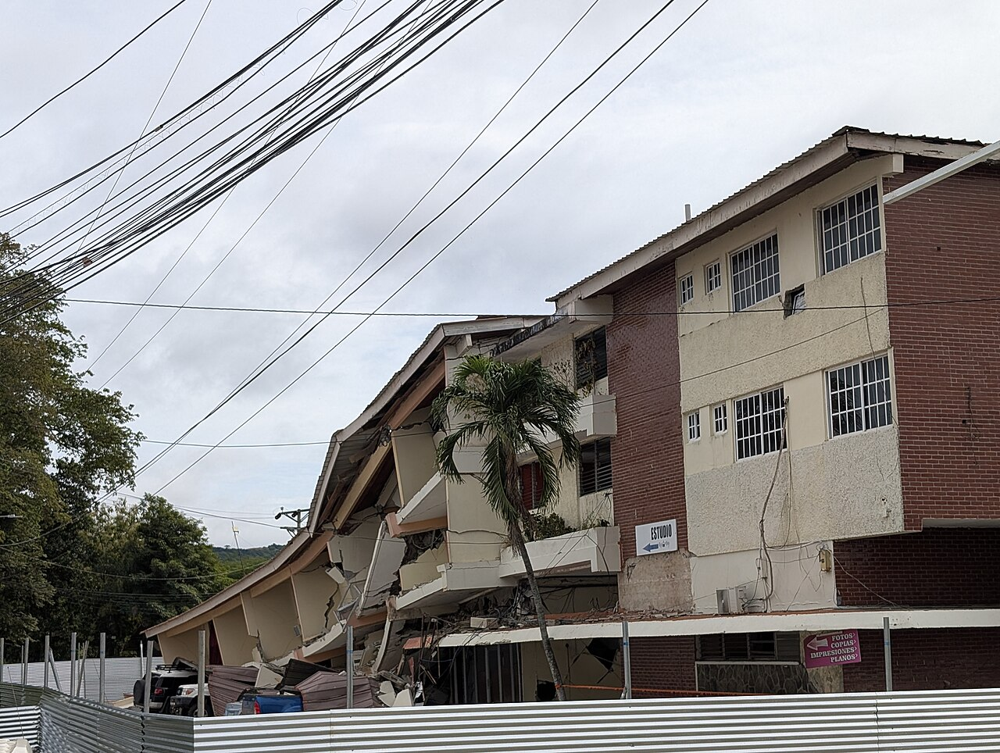
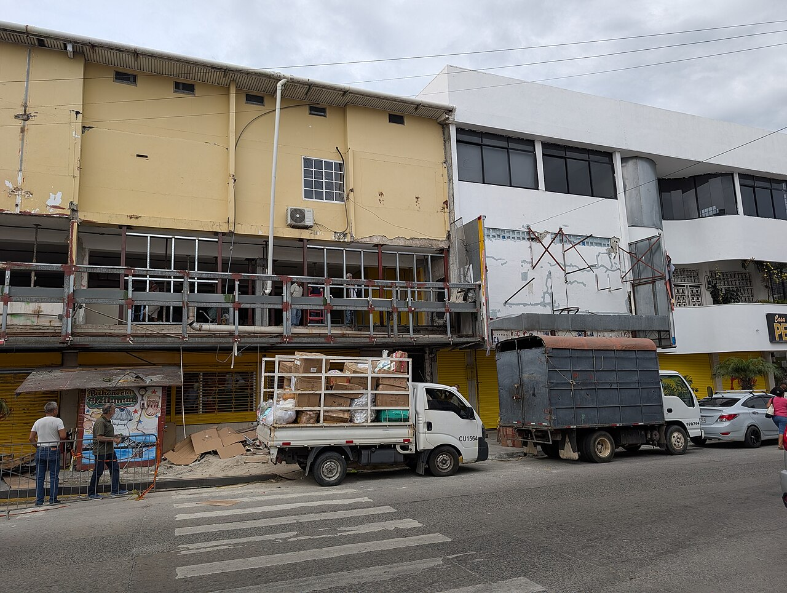
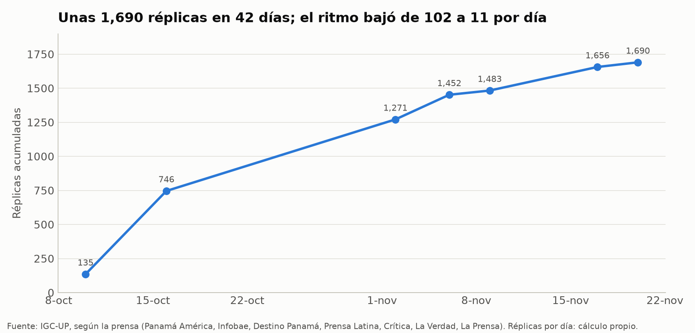

# Afectaciones sociales del sismo del 9 de octubre de 2026 en Coclé y vulnerabilidad de Penonomé por corregimiento

Equipo RacoonCity · 21 de noviembre de 2026, revisado el 25 de noviembre de 2026

**Índice**

1. [Resumen ejecutivo](#resumen-ejecutivo)
2. [Metodología y fuentes](#metodologia)
3. [Población actual de Penonomé](#poblacion)
4. [Los 16 corregimientos](#corregimientos)
5. [El terremoto: Penonomé antes y después](#terremoto)
6. [Balance final de la EDAN de SINAPROC para Coclé](#edan-sinaproc)
7. [Análisis social de Coclé: antes y después](#analisis-social)
8. [Instituciones y edificios afectados](#entidades-afectadas)
9. [Vivir con las réplicas](#replicas)
10. [Cronología día a día](#cronologia)
11. [Situación a noviembre de 2026](#situacion-noviembre-2026)
12. [Problemas de antes, de ahora y futuro](#problemas-y-futuro)
13. [Recomendaciones](#recomendaciones)
14. [Plan de datos: fuentes y limpieza](#plan-de-datos)
15. [Limitaciones](#limitaciones)
16. [Referencias](#referencias)

(resumen-ejecutivo)=
## 1. Resumen ejecutivo

El terremoto del 9 de octubre de 2026 dejó afectaciones sociales documentadas en Coclé: viviendas dañadas, escuelas y hospitales con daños, familias fuera de sus casas y personas que necesitan atención especial. Este estudio reúne el balance final de la EDAN de SINAPROC (cifras con corte al 15 de noviembre de 2026) y lo lee junto con la vulnerabilidad previa de Penonomé por corregimiento: pobreza multidimensional, carencias de vivienda y acceso a servicios. Los datos de daño son provinciales, así que no se pueden asignar a corregimientos; el cruce entre daño y vulnerabilidad es descriptivo.

**Propósito: mostrar lo que vive la gente del interior.** Los reportes documentan unos 193,000 estudiantes sin clases presenciales en cuatro provincias centrales y viviendas dañadas en corregimientos rurales de Penonomé con pobreza alta. El acceso a las ayudas depende de cada programa. Véase [Quién gana y quién pierde](#quien-gana-y-quien-pierde) (sección 12).

- **Población:** el distrito tenía 104,326 habitantes en el Censo 2023 y el INEC lo estima en 111,457 para 2024 \[[INEC, Censo 2023](https://www.inec.gob.pa/archivos/P0705547520231109105354CUADRO%2010.pdf)\] \[[INEC, estimación 2024](https://www.inec.gob.pa/archivos/P0705547520260319141416b-Estimaci%C3%B3n%20proyecci%C3%B3n%20Distrito%202024.pdf)\].
- **Desigualdad interna:** en el centro urbano la pobreza multidimensional es 16%, pero en Riecito llega a 86% y en San Miguel a 81% \[[PNUD/MEF, IPM por corregimiento 2023](https://www.undp.org/sites/g/files/zskgke326/files/2024-05/undp-pa-correginf.pdf)\].
- **Pobreza provincial:** Coclé tiene 25.1% de pobreza general en 2025, frente a 21.9% nacional \[[MEF, Pobreza e Indigencia 2025](https://www.mef.gob.pa/wp-content/uploads/2026/08/MEF.Pobreza-e-Indigencia-Ano-2025.pdf)\].
- **Balance final de la EDAN en Coclé:** SINAPROC evaluó 2,531 viviendas, donde viven 10,199 personas. De esas viviendas, 414 (16.4%) tienen daño total, 147 (5.8%) moderado, 1,750 (69.1%) parcial, 145 (5.7%) leve y 75 (3.0%) menor \[[SINAPROC, plataforma de afectaciones, ficha de Coclé](https://sig.sinaproc.gob.pa/portal/apps/experiencebuilder/experience/?id=4f7c97e5f0184d37aa973d9ec84768c8&page=Cocl%C3%A9)\]. Son viviendas evaluadas, no el total de viviendas de la provincia, y «daño total» no equivale a «colapso» (sección 6).
- **Personas con atención especial:** 431 personas con discapacidad y 21 mujeres embarazadas viven en las viviendas evaluadas; 91 de ellas con discapacidad y 9 embarazadas viven en viviendas con daño total o moderado (sección 6).
- **Otras afectaciones (COE, consulta del 25-nov):** 17 lesionados; 2 hospitales, 40 escuelas, 14 iglesias, 17 edificios gubernamentales, 7 hoteles y 6 puentes peatonales afectados; 0 albergues activos; 9,693 bolsas de alimentos del IMA en 448 comunidades (sección 6).

**Hallazgos del análisis del sismo (secciones 5 a 10)**

- **Dónde se reportaron daños:** la compilación de la sección 5 recoge casos en el centro de Penonomé y en corregimientos rurales con alta pobreza previa. Sus registros no permiten saber en qué corregimiento hubo más daños.
- **Cómo crecieron las cifras:** el comunicado #5 de SINAPROC contó 149 viviendas afectadas el 10 de octubre, el #7 contó 229 y el #12 contó 1,324 el 14 de octubre; la EDAN final llegó a 2,531 viviendas evaluadas. «Afectadas» y «evaluadas» no son la misma unidad (sección 6).
- **Servicios públicos:** la luz volvió por completo el 15 de octubre y el agua se atiende con cisternas, pero las escuelas de Coclé siguen sin clases presenciales y el hospital de Aguadulce sigue cerrado en parte (sección 7).
- **Instituciones afectadas:** Gobernación, Contraloría, juzgados, UTP y dos hospitales, además de la Catedral y otras iglesias (sección 8).
- **Réplicas:** el Instituto de Geociencias localizó 1,656 hasta el 17 de noviembre. Ese día se registraron ocho; el instituto esperaba actividad durante dos o tres meses más, con frecuencia decreciente (sección 9).
- **Cronología:** más de 60 hechos fechados sobre Penonomé y Coclé del 9 de octubre al 24 de noviembre (sección 10).

**Hacia dónde va y cómo medirlo**

- **Futuro (sección 12):** Coclé llegó al sismo con pobreza rural y servicios débiles en el norte. La reconstrucción de viviendas y escuelas y el nuevo hospital son los hitos a seguir; aún falta medir cómo evolucionan la pobreza y el acceso a servicios.
- **Lo que falta medir:** al cierre del estudio no había una medición oficial de pobreza posterior al sismo para Coclé, y el balance de la EDAN se publica por provincia, sin desglose por distrito ni corregimiento.
- **Qué hacer (sección 13):** las recomendaciones por actor proponen publicar el desglose de la EDAN por corregimiento, un tablero público de la reconstrucción, atención prioritaria a las personas con discapacidad y embarazadas en viviendas con daño alto, y un observatorio de datos de Penonomé.
- **Siguiente paso (sección 14):** catálogo de datos y flujo de limpieza en 9 pasos.

(metodologia)=
## 2. Metodología y fuentes

Estudio descriptivo (2016–2026) con análisis de evento (antes y después del sismo). Prioridad de las fuentes: primero cuadros y plataformas oficiales; la prensa solo para hechos que aún no tienen estadística oficial.

1. Variables: población, pobreza multidimensional, carencias de vivienda y servicios, daño en viviendas, personas por edad y sexo, personas con discapacidad y embarazadas, otras afectaciones (salud, escuelas, albergues, ayuda alimentaria).
2. Datos oficiales descargados o consultados en INEC, MEF, SINAPROC, MINSA y PNUD (tabla abajo).
3. Impacto del sismo: plataforma de SINAPROC (EDAN y COE), comunicados oficiales, prensa nacional e informes de instituciones, siempre con enlace.
4. Depuración: si prensa e INEC difieren, prevalece el INEC; las cifras de SINAPROC se citan con la fecha de corte o el número del comunicado porque cambiaron con cada corte.
5. Análisis: porcentajes calculados sobre las viviendas o personas evaluadas por la EDAN (no sobre la población de Coclé), brecha Coclé–República en carencias y comparación por corregimiento.

**Cómo se construyeron las piezas propias del estudio**

- **Cifras de la EDAN (sección 6):** se transcribieron de la ficha de Coclé de la plataforma de SINAPROC el 25 de noviembre de 2026. Los porcentajes y las sumas son cálculo propio sobre esas cifras.
- **Mapa:** los polígonos de los 16 corregimientos se descargaron del servicio cartográfico de la ANATI (capa de división político-administrativa) y se cruzaron con el IPM y con los daños reportados. La clasificación del panel "después" (daño y pobreza alta, cabecera, daño con pobreza baja, sin daño) es de elaboración propia.
- **Fotos:** se usaron solo imágenes con licencia libre de Wikimedia Commons, con su autor y licencia en el pie.
- **Cronología (sección 10):** se revisaron las noticias diarias de medios nacionales e informes oficiales del 9 de octubre al 24 de noviembre de 2026. Cada hecho lleva su fuente, y las fechas aproximadas están señaladas.
- **Lectura por dimensión (sección 12) y recomendaciones (sección 13):** son análisis propios basados en las cifras citadas, no políticas oficiales.

| Fuente | Institución | Qué aporta | Nivel |
| --- | --- | --- | --- |
| [Plataforma de afectaciones del sismo, ficha de Coclé](https://sig.sinaproc.gob.pa/portal/apps/experiencebuilder/experience/?id=4f7c97e5f0184d37aa973d9ec84768c8&page=Cocl%C3%A9), enlazada desde [Panamá Conecta](https://panamaconecta.gob.pa/emergencias/mapa-sinaproc) | SINAPROC (EDAN y COE Nacional) | Viviendas evaluadas y nivel de daño, personas por edad y sexo, atención especial, otras afectaciones | Provincia |
| Comunicados [#5](https://www.sinaproc.gob.pa/comunicado-oficial-5/), [#7](https://www.sinaproc.gob.pa/comunicado-oficial-7/) y [#12](https://www.sinaproc.gob.pa/comunicado-oficial-12/) | SINAPROC | Cortes preliminares de daños del sismo | Provincia |
| [Censo 2023, Cuadro 10](https://www.inec.gob.pa/archivos/P0705547520231109105354CUADRO%2010.pdf) | INEC | Población 2000, 2010, 2023 por corregimiento | Corregimiento |
| [Estimación de población 2024](https://www.inec.gob.pa/archivos/P0705547520260319141416b-Estimaci%C3%B3n%20proyecci%C3%B3n%20Distrito%202024.pdf) | INEC | Población actual estimada | Distrito |
| [Plan Estratégico Distrital de Penonomé 2024–2025](https://www.gacetaoficial.gob.pa/pdfTemp/30376_A/115045.pdf) | MEF / Municipio | Ingreso del hogar y diagnóstico local de servicios | Distrito y corregimiento |
| [IPM por corregimiento 2023](https://www.undp.org/sites/g/files/zskgke326/files/2024-05/undp-pa-correginf.pdf) | PNUD / Gabinete Social / MEF | Pobreza multidimensional | Corregimiento |
| [Pobreza e Indigencia 2025](https://www.mef.gob.pa/wp-content/uploads/2026/08/MEF.Pobreza-e-Indigencia-Ano-2025.pdf) | MEF | Pobreza por ingreso 2024–2025 | Provincia |
| [ASIS Coclé 2024](https://minsa.gob.pa/sites/default/files/publicacion-general/resumen_cocle_asis_2024_region_de_salud_de_cocle.pdf) | MINSA | Contexto social y corregimientos pobres | Provincia |

(poblacion)=
## 3. Población actual de Penonomé

Penonomé es un distrito en crecimiento: pasó de 72,448 habitantes en 2000 a 85,737 en 2010 y 104,326 en 2023 (+21.7% en 13 años), con 61.1 habitantes por km² \[[INEC, Censo 2023, Cuadro 10](https://www.inec.gob.pa/archivos/P0705547520231109105354CUADRO%2010.pdf)\]. La estimación oficial más reciente es **111,457 habitantes al 1 de julio de 2024** (56,633 hombres y 54,824 mujeres), el 39% de los 285,060 habitantes de Coclé \[[INEC, estimación 2024](https://www.inec.gob.pa/archivos/P0705547520260319141416b-Estimaci%C3%B3n%20proyecci%C3%B3n%20Distrito%202024.pdf)\]. El INEC publicó en mayo de 2026 las proyecciones revisadas por distrito: 113,409 habitantes en 2026.

| Indicador | Valor | Año | Fuente |
| --- | --- | --- | --- |
| Población estimada del distrito | 113,409 (2025: 112,470; 2024: 111,457) | 2026 | [INEC, proyecciones revisadas con el Censo 2023, Cuadro 12](https://www.inec.gob.pa/archivos/P0289562520260513151958Cuadro%2012.xlsx) |
| Población estimada de Coclé | 287,937 (2025: 286,586) | 2026 | [INEC, Cuadro 6](https://www.inec.gob.pa/archivos/P0579518620260513151728Cuadro%206.xlsx) |
| Ingreso mediano mensual del hogar | B/.600 | 2023 | [Censo vía MEF](https://www.gacetaoficial.gob.pa/pdfTemp/30376_A/115045.pdf) |
| Viviendas particulares ocupadas con internet fijo o móvil | 58.1% (16,590 de 28,547) | 2023 | Cálculo sobre [INEC, Censo 2023, Cuadro 1](https://www.inec.gob.pa/archivos/P0705547520240202111515Cuadro%201.pdf) |
| Pobreza general / extrema, Coclé | 25.1% / 10.3% (2024: 28.0% / 9.6%) | 2025 | [MEF](https://www.mef.gob.pa/wp-content/uploads/2026/08/MEF.Pobreza-e-Indigencia-Ano-2025.pdf) |
| Pobreza general / extrema, nacional | 21.9% / 10.0% | 2025 | [MEF](https://www.mef.gob.pa/wp-content/uploads/2026/08/MEF.Pobreza-e-Indigencia-Ano-2025.pdf) |
| Índice de Desarrollo Humano, Penonomé | 0.722 (0.676 en 2010) | 2018 | [PNUD vía MEF](https://www.gacetaoficial.gob.pa/pdfTemp/30376_A/115045.pdf) |
| Balance final de la EDAN, Coclé | 2,531 viviendas evaluadas y 10,199 personas | corte 15-nov-2026 | [SINAPROC, plataforma de afectaciones](https://sig.sinaproc.gob.pa/portal/apps/experiencebuilder/experience/?id=4f7c97e5f0184d37aa973d9ec84768c8&page=Cocl%C3%A9) |

**Cómo está hoy la población.** Coclé redujo su pobreza general de 28.0% a 25.1% entre 2024 y 2025, pero la pobreza extrema subió de 9.6% a 10.3% y sigue por encima del promedio nacional \[[MEF](https://www.mef.gob.pa/wp-content/uploads/2026/08/MEF.Pobreza-e-Indigencia-Ano-2025.pdf)\]. El MINSA cuenta 16 corregimientos de Coclé entre los 300 más pobres del país, ubicados en Penonomé, La Pintada, Olá, Natá y Antón \[[MINSA, ASIS Coclé 2024](https://minsa.gob.pa/sites/default/files/publicacion-general/resumen_cocle_asis_2024_region_de_salud_de_cocle.pdf)\]. El plan distrital identifica como problemas principales el agua potable insuficiente, puestos de salud cerrados, caminos en mal estado en el norte y una red de alcantarillado vieja \[[MEF, Plan Distrital](https://www.gacetaoficial.gob.pa/pdfTemp/30376_A/115045.pdf)\]. A eso se suma, desde octubre, el daño en viviendas del sismo (secciones 5 y 6).

(corregimientos)=
## 4. Los sectores de Penonomé: sus 16 corregimientos

Penonomé son dos distritos en uno: un sur urbano y costero con pobreza baja, y un norte montañoso y rural donde la mayoría es pobre.

| Corregimiento | Población 2010 | Población 2023 | Habitantes por km² (2023) | Pobreza multidimensional 2023 (incidencia H) |
| --- | --- | --- | --- | --- |
| Penonomé (cabecera) | 21,748 | 25,836 | 484.2 | 16% |
| El Coco | 5,605 | 11,064 | 74.6 | 12% |
| Cañaveral | 7,517 | 9,324 | 147.0 | 25% |
| Gral. Victoriano Lorenzo | (creado en 2022) | 8,496 | 107.3 | 28% |
| Pajonal | 13,565 | 7,678 | 120.4 | 45% |
| Toabré | 10,203 | 7,440 | 38.4 | 47% |
| Chiguirí Arriba | 10,018 | 7,185 | 69.1 | 64% |
| Coclé | 4,100 | 5,811 | 50.4 | 13% |
| Río Indio | 5,240 | 4,026 | 18.8 | 77% |
| Candelario Ovalle | (creado en 2022) | 3,615 | 36.5 | 75% |
| Río Grande | 3,117 | 3,505 | 37.2 | 15% |
| Las Minas | (creado en 2022) | 2,662 | 37.5 | 47% |
| Tulú | 4,624 | 2,241 | 18.4 | 76% |
| Boca de Tucué | (creado en 2022) | 2,090 | 20.2 | 71% |
| San Miguel | (creado en 2022) | 2,038 | 20.4 | 81% |
| Riecito | (creado en 2022) | 1,315 | 15.8 | 86% |

Fuentes: [INEC, Censo 2023, Cuadro 10](https://www.inec.gob.pa/archivos/P0705547520231109105354CUADRO%2010.pdf) para población y densidad; [PNUD, Gabinete Social y MEF, IPM por corregimiento 2023](https://www.undp.org/sites/g/files/zskgke326/files/2024-05/undp-pa-correginf.pdf), cuadro de Coclé, para la proporción de personas en pobreza multidimensional (incidencia H).

**Lectura.**

- **El crecimiento está en el sur.** El Coco casi duplicó su población entre 2010 y 2023 (5,605 → 11,064) y la cabecera concentra uno de cada cuatro habitantes \[[INEC](https://www.inec.gob.pa/archivos/P0705547520231109105354CUADRO%2010.pdf)\].
- **Los límites cambiaron:** la Ley 296 de 26 de abril de 2022 creó seis corregimientos y modificó el territorio de Pajonal, Toabré, Chiguirí Arriba, Río Indio y Tulú. Las diferencias con 2010 no permiten medir migración sin reconstruir la población con límites comparables \[[INEC](https://www.inec.gob.pa/archivos/P0705547520231109105354CUADRO%2010.pdf)\].
- **El norte es la zona más vulnerable:** Toabré, Chiguirí Arriba, Pajonal, Río Indio, Candelario Ovalle, Las Minas, Tulú, Boca de Tucué, San Miguel y Riecito tienen entre 45% y 86% de pobreza multidimensional. El plan distrital señala además caminos en mal estado, ríos sin puentes y áreas sin electricidad \[[MEF](https://www.gacetaoficial.gob.pa/pdfTemp/30376_A/115045.pdf)\].
- **El sismo también llegó al norte:** hubo viviendas colapsadas en Chiguirí Arriba, Toabré (Sagrejá), Pajonal y San Miguel, donde más de 50 familias se refugiaron en un puesto de salud \[[Mapa del terremoto, compilación de TVN, Mi Favorita y otros](https://www.mapadelterremoto.com/panama/distrito/penonome)\].

(terremoto)=
## 5. El terremoto del 9 de octubre de 2026: Penonomé antes y después

El sismo ocurrió a las 12:56 p.m. (hora de Panamá), con epicentro en Azuero. El [USGS](https://earthquake.usgs.gov/earthquakes/eventpage/us6000u18k) registra Mw 7.7. El Instituto de Geociencias de la Universidad de Panamá informó inicialmente magnitud 7.2 \[[El Mundo](https://diario.elmundo.sv/el-mundo/un-terremoto-de-magnitud-7-7-sacude-a-panama-este-viernes)\]; en reportes posteriores, el instituto y [SINAPROC #12](https://www.sinaproc.gob.pa/comunicado-oficial-12/) citaron magnitud 7.5 \[[Revista Hacia la Luz, Universidad de Panamá](https://uphacialaluz.com/2026/11/17/instituto-de-geociencias-de-la-universidad-de-panama-registra-1656-replicas-asociadas-al-sismo-de-azuero/)\]. En Penonomé se reportaron colapsos parciales en la catedral, la Gobernación y un hotel de tres pisos \[[EFE vía Diario Libre](https://www.diariolibre.com/mundo/america-latina/2026/10/09/terremoto-panama-provoca-colapso-de-edificios-en-penonome/3683140)\]. El balance oficial de Coclé, con cifras finales de la EDAN, está en la sección 6.

*Figura del original no recuperada (el documento original no está disponible para esta revisión). Las fotos de la sección «Fotos: Penonomé antes y después» muestran los mismos lugares. Pie de la figura original:* Fuentes: Catedral y Gobernación: MiCultura vía La Estrella; Hotel Dos Continentes: EFE e Infobae; Hospital: La Prensa; Mercado Público y avenida central: TVN (9-nov-2026); Contraloría, Órgano Judicial, UTP, estatua, museo y artesanías: compilación de mapadelterremoto.com (La Prensa, MiCultura, EFE y otros). Enlaces en la sección 10.

**Registros dentro del distrito de Penonomé, por tipo.** Un mapa colaborativo que geolocaliza noticias y reportes oficiales cuenta 60 puntos en el distrito \[[mapadelterremoto.com](https://www.mapadelterremoto.com/panama/distrito/penonome)\]. Cada punto es un registro, no una unidad dañada: uno solo puede reunir varias viviendas o un corregimiento entero. El propio mapa advierte que 41 de sus puntos no tienen ubicación precisa. Clasificación propia de esos registros:

| Tipo | Puntos | Ejemplos |
| --- | --- | --- |
| Viviendas | 19 | Chiguirí Arriba, Toabré, Pajonal, Las Minas, Coclé (Puerto El Gago), casas de quincha del barrio San Antonio |
| Escuelas y educación | 8 | Federico Zúñiga, Simeon Conte, Carmen Conte Lombardo, Escuela Bilingüe Sagrejá, UTP |
| Patrimonio y templos | 7 | Catedral, capilla de San Antonio, estatua de Bolívar, museo, casa de don Simeón Conte |
| Gobierno | 6 | Gobernación, Municipio, Contraloría, Órgano Judicial, Dirección Regional de Educación, antiguo Correos |
| Comercio y hoteles | 5 | Hotel Dos Continentes, Mercado Público, Mercado de Artesanías, Iguana Mall, Apartahotel Dimashq |
| Infraestructura y servicios | 3 | Puente peatonal de la Interamericana, estación de Bomberos, Cruz Roja |
| Salud | 2 | Hospital Aquilino Tejeira, Policlínica de la CSS |
| Puntos de respuesta (albergues y acopio) | 9 | IFARHU, IMA, Centro Regional Universitario, aeropuerto |
| Descartado tras inspección | 1 | Nuevo Hospital Aquilino Tejeira, sin daños estructurales |

### Mapa: Penonomé antes y después, por corregimiento

El mapa original usaba los límites oficiales de los 16 corregimientos de ANATI. La tabla siguiente reproduce su clasificación; la pobreza de cada corregimiento está en la tabla de la sección 4.

*Mapa del original no recuperado; la tabla siguiente reproduce su clasificación. Pie del mapa original:* Límites: ANATI, capa oficial de corregimientos (servicio Mapa\_Web\_de\_Poblados\_MIL1, capa 10), consultada el 21-nov-2026. Pobreza: PNUD/MEF, IPM por corregimiento 2023. Daños: puntos de mapadelterremoto.com asignados por el nombre del lugar que da cada reporte (clasificación propia).

**Cómo leer la clasificación.** La situación de antes es la pobreza multidimensional de 2023 \[[PNUD/MEF](https://www.undp.org/sites/g/files/zskgke326/files/2024-05/undp-pa-correginf.pdf)\]. Después, cada corregimiento está clasificado según su pobreza previa y si tuvo daños reportados \[[mapadelterremoto](https://www.mapadelterremoto.com/panama/distrito/penonome)\]. Al cierre del estudio no había una medición oficial de pobreza posterior al sismo por corregimiento. Es una clasificación propia, no una nueva medición, y cuenta registros de prensa, no daños. Límites: [ANATI](https://sigigntg.anati.gob.pa/arcgisserver/rest/services/Mapa_Web_de_Poblados_MIL1/MapServer/layers).

| Situación después del sismo | Corregimientos | Qué significa |
| --- | --- | --- |
| Prioridad alta: daños reportados en zona pobre | Toabré (6 registros), San Miguel, Chiguirí Arriba, Tulú, Las Minas y Pajonal (1 cada uno) | Corregimientos con daños reportados en viviendas o escuelas y una incidencia de pobreza multidimensional de 45% a 81% antes del sismo. Un registro puede abarcar muchas casas: el de Las Minas recoge unas 20 viviendas destruidas y 129 sin inspeccionar, según un representante local |
| Centro urbano | Penonomé cabecera (28 registros) | Registros de comercio, mercado, hotel, gobierno, hospital y viviendas; es también la zona con más cobertura de prensa |
| Daños reportados con pobreza baja | Río Grande (2 registros), El Coco (1) y Coclé (1, Puerto El Gago) | Viviendas y escuelas con daños reportados en corregimientos con 12% a 15% de pobreza multidimensional |
| Sin registros, pobreza alta | Riecito, Río Indio, Candelario Ovalle, Boca de Tucué | La falta de registros no equivale a ausencia de daños: son zonas aisladas, con caminos en mal estado |
| Sin registros, pobreza baja | Cañaveral, Gral. Victoriano Lorenzo | Sin daños registrados en la compilación |

Puerto El Gago se cuenta en el corregimiento de Coclé, donde lo ubican el Plan Distrital y un informe oficial de 2020 \[[MINSEG](https://minseg.gob.pa/fuerza-de-tarea-conjunta-mantiene-acciones-de-socorro-a-afectados-por-eta)\]; el mapa lo rotula como El Coco. Los seis corregimientos de la primera fila suman 29,244 habitantes (Censo 2023) y ya tenían pobreza alta antes del sismo. Como los registros no miden cuántas viviendas se dañaron en cada lugar, conviene levantar allí primero el daño en vivienda y la escolaridad.

### Fotos: Penonomé antes y después

Las fotos de después fueron tomadas el 31 de octubre de 2026, tres semanas después del sismo. Todas tienen licencia libre de Wikimedia Commons.

*Catedral San Juan Bautista. Antes: [«Catedral de penonomé»](https://commons.wikimedia.org/wiki/File:Catedral_de_penonom%C3%A9.jpg), Editorpana, 2008, CC BY-SA 3.0. Después: [«Portada y fachada de la Catedral... afectada por el sismo»](https://commons.wikimedia.org/wiki/File:Portada_y_fachada_de_la_Catedral_de_San_Juan_Bautista_de_Penonom%C3%A9_afectada_por_el_sismo_de_7.7_del_9_de_octubre_de_2026.jpg), Luna Delgado, CC BY-SA 4.0. Ver también la [torre campanario colapsada](https://commons.wikimedia.org/wiki/File:Torre_campanario_colapsada_parcialmente_de_la_Catedral_de_San_Juan_Bautista_tras_el_sismo_de_7.7_del_9_de_octubre_de_2026.jpg).*

*Hotel y mercado. Izquierda: [Hotel Dos Continentes](https://commons.wikimedia.org/wiki/File:Colapso_total_del_Hotel_Dos_Continentes_en_Penonom%C3%A9_tras_el_sismo_de_7.7_del_9_de_octubre_de_2026.jpg), con su ala trasera colapsada y la zona cercada. Derecha: [Mercado Público](https://commons.wikimedia.org/wiki/File:Interior_vac%C3%ADo_y_puestos_desolados_en_el_Mercado_P%C3%BAblico_de_Penonom%C3%A9_tras_el_sismo_de_7.7_del_9_de_octubre_de_2026.jpg) con los puestos vacíos. Fotos: Luna Delgado, CC BY-SA 4.0.*

*Edificios comerciales y públicos del centro. Izquierda: [Almacén Flash](https://commons.wikimedia.org/wiki/File:Da%C3%B1os_estructurales_en_el_Almac%C3%A9n_Flash_en_el_centro_de_Penonom%C3%A9_tras_el_sismo_de_7.7_del_9_de_octubre_de_2026.jpg), con la fachada sin ventanales y en reparación. Derecha: [Alcaldía Municipal](https://commons.wikimedia.org/wiki/File:Da%C3%B1os_estructurales_en_el_edificio_de_la_Alcald%C3%ADa_Municipal_de_Penonom%C3%A9_tras_el_sismo_de_7.7_del_9_de_octubre_de_2026.jpg). Fotos: Luna Delgado, CC BY-SA 4.0.*

**Fotos y videos del daño** (más material en los medios): video de EFE en Penonomé \[[Diario Libre](https://www.diariolibre.com/mundo/america-latina/2026/10/09/terremoto-panama-provoca-colapso-de-edificios-en-penonome/3683140)\], fotos del Hotel Dos Continentes \[[Infobae](https://www.infobae.com/panama/2026/11/05/terremoto-en-panama-una-de-cada-cinco-empresas-evaluadas-reporto-afectaciones/)\], calles y mercado al día siguiente \[[La Estrella](https://www.laestrella.com.pa/panama/nacional/penonome-entre-escombros-y-calles-vacias-PO26398689)\].

(edan-sinaproc)=
## 6. Balance final de la EDAN de SINAPROC para Coclé

La EDAN (evaluación de daños y análisis de necesidades) de SINAPROC cubre las evaluaciones hechas del 9 de octubre al 15 de noviembre de 2026. Las cifras de esta sección se verificaron el 25 de noviembre de 2026 en la plataforma oficial de afectaciones del sismo, enlazada desde [Panamá Conecta](https://panamaconecta.gob.pa/emergencias/mapa-sinaproc), en la [ficha de Coclé](https://sig.sinaproc.gob.pa/portal/apps/experiencebuilder/experience/?id=4f7c97e5f0184d37aa973d9ec84768c8&page=Cocl%C3%A9). La plataforma indica «Cifras finales con corte al 15 de noviembre de 2026» para la EDAN. El bloque «Otras afectaciones» es del COE Nacional y la plataforma lo muestra con corte al día de la consulta (25 de noviembre de 2026).

**Cómo leer estas cifras.** Son viviendas **evaluadas** por la EDAN, no el total de viviendas de la provincia (el Censo 2023 cuenta 77,384 viviendas particulares ocupadas en Coclé \[[INEC](https://www.inec.gob.pa/archivos/P0705547520240202111515Cuadro%201.pdf)\]). Por eso los porcentajes se calculan sobre las viviendas o personas evaluadas, no sobre la población de Coclé. «Daño total» es una categoría de la evaluación y no equivale a «colapso».

### Viviendas y personas evaluadas

| Concepto | Cifra |
| --- | --- |
| Viviendas evaluadas | 2,531 |
| Personas que viven en ellas | 10,199 |
| Personas por vivienda evaluada (cálculo propio) | 4.0 |

### Daño en las viviendas evaluadas

| Nivel de daño | Viviendas | % de las evaluadas |
| --- | --- | --- |
| Total | 414 | 16.4% |
| Moderado | 147 | 5.8% |
| Parcial | 1,750 | 69.1% |
| Leve | 145 | 5.7% |
| Menor | 75 | 3.0% |
| **Suma** | **2,531** | **100.0%** |

- **El daño parcial es el más frecuente:** 1,750 viviendas, el 69.1% de las evaluadas.
- **Daño total o moderado:** 561 viviendas (22.2% de las evaluadas), de las que 414 son de daño total (16.4%).
- **Qué no dice la cifra:** las cifras de la ficha no permiten saber cuántas viviendas con «daño total» colapsaron.

### Quiénes viven en esas viviendas

| Grupo | Hombres | Mujeres | Total | % de las personas evaluadas |
| --- | --- | --- | --- | --- |
| Recién nacidos | 172 | 151 | 323 | 3.2% |
| Niñez | 1,090 | 897 | 1,987 | 19.5% |
| Adolescencia | 455 | 458 | 913 | 9.0% |
| Adultos | 2,521 | 2,720 | 5,241 | 51.4% |
| Adultos mayores | 873 | 862 | 1,735 | 17.0% |
| **Suma** | **5,111** | **5,088** | **10,199** | **100.0%** |

Los grupos de edad son los de la plataforma. Los totales por grupo y los porcentajes son cálculo propio.

- **Sexo:** 5,111 hombres (50.1%) y 5,088 mujeres (49.9%).
- **Niñez y adultos mayores:** recién nacidos, niñez y adolescencia suman 3,223 personas (31.6%); los adultos mayores son 1,735 (17.0%). Son grupos que suelen depender de otros para su cuidado y su salud (inferencia propia).

### Personas con atención especial

La plataforma registra 431 personas con discapacidad (4.2% de las personas evaluadas) y 21 mujeres embarazadas (0.2%). Su distribución según el daño de la vivienda donde viven:

| Daño de la vivienda | Personas con discapacidad | Mujeres embarazadas |
| --- | --- | --- |
| Total | 77 | 7 |
| Moderado | 14 | 2 |
| Parcial | 314 | 11 |
| Leve | 13 | 1 |
| Menor | 13 | 0 |
| **Suma** | **431** | **21** |

- **Viviendas con daño total o moderado:** 91 personas con discapacidad (21.1% de las 431) y 9 embarazadas (42.9% de las 21). Son las más expuestas a quedarse sin una vivienda segura y sin acceso a servicios de salud (inferencia propia).
- **Viviendas con daño parcial:** 314 personas con discapacidad (72.9%) y 11 embarazadas (52.4%).

### Otras afectaciones en Coclé (COE Nacional, consulta del 25-nov)

| Afectación | Cifra |
| --- | --- |
| Lesionados | 17 |
| Hospitales afectados | 2 |
| Escuelas afectadas | 40 |
| Iglesias afectadas | 14 |
| Edificios gubernamentales afectados | 17 |
| Hoteles afectados | 7 |
| Puentes peatonales afectados | 6 |
| Albergues activos | 0 |
| Personas albergadas | 0 |
| Ayuda alimentaria | 9,693 bolsas de alimentos del IMA en 448 comunidades |

- **Frente al balance del 14 de octubre:** los lesionados, hospitales, iglesias, edificios gubernamentales, hoteles y puentes coinciden con el comunicado #12. Las escuelas afectadas pasaron de 32 a 40 \[[SINAPROC #12](https://www.sinaproc.gob.pa/comunicado-oficial-12/)\].
- **Albergues:** el 2 de noviembre quedaban 66 personas en albergues de Coclé \[[Crítica](https://www.critica.com.pa/nacional/terremoto-autoridades-revisan-casi-20-mil-casas-4633-estan-en-ruinas-519191)\]; el 25 de noviembre la plataforma muestra 0 albergues activos y 0 personas albergadas. Eso indica que ya no hay albergues abiertos, no que todas las familias hayan vuelto a una vivienda segura.
- **Ayuda alimentaria:** 9,693 bolsas en 448 comunidades equivalen a unas 22 bolsas por comunidad en promedio (cálculo propio); no dice cuántas familias recibieron ayuda ni con qué frecuencia.

### Cómo crecieron las cifras oficiales en Coclé

Cada corte suma lo evaluado o reportado hasta ese momento. La unidad cambia entre los comunicados («viviendas afectadas») y la EDAN («viviendas evaluadas»), por lo que la serie muestra la tendencia pero no permite calcular una tasa de crecimiento exacta.

| Corte | Viviendas en Coclé | Otros daños en Coclé | Fuente |
| --- | --- | --- | --- |
| EDAN, cifras finales (corte 15-nov; COE al 25-nov) | 2,531 evaluadas (10,199 personas) | 17 lesionados, 2 hospitales, 40 escuelas, 14 iglesias, 17 edificios de gobierno, 7 hoteles, 6 puentes peatonales | [SINAPROC, plataforma](https://sig.sinaproc.gob.pa/portal/apps/experiencebuilder/experience/?id=4f7c97e5f0184d37aa973d9ec84768c8&page=Cocl%C3%A9) |
| Comunicado #12 (14-oct, balance preliminar) | 1,324 afectadas (4,703 personas afectadas) | 7 hoteles, 2 hospitales, 32 centros educativos, 14 iglesias, 17 edificios de gobierno, 6 puentes peatonales, la Interamericana a la altura de Penonomé | [SINAPROC #12](https://www.sinaproc.gob.pa/comunicado-oficial-12/) |
| Comunicado #7 (11-oct, mediodía) | 229 afectadas | 6 hoteles, 2 hospitales, 32 centros educativos, 10 iglesias, 10 edificios de gobierno; albergue en el IFARHU de Penonomé | [SINAPROC #7](https://www.sinaproc.gob.pa/comunicado-oficial-7/) |
| Comunicado #5 (10-oct, 6:30 p.m.) | 149 afectadas | 6 hoteles, 12 centros educativos, 9 edificios de gobierno, 21 infraestructuras privadas, 1 puente peatonal en Penonomé; albergue en el IFARHU de Penonomé | [SINAPROC #5](https://www.sinaproc.gob.pa/comunicado-oficial-5/) |
| Gobernador, 10-oct | 86 viviendas, 137 incidencias, 17 lesionados | 3 hospitales (Antón, Penonomé, Aguadulce), 4 escuelas, 4 hoteles | [La Estrella](https://www.laestrella.com.pa/panama/nacional/cocle-reporta-137-incidencias-y-17-personas-lesionadas-tras-el-sismo-sin-perdidas-humanas-GP26389249) |

Otros datos usan unidades distintas y no sustituyen a la EDAN: al 25 de octubre el Miviot había evaluado más de 2,520 viviendas en Coclé \[[TVN](https://www.tvn-2.com/nacionales/provincias/avanza-reconstruccion-viviendas-afectadas-sismo-cocle_1_2267901.html)\], y al 9 de noviembre su plataforma sumaba 40,720 viviendas con daños totales o parciales en todo el país, sin desglose de Coclé en la nota \[[Panamá América](https://www.panamaamerica.com.pa/sociedad/miviot-contabiliza-mas-de-40-mil-viviendas-afectadas-por-el-sismo-y-avanza-en-la-reconstruccion-1281821)\].

### Coclé frente a otras provincias evaluadas

La misma plataforma muestra el contexto de las provincias con evaluaciones:

| Provincia | Viviendas evaluadas | Personas | Personas por vivienda evaluada (cálculo propio) |
| --- | --- | --- | --- |
| Los Santos | 11,262 | 32,034 | 2.8 |
| Herrera | 6,572 | 20,300 | 3.1 |
| Coclé | 2,531 | 10,199 | 4.0 |
| Veraguas | 816 | 3,175 | 3.9 |

Coclé es la tercera de estas cuatro provincias en viviendas evaluadas. Las cifras dependen de cuántas viviendas evaluó la EDAN en cada provincia; no miden qué provincia sufrió más ni se pueden leer como porcentaje del total de viviendas de cada una.

(analisis-social)=
## 7. Análisis social de Coclé: antes y después del terremoto

El terremoto golpeó a una provincia que ya tenía más carencias que el promedio nacional en electricidad, internet y vivienda, y más pobreza por ingresos, aunque con menos pobreza multidimensional que el país (9.9% frente a 12.4%, [MEF, IPM 2025](https://www.mef.gob.pa/wp-content/uploads/2026/08/Informe-del-Indice-de-Pobreza-Multidimensional-de-Panama2025.pdf)). Los servicios básicos (luz y agua) se recuperaron en días; la educación y la salud siguen afectadas un mes y medio después.

### Servicios públicos antes del sismo

*Figura generada por `analisis-penonome.ipynb`.* Fuente: INEC, Censo 2023, Cuadro 1 (viviendas particulares ocupadas con algunas características): República 1,201,809; Coclé 77,384; Penonomé 28,547 viviendas. Porcentajes calculados.

Coclé estaba mejor que el país en agua potable y saneamiento, pero peor en luz eléctrica (7.0% vs. 4.8%), internet (44.0% sin acceso vs. 30.3%) y uso de leña (10.8% vs. 6.0%) \[[INEC, Censo 2023](https://www.inec.gob.pa/archivos/P0705547520240202111515Cuadro%201.pdf)\]. En el distrito de Penonomé el piso de tierra (9.3%) y la leña (15.7%) son aún más comunes, por el peso del norte rural.

### Servicios públicos: antes y después

| Servicio | Antes del 9-oct-2026 | Inmediatamente después | A noviembre de 2026 |
| --- | --- | --- | --- |
| Electricidad | 7.0% de viviendas de Coclé sin luz \[[INEC](https://www.inec.gob.pa/archivos/P0705547520240202111515Cuadro%201.pdf)\] | Cortes de Naturgy en sectores de Coclé y otras 5 provincias \[[La Estrella](https://www.laestrella.com.pa/panama/nacional/sismo-provoca-afectaciones-electricas-en-varias-provincias-ensa-restablece-17-circuitos-en-colon-BC26354849)\]; al día siguiente, 97% restablecido, con Río Hato y Antón aún pendientes \[[Destino Panamá](https://destinopanama.com.pa/2026/10/naturgy-restablece-el-97-del-servicio-electrico-tras-el-sismo/)\] | Servicio completo desde el 15-oct \[[Destino Panamá](https://destinopanama.com.pa/2026/10/naturgy-completa-el-restablecimiento-del-suministro-electrico/)\]; la ASEP prohibió cortes por falta de pago durante 60 días en zonas afectadas de Coclé \[[Telemetro](https://www.telemetro.com/nacionales/asep-suspende-cortes-electricidad-60-dias-zonas-afectadas-el-terremoto-n6099122), [ASEP](https://asep.gob.pa/asep-establece-suspension-de-cortes-para-proteger-a-usuarios-del-servicio-electrico-afectados-por-el-sismo-del-9-de-octubre/)\] |
| Agua potable | 3.8% de viviendas sin agua potable \[[INEC](https://www.inec.gob.pa/archivos/P0705547520240202111515Cuadro%201.pdf)\]; el plan distrital ya señalaba suministro insuficiente y tanques en mal estado \[[MEF](https://www.gacetaoficial.gob.pa/pdfTemp/30376_A/115045.pdf)\] | Suministro afectado en distritos de Coclé, Herrera, Veraguas y Los Santos \[[Metro Libre](https://www.metrolibre.com/nacionales/tonosi-los-pozos-y-montijo-distritos-mas-afectados-por-falta-de-agua-CF26453045)\] | El IDAAN reportó 26 tanques con daños críticos en el país \[[Crítica](https://www.critica.com.pa/nacional/idaan-detecta-danos-criticos-en-26-tanques-de-agua-tras-el-terremoto-519729)\] y reparte más de 100,000 galones diarios con 19 carros cisterna \[[La Verdad](https://www.laverdadpa.com/idaan-distribuye-mas-de-100-mil-galones-de-agua-diarios-en-zonas-afectadas-por-el-terremoto/)\] |
| Salud | Hospital Aquilino Tejeira (Penonomé) y Rafael Estévez (Aguadulce) operando | Aquilino Tejeira evacuado, atención en hospital modular \[[Telemetro](https://www.telemetro.com/nacionales/minsa-reporta-67-instalaciones-salud-afectadas-terremoto-panama-n6094982)\]; unos 65 pacientes del Rafael Estévez entre el edificio y carpas \[[Telemetro](https://www.telemetro.com/nacionales/asi-avanza-la-ayuda-las-comunidades-afectadas-el-sismo-panama-n6094789)\] | 2 hospitales afectados en Coclé según el COE (sección 6). La OPS/OMS evaluó que el Aquilino Tejeira puede seguir atendiendo \[[OPS](https://www.paho.org/es/noticias/27-10-2026-ocho-establecimientos-salud-evaluados-tras-terremoto-panama-reunen-condiciones)\]; el Rafael Estévez sigue con cierre parcial y refiere pacientes \[[Metro Libre](https://www.metrolibre.com/nacionales/hospitales-siguen-sus-jornadas-tras-sismo-MP26924282)\]; el 16-nov el Aquilino Tejeira se quedó sin electricidad por daños en su transformador y planta \[[En Segundos](https://ensegundos.com.pa/2026/11/17/hospital-aquilino-tejeira-queda-sin-electricidad-por-danos-en-transformador-y-planta-electrica)\] |
| Educación | Clases presenciales normales; año escolar hasta diciembre | 32 escuelas afectadas en Coclé \[[Telemetro](https://www.telemetro.com/nacionales/meduca-revela-danos-619-escuelas-el-terremoto-panama-35-ya-no-existen-n6095029)\]; Coclé quedó fuera del regreso a clases del 21-oct \[[Telemetro](https://www.telemetro.com/nacionales/meduca-anuncia-regreso-clases-el-21-octubre-12-regiones-educativas-panama-n6095685)\] | 40 escuelas afectadas en Coclé según el COE (sección 6). Unos 193,000 estudiantes de Coclé, Herrera, Los Santos y Veraguas siguen sin clases presenciales \[[TVN](https://www.tvn-2.com/videos/noticias/video-terremoto-panama-193-mil-estudiantes_8_2271438.html)\]; demolición de escuelas en Tulú, Sagrejá, Otoal, El Potrero y El Espabé \[[Panamá América](https://panamaamerica.com.pa/provincias/directora-regional-de-educacion-confirma-demolicion-de-escuelas-danadas-en-cocle-y-anuncia-nuevo-proyecto-para-san-isidro-1282294)\] |
| Vías y puentes | Caminos del norte de Penonomé ya en mal estado \[[MEF](https://www.gacetaoficial.gob.pa/pdfTemp/30376_A/115045.pdf)\] | 6 puentes peatonales y la Interamericana a la altura de Penonomé afectados \[[SINAPROC #12](https://www.sinaproc.gob.pa/comunicado-oficial-12/)\] | Límite de 5 toneladas en dos puentes Bailey de Cañaveral y El Copé \[[Telemetro](https://www.telemetro.com/nacionales/mop-restringe-circulacion-vehiculos-pesados-dos-puentes-cocle-el-terremoto-n6096048)\]; el MOP prevé más de US\$14 millones para vías y puentes del país \[[Panamá América](https://www.panamaamerica.com.pa/sociedad/mop-anuncia-mas-de-14-millones-para-reparar-carreteras-y-puentes-afectados-por-el-sismo-1282230)\] |
| Vivienda | 5.8% de viviendas de Coclé con piso de tierra; 9.3% en Penonomé \[[INEC](https://www.inec.gob.pa/archivos/P0705547520240202111515Cuadro%201.pdf)\] | 1,324 viviendas afectadas en Coclé en el balance preliminar del 14-oct \[[SINAPROC #12](https://www.sinaproc.gob.pa/comunicado-oficial-12/)\] | La EDAN evaluó 2,531 viviendas, 414 con daño total (corte 15-nov; sección 6). Demolición de casas colapsadas para reconstruirlas \[[Telemetro](https://www.telemetro.com/c6095213)\]; carpas familiares del MIDES en Coclé y Veraguas \[[Telemetro](https://www.telemetro.com/c6096585)\] |
| Albergues | Sin albergues activos | Albergue en el IFARHU de Penonomé \[[SINAPROC #5](https://www.sinaproc.gob.pa/comunicado-oficial-5/)\]; más de 50 familias de Bajito de San Miguel en el puesto de salud \[[TVN](https://www.tvn-2.com/nacionales/damnificados-terremoto-cocle-improvisan-refugios-centro-salud-san-miguel_1_2265655.html)\] | 66 personas en albergues de Coclé el 2-nov \[[Crítica](https://www.critica.com.pa/nacional/terremoto-autoridades-revisan-casi-20-mil-casas-4633-estan-en-ruinas-519191)\]; 0 albergues activos el 25-nov (COE, sección 6) |
| Ayuda alimentaria | Sin dato | Sin dato | 9,693 bolsas de alimentos del IMA en 448 comunidades (COE, 25-nov; sección 6) |

### Indicadores sociales: antes y después

| Indicador | Antes del sismo | Después del sismo | Lectura |
| --- | --- | --- | --- |
| Pobreza general / extrema, Coclé | 25.1% / 10.3% (2025) \[[MEF](https://www.mef.gob.pa/wp-content/uploads/2026/08/MEF.Pobreza-e-Indigencia-Ano-2025.pdf)\] | Sin dato; la medición de 2026 aún no se publica | Hubo daños reportados en corregimientos pobres del norte (sección 5) |
| Pobreza multidimensional, Penonomé | De 12% (El Coco) a 86% (Riecito) en 2023 \[[PNUD/MEF](https://www.undp.org/sites/g/files/zskgke326/files/2024-05/undp-pa-correginf.pdf)\] | Nuevas privaciones en vivienda, agua y educación para familias afectadas | Es probable que el IPM empeore en los corregimientos con daños (inferencia propia) |
| Personas en viviendas evaluadas, Coclé | Sin dato | 10,199 personas en 2,531 viviendas (EDAN, corte 15-nov) \[[SINAPROC](https://sig.sinaproc.gob.pa/portal/apps/experiencebuilder/experience/?id=4f7c97e5f0184d37aa973d9ec84768c8&page=Cocl%C3%A9)\] | Cifras finales de la EDAN; antes, el comunicado #12 contaba 4,703 personas afectadas el 14-oct \[[SINAPROC #12](https://www.sinaproc.gob.pa/comunicado-oficial-12/)\] |
| Atención social | Programas regulares del MIDES | El MIDES activó la Ficha Básica de Emergencia Social para registrar a las familias afectadas \[[Telemetro](https://www.telemetro.com/nacionales/mides-activa-ficha-basica-emergencia-familias-afectadas-el-terremoto-n6096521)\] | Base para ayudas focalizadas |

### Síntesis del análisis

1. **Vulnerabilidad previa:** Coclé llegó al sismo con más pobreza por ingresos (25.1% vs. 21.9% nacional) y más carencias en luz, internet y vivienda que el país; en el norte de Penonomé la pobreza multidimensional va de 45% a 86%.
2. **Servicios básicos, recuperación rápida:** la electricidad volvió en menos de una semana; el agua tuvo cortes puntuales y se atiende con cisternas.
3. **Servicios sociales, recuperación lenta:** las escuelas de Coclé siguen sin clases presenciales y varias se demolerán para reabrir en marzo de 2027; el hospital de Aguadulce sigue parcialmente cerrado.
4. **Magnitud de la afectación en vivienda y personas:** la EDAN evaluó 2,531 viviendas con 10,199 personas; 414 viviendas (16.4% de las evaluadas) tienen daño total, y 431 personas con discapacidad y 21 embarazadas viven en esas viviendas evaluadas (sección 6).
5. **Lo que falta medir:** la pobreza posterior al sismo, y el desglose de la EDAN por distrito y corregimiento para cruzarlo con la vulnerabilidad previa.

(entidades-afectadas)=
## 8. Instituciones y edificios afectados en Coclé: dónde, cuánto y cómo están hoy

Los daños se concentraron en el casco de Penonomé (gobierno, mercado, hotel, templos) y en Aguadulce (hospital, alcaldía, museo). Según el COE (consulta del 25 de noviembre), en Coclé hay 2 hospitales, 40 escuelas, 14 iglesias, 17 edificios gubernamentales, 7 hoteles y 6 puentes peatonales afectados (sección 6). La tabla siguiente detalla los casos con nombre que se pudieron verificar; no es un inventario completo.

### Entidades públicas

| Entidad | Lugar | Daño | Estado a noviembre de 2026 | Fuente |
| --- | --- | --- | --- | --- |
| Gobernación de Coclé | Penonomé | Colapso parcial; declarada zona insegura | Cerrada | [Panamá América](https://www.panamaamerica.com.pa/variedades/evaluan-danos-en-el-patrimonio-historico-tras-el-sismo-1267433) |
| Hospital Aquilino Tejeira (MINSA) | Penonomé | Grietas; evacuado a hospital modular | Atiende; la OPS/OMS confirmó que puede operar; sin electricidad desde el 16-nov por daño en transformador | [OPS](https://www.paho.org/es/noticias/27-10-2026-ocho-establecimientos-salud-evaluados-tras-terremoto-panama-reunen-condiciones), [En Segundos](https://ensegundos.com.pa/2026/11/17/hospital-aquilino-tejeira-queda-sin-electricidad-por-danos-en-transformador-y-planta-electrica) |
| Hospital Dr. Rafael Estévez (CSS) | Aguadulce | Grietas que crecieron con la réplica del 31-oct | Cierre parcial; refiere pacientes a otros hospitales | [Metro Libre](https://www.metrolibre.com/nacionales/hospitales-siguen-sus-jornadas-tras-sismo-MP26924282), [Metro Libre](https://www.metrolibre.com/nacionales/replica-de-59-mantiene-en-alerta-a-las-autoridades-evaluan-danos-en-hospitales-y-viviendas-IK26978527) |
| Escuelas oficiales (MEDUCA) | Toda la provincia | 40 escuelas afectadas según el COE (eran 32 el 14-oct); daños de leves a graves | Sin clases presenciales; demolición en Tulú, Sagrejá, Otoal, El Potrero y El Espabé | [SINAPROC, plataforma](https://sig.sinaproc.gob.pa/portal/apps/experiencebuilder/experience/?id=4f7c97e5f0184d37aa973d9ec84768c8&page=Cocl%C3%A9), [Telemetro](https://www.telemetro.com/nacionales/meduca-revela-danos-619-escuelas-el-terremoto-panama-35-ya-no-existen-n6095029), [Panamá América](https://panamaamerica.com.pa/provincias/directora-regional-de-educacion-confirma-demolicion-de-escuelas-danadas-en-cocle-y-anuncia-nuevo-proyecto-para-san-isidro-1282294) |
| Mercado Público (municipal) | Penonomé | Daños estructurales | Reabierto progresivamente desde el 9-nov | [TVN](https://www.tvn-2.com/nacionales/mercado-penonome-reabre-puertas-vendedores_1_2270109.html) |
| Alcaldía de Aguadulce | Aguadulce | Afectaciones en la infraestructura | Sin información de reapertura | [Defensoría vía mapadelterremoto](https://www.mapadelterremoto.com/panama/lugar/pa-320-alcaldia-de-aguadulce) |
| Contraloría regional | Penonomé | Base trasera dañada | Cerrada; unos 150 funcionarios desplazados | [La Prensa vía mapadelterremoto](https://www.mapadelterremoto.com/panama/distrito/penonome) |
| Órgano Judicial | Penonomé | Daño probablemente superficial | Cerrado; audiencias en el estacionamiento | [mapadelterremoto](https://www.mapadelterremoto.com/panama/distrito/penonome) |
| UTP, Centro Regional de Coclé | Penonomé | Afectaciones no detalladas | Cerrado hasta nuevo aviso | [mapadelterremoto](https://www.mapadelterremoto.com/panama/distrito/penonome) |
| Museos de Penonomé y Aguadulce (MiCultura) | Penonomé y Aguadulce | Grietas, vitrinas y piezas arqueológicas dañadas | Bajo seguimiento de MiCultura, que atiende 45 sitios en el país | [Panamá América](https://www.panamaamerica.com.pa/variedades/evaluan-danos-en-el-patrimonio-historico-tras-el-sismo-1267433), [MiCultura](https://micultura.gob.pa/2026/10/27/micultura-responde-a-la-emergencia-en-45-sitios-patrimoniales-y-culturales-afectados-por-el-sismo/) |
| Puentes Bailey de Cañaveral y El Copé (MOP) | Penonomé y Olá | Restricción de carga | Límite de 5 toneladas desde el 21-oct | [Telemetro](https://www.telemetro.com/nacionales/mop-restringe-circulacion-vehiculos-pesados-dos-puentes-cocle-el-terremoto-n6096048) |

### Templos y otros edificios con daño visible

| Edificio | Lugar | Daño | Estado a noviembre de 2026 | Fuente |
| --- | --- | --- | --- | --- |
| Catedral y 13 iglesias más | Penonomé, Antón, Aguadulce, Natá | Torre colapsada en Penonomé; otras con grietas | Catedral cerrada; templos bajo evaluación | [SINAPROC #12](https://www.sinaproc.gob.pa/comunicado-oficial-12/), [MiCultura](https://micultura.gob.pa/2026/10/27/micultura-responde-a-la-emergencia-en-45-sitios-patrimoniales-y-culturales-afectados-por-el-sismo/) |
| Hotel Dos Continentes | Penonomé | Colapso parcial | Será demolido | [Infobae](https://www.infobae.com/panama/2026/11/05/terremoto-en-panama-una-de-cada-cinco-empresas-evaluadas-reporto-afectaciones/) |
| Edificios del centro de Penonomé | Penonomé | 20 con estructura comprometida el 18-oct | El comité posísmico de Coclé evaluó más del 80% de las estructuras afectadas del distrito | [Telemetro](https://www.telemetro.com/nacionales/sismo-panama-aumentan-20-los-edificios-estructuras-comprometidas-penonome-n6095677), [TVN](https://www.tvn-2.com/nacionales/provincias/evaluan-ochenta-por-ciento-estructuras-afectadas-penonome-cocle-seguimiento-restauraciones-de-iglesias_1_2268284.html) |

(replicas)=
## 9. Vivir con las réplicas

El Instituto de Geociencias localizó unas 1,690 réplicas hasta el 20 de noviembre, ya menos de 10 por día \[[La Prensa](https://www.prensa.com/sociedad/replicas-tras-el-terremoto-de-75-disminuyen-a-menos-de-10-por-dia/)\]; 1,656 hasta el 17 de noviembre. A mediados de mes se reportaban unas 20 al día; el 17 se registraron ocho \[[Destino Panamá](https://destinopanama.com.pa/2026/11/al-menos-20-replicas-sismicas-diarias-siguen-dandose-en-panama/)\] \[[Metro Libre](https://www.metrolibre.com/nacionales/azuero-acumula-1656-replicas-tras-el-terremoto-del-9-de-octubre-LD27429147)\]. El instituto esperaba que la actividad continuara dos o tres meses más, con frecuencia decreciente.

*Figura generada por `analisis-penonome.ipynb`.* Fuentes: Panamá América (10-oct, 135 réplicas); Infobae (16-oct, 746); La Estrella (2-nov, 1,271); Prensa Latina (6-nov, 1,452); Crítica (9-nov, 1,483); La Verdad (17-nov, 1,656); La Prensa (20-nov, unas 1,690), todas con datos del IGC-UP. El conteo crece también porque el IGC sigue localizando eventos a mano.

**Cómo lo vive la gente en Penonomé y Coclé**

- **Dormir afuera:** la primera noche muchos vecinos de Penonomé no durmieron o lo hicieron a la intemperie por las réplicas \[[El Universo, con EFE](https://www.eluniverso.com/internacional/latinoamerica/las-replicas-del-terremoto-en-panama-obligan-a-muchos-a-dormir-a-la-intemperie-nota/)\]. En Pajonal, una familia pasó la tarde en el portal, atenta a cada temblor \[[Panamá América](https://www.panamaamerica.com.pa/sociedad/penonome-entre-el-nerviosismo-y-la-esperanza-1267385)\].
- **Albergues:** más de 50 familias de Bajito de San Miguel se refugiaron en el puesto de salud \[[TVN](https://www.tvn-2.com/nacionales/damnificados-terremoto-cocle-improvisan-refugios-centro-salud-san-miguel_1_2265655.html)\]; en Penonomé se habilitó un albergue en el IFARHU \[[SINAPROC #5](https://www.sinaproc.gob.pa/comunicado-oficial-5/)\]. En todo el país, el MIDES contaba 5,735 personas en 154 albergues el 26 de octubre \[[Telemetro](https://www.telemetro.com/c6096585)\]. La plataforma de SINAPROC muestra 0 albergues activos en Coclé el 25 de noviembre (sección 6).
- **Salud en los albergues:** el MINSA detectó 200 casos gastrointestinales y vigila 54 albergues \[[Telemetro](https://www.telemetro.com/c6095779)\].
- **Salud mental:** el MINSA abrió atención psicológica por miedo, ansiedad y crisis de pánico en los centros de salud de Penonomé, Antón y Pocrí, de 7:00 a.m. a 3:00 p.m. \[[Telemetro](https://www.telemetro.com/nacionales/sismo-panama-minsa-habilita-atencion-psicologica-provincias-afectadas-n6094881)\], y una línea de contención emocional, 800-6467 \[[Telemetro](https://www.telemetro.com/c6096133)\].
- **Réplicas que siguen haciendo daño:** la de 5.9 del 31 de octubre agrandó las grietas del hospital de Aguadulce \[[Metro Libre](https://www.metrolibre.com/nacionales/replica-de-59-mantiene-en-alerta-a-las-autoridades-evaluan-danos-en-hospitales-y-viviendas-IK26978527)\]. Por eso muchas evaluaciones estructurales se repiten.
- **Deslizamientos:** el IGC identificó 12,251 deslizamientos con imágenes satelitales, sobre todo en Azuero \[[Crítica](https://www.critica.com.pa/nacional/un-mes-del-terremoto-se-contabilizan-1483-replicas-y-12-mil-deslizamientos-519581)\]; con las lluvias, es un riesgo para caminos y viviendas en zonas de ladera.

**Efecto social de las réplicas:** prolongan el cierre de escuelas y edificios públicos, y mantienen a familias fuera de sus casas. Es un costo que no aparece en las cifras de daños, pero sí en días sin clases, atención de salud interrumpida y salud mental.

(cronologia)=
## 10. Cronología día a día: Penonomé y Coclé del 9 de octubre al 24 de noviembre de 2026

Noticias e informes oficiales sobre Penonomé y Coclé, en orden de fecha. Las fechas marcadas «aprox.» se calcularon por la fecha de publicación porque el artículo no da el día exacto. Los días que no aparecen son días en que no se encontraron noticias específicas de Penonomé o Coclé.

| Fecha | Hecho | Fuente |
| --- | --- | --- |
| 9-oct (vie) | A las 12:56 p.m. ocurre el terremoto. En Penonomé colapsan una torre de la Catedral, parte de la Gobernación y un hotel de tres pisos | [EFE vía Diario Libre](https://www.diariolibre.com/mundo/america-latina/2026/10/09/terremoto-panama-provoca-colapso-de-edificios-en-penonome/3683140) |
| 9-oct | Videos ciudadanos muestran el derrumbe de una parte del Hotel Dos Continentes | [La Nación](https://www.lanacion.com.ar/el-mundo/las-impactantes-imagenes-y-videos-del-terremoto-que-sacudio-a-panama-nid09102026/) |
| 9-oct | El COE reporta en Coclé derrumbe de fachadas de comercios, hospitales evacuados y 15 estudiantes con lesiones menores | [La Prensa](https://www.prensa.com/sociedad/terremoto-en-panama-balance-preliminar-de-danos-y-afectaciones/) |
| 9-oct | El presidente Mulino viaja a Penonomé a recorrer las zonas afectadas | [France 24](https://www.france24.com/es/am%C3%A9rica-latina/20261009-en-directo-el-fuerte-terremoto-en-panam%C3%A1-causa-da%C3%B1os-en-edificaciones-el-canal-no-se-vio-afectado) |
| 9-oct | Naturgy reporta cortes de luz en sectores de Coclé y otras cinco provincias | [La Estrella](https://www.laestrella.com.pa/panama/nacional/sismo-provoca-afectaciones-electricas-en-varias-provincias-ensa-restablece-17-circuitos-en-colon-BC26354849) |
| 9-10 oct | La primera noche, vecinos de Penonomé duermen a la intemperie por las réplicas | [El Universo, con EFE](https://www.eluniverso.com/internacional/latinoamerica/las-replicas-del-terremoto-en-panama-obligan-a-muchos-a-dormir-a-la-intemperie-nota/) |
| 10-oct (sáb) | El gobernador reporta en Coclé 137 incidencias, 86 viviendas dañadas y 17 lesionados, sin fallecidos | [La Estrella](https://www.laestrella.com.pa/panama/nacional/cocle-reporta-137-incidencias-y-17-personas-lesionadas-tras-el-sismo-sin-perdidas-humanas-GP26389249) |
| 10-oct | Penonomé amanece con calles vacías, el mercado cerrado y el hospital bajo evaluación | [La Estrella](https://www.laestrella.com.pa/panama/nacional/penonome-entre-escombros-y-calles-vacias-PO26398689) |
| 10-oct | El gobierno declara emergencia nacional y asigna US\$100 millones | [Agencia FE](https://www.agenciafe.com/nota/402980-Terremoto-en-Panama-destinaran-100-millones-de-dolares-para-la-reconstruccion) |
| 10-oct | Naturgy restablece la luz al 97% de los clientes; quedan pendientes Río Hato y Antón | [Destino Panamá](https://destinopanama.com.pa/2026/10/naturgy-restablece-el-97-del-servicio-electrico-tras-el-sismo/) |
| 10-oct | SINAPROC #5: 149 viviendas afectadas en Coclé y un puente peatonal dañado en Penonomé; albergue en el IFARHU | [SINAPROC](https://www.sinaproc.gob.pa/comunicado-oficial-5/) |
| 11-oct (dom) | SINAPROC #7: 229 viviendas afectadas en Coclé; albergues en el IFARHU de Penonomé y en Natá | [SINAPROC](https://www.sinaproc.gob.pa/comunicado-oficial-7/) |
| 12-oct (lun) | El informe preliminar de MiCultura identifica como inseguras la Catedral y la Gobernación; el mercado de artesanías de Penonomé permanece cerrado de manera preventiva | [La Estrella](https://www.laestrella.com.pa/panama/nacional/sismo-en-panama-micultura-evalua-danos-en-iglesias-museos-y-edificios-patrimoniales-ED26439195) |
| 12-oct | El MINSA mantiene atención psicológica en los centros de salud de Penonomé, Antón y Pocrí | [Telemetro](https://www.telemetro.com/nacionales/sismo-panama-minsa-habilita-atencion-psicologica-provincias-afectadas-n6094881) |
| 12-oct | Más de 50 familias de Bajito de San Miguel se refugian en el puesto de salud | [TVN](https://www.tvn-2.com/nacionales/damnificados-terremoto-cocle-improvisan-refugios-centro-salud-san-miguel_1_2265655.html) |
| 13-oct (mar) | El alcalde de Antón, Eric Domínguez, anuncia la reubicación de las oficinas municipales de Antón | [mapadelterremoto](https://www.mapadelterremoto.com/panama/distrito/anton) |
| 13-oct | Persisten afectaciones de agua en comunidades de Los Santos, Herrera, Veraguas y Coclé; el IDAAN reporta que las potabilizadoras de Coclé operan con normalidad | [Metro Libre](https://www.metrolibre.com/nacionales/tonosi-los-pozos-y-montijo-distritos-mas-afectados-por-falta-de-agua-CF26453045) |
| 13-oct | Evaluación preliminar: el edificio de la Gobernación tendría que ser demolido | [TVN](https://www.tvn-2.com/nacionales/provincias/temblor-panama-edificio-gobernacion-cocle-debe-ser-demolida_1_2265945.html) |
| 14-oct (mié) | SINAPROC #12, balance preliminar: 1,324 viviendas y 4,703 personas afectadas en Coclé | [SINAPROC](https://www.sinaproc.gob.pa/comunicado-oficial-12/) |
| 14-oct | La ministra de Cultura recorre Penonomé: un restaurador español evaluará el campanario | [TVN](https://www.tvn-2.com/nacionales/provincias/temblor-panama-especialista-espanol-evaluara-campanario-catedral-san-juan-bautista-penonome_1_2266058.html) |
| 14-oct | El MINSA prevé normalizar el Hospital Aquilino Tejeira entre el 14 y el 15 de octubre | [TVN](https://www.tvn-2.com/nacionales/provincias/temblor-panama-preve-restablecer-aquilino-tejeira-minsa_1_2266037.html) |
| 14-oct | Comienza la demolición de viviendas colapsadas en Coclé para reconstruirlas | [Telemetro](https://www.telemetro.com/c6095213) |
| 15-oct (jue) | Comienza la demolición de la torre izquierda de la Catedral; la otra torre también tiene fisuras | [TVN](https://www.tvn-2.com/nacionales/temblor-panama-demuelen-torre-danada-catedral-san-juan-bautsita-penonome_1_2266268.html), [La Prensa](https://www.prensa.com/sociedad/la-catedral-pierde-una-torre-y-el-mercado-su-ritmo-habitual/) |
| 15-oct | Naturgy termina de restablecer el servicio eléctrico | [Destino Panamá](https://destinopanama.com.pa/2026/10/naturgy-completa-el-restablecimiento-del-suministro-electrico/) |
| 16-oct (vie) | El Instituto de Geociencias cuenta 746 réplicas | [Infobae](https://www.infobae.com/panama/2026/10/16/746-replicas-13-mil-damnificados-y-un-solo-muerto-oficial-el-terremoto-de-panama-que-no-cuadra-con-las-imagenes-de-pueblos-arrasados/) |
| 18-oct (dom) | Suben a 20 los edificios con estructura comprometida en Penonomé; cierran la carretera Penonomé–El Valle por un derrumbe | [Telemetro](https://www.telemetro.com/nacionales/sismo-panama-aumentan-20-los-edificios-estructuras-comprometidas-penonome-n6095677), [Telemetro](https://www.telemetro.com/nacionales/cierran-carretera-penonome-el-valle-anton-derrumbe-recomiendan-ruta-alterna-n6095672) |
| 19-oct (lun) | El MINSA detecta 200 casos gastrointestinales y vigila 54 albergues en el país | [Telemetro](https://www.telemetro.com/c6095779) |
| 19-oct | Empieza la construcción de tres casas en Chigoré para familias que perdieron la suya | [TVN](https://www.tvn-2.com/nacionales/provincias/temblor-en-panama-penonome-comienza-reconstruir-viviendas-reparar-negocio_1_2266987.html) |
| 21-oct (mié) | Vuelven las clases en 12 regiones, pero no en Coclé | [Telemetro](https://www.telemetro.com/nacionales/meduca-anuncia-regreso-clases-el-21-octubre-12-regiones-educativas-panama-n6095685) |
| 21-oct | El MOP limita a 5 toneladas dos puentes Bailey en Cañaveral y El Copé | [Telemetro](https://www.telemetro.com/nacionales/mop-restringe-circulacion-vehiculos-pesados-dos-puentes-cocle-el-terremoto-n6096048) |
| 22-oct (jue) | El MINSA habilita la línea de contención emocional 800-6467 | [Telemetro](https://www.telemetro.com/c6096133) |
| 25-oct (dom) | El MIDES activa la Ficha Básica de Emergencia Social para las familias afectadas | [Telemetro](https://www.telemetro.com/nacionales/mides-activa-ficha-basica-emergencia-familias-afectadas-el-terremoto-n6096521) |
| 25-oct | El Miviot ha evaluado más de 2,520 viviendas en Coclé; las inspecciones continúan | [TVN](https://www.tvn-2.com/nacionales/provincias/avanza-reconstruccion-viviendas-afectadas-sismo-cocle_1_2267901.html) |
| 26-oct (lun) | El MIDES entrega carpas familiares en Coclé y Veraguas; hay 5,735 personas en 154 albergues en el país | [Telemetro](https://www.telemetro.com/c6096585) |
| 26-oct | El Tribunal Electoral de Coclé atiende temporalmente en el Centro Regional Universitario | [Telemetro](https://www.telemetro.com/nacionales/tribunal-electoral-habilita-sedes-provisionales-cuatro-provincias-danos-terremoto-n6096627) |
| 27-oct (mar) | La OPS/OMS confirma que el Hospital Aquilino Tejeira puede seguir atendiendo | [OPS](https://www.paho.org/es/noticias/27-10-2026-ocho-establecimientos-salud-evaluados-tras-terremoto-panama-reunen-condiciones) |
| 27-oct | MiCultura da seguimiento a 45 sitios patrimoniales, entre ellos la Catedral y museos de Coclé | [MiCultura](https://micultura.gob.pa/2026/10/27/micultura-responde-a-la-emergencia-en-45-sitios-patrimoniales-y-culturales-afectados-por-el-sismo/) |
| 27-oct | El comité posísmico de Coclé ya evaluó más del 80% de las estructuras afectadas de Penonomé | [TVN](https://www.tvn-2.com/nacionales/provincias/evaluan-ochenta-por-ciento-estructuras-afectadas-penonome-cocle-seguimiento-restauraciones-de-iglesias_1_2268284.html) |
| 31-oct (sáb) | Réplica de 5.9: agranda las grietas del Hospital Rafael Estévez de Aguadulce | [Metro Libre](https://www.metrolibre.com/nacionales/replica-de-59-mantiene-en-alerta-a-las-autoridades-evaluan-danos-en-hospitales-y-viviendas-IK26978527) |
| 31-oct | Se publican fotos con licencia libre de los daños en el centro de Penonomé | [Wikimedia Commons](https://commons.wikimedia.org/wiki/File:Colapso_total_del_Hotel_Dos_Continentes_en_Penonom%C3%A9_tras_el_sismo_de_7.7_del_9_de_octubre_de_2026.jpg) |
| 2-nov (lun) | 1,271 réplicas; el IGC observa una disminución progresiva en magnitud y frecuencia | [Destino Panamá](https://destinopanama.com.pa/2026/11/instituto-de-geociencias-contabiliza-1271-replicas-tras-terremoto-de-7-5-en-panama/) |
| 2-nov | El COE reporta 19,865 viviendas inspeccionadas en el país, 4,633 con daño total; en Coclé quedan 66 personas en albergues | [Crítica](https://www.critica.com.pa/nacional/terremoto-autoridades-revisan-casi-20-mil-casas-4633-estan-en-ruinas-519191) |
| 6-nov (vie) | Se anuncian más de 300 viviendas a construir en Coclé | [Telemetro](https://www.telemetro.com/nacionales/sismo-panama-mas-300-viviendas-seran-construidas-cocle-n6097735) |
| 8-nov (dom) | Un mes del sismo en Coclé: 13 escuelas por demoler; la vía de Cerro La Cruz en El Valle sigue cerrada | [Telemetro](https://www.telemetro.com/nacionales/cocle-cumple-un-mes-del-terremoto-13-escuelas-demoler-y-miles-viviendas-afectadas-n6097819) |
| 9-nov (lun) | El mercado público de Penonomé retoma sus operaciones desde el 6-nov | [TVN](https://www.tvn-2.com/nacionales/mercado-penonome-reabre-puertas-vendedores_1_2270109.html) |
| 9-nov | El Miviot suma 40,720 viviendas con daños totales o parciales en el país y atiende 67 casas en Penonomé, Natá y Aguadulce | [Panamá América](https://www.panamaamerica.com.pa/sociedad/miviot-contabiliza-mas-de-40-mil-viviendas-afectadas-por-el-sismo-y-avanza-en-la-reconstruccion-1281821) |
| 10-nov (mar) | Mulino admite que la reconstrucción costará más de US\$100 millones | [Eco TV](https://www.ecotvpanama.com/nacionales/reconstruccion-terremoto-azuero-superara-los-100-millones-advierte-mulino-n6098038) |
| 12-nov (jue) | El Miviot registra 24 contratos por US\$35 millones para 1,167 viviendas, incluidas en Coclé | [La Prensa](https://www.prensa.com/economia/miviot-registra-otros-24-contratos-por-35-millones-para-construir-viviendas-afectadas-por-el-sismo/) |
| 13-nov (vie) | El MIDES ofrece duplicado gratuito de cédula a beneficiarios que la perdieron en el sismo | [Telemetro](https://www.telemetro.com/c6098415) |
| 15-nov (dom) | Más de 1,500 réplicas; el IGC calcula dos o tres meses más | [Destino Panamá](https://destinopanama.com.pa/2026/11/al-menos-20-replicas-sismicas-diarias-siguen-dandose-en-panama/) |
| 15-nov | Corte de las cifras finales de la EDAN de SINAPROC para Coclé: 2,531 viviendas evaluadas y 10,199 personas (evaluaciones del 9-oct al 15-nov) | [SINAPROC, plataforma](https://sig.sinaproc.gob.pa/portal/apps/experiencebuilder/experience/?id=4f7c97e5f0184d37aa973d9ec84768c8&page=Cocl%C3%A9) |
| 16-nov (lun) | El Hospital Aquilino Tejeira se queda sin electricidad por daños en su transformador y planta | [En Segundos](https://ensegundos.com.pa/2026/11/17/hospital-aquilino-tejeira-queda-sin-electricidad-por-danos-en-transformador-y-planta-electrica) |
| 17-nov (mar) | 1,656 réplicas localizadas | [La Verdad](https://www.laverdadpa.com/geociencias-de-la-universidad-de-panama-registra-1656-replicas-asociadas-al-sismo-de-azuero/) |
| 19-nov (jue) | Comienza la demolición del CEBG San Isidro en Tulú; siguen Sagrejá, Otoal, El Potrero y El Espabé | [Panamá América](https://panamaamerica.com.pa/provincias/directora-regional-de-educacion-confirma-demolicion-de-escuelas-danadas-en-cocle-y-anuncia-nuevo-proyecto-para-san-isidro-1282294) |
| 20-nov (vie) | La Iglesia presenta un comité de vigilancia para la restauración de la Catedral; ya escanearon el templo en 3D | [TVN](https://www.tvn-2.com/nacionales/provincias/iglesia-presenta-comite-dar-seguimiento-restauracion-catedral-san-juan-bautista_1_2272053.html) |
| 20-nov | Las necesidades de reconstrucción ya superan US\$193.8 millones | [La Prensa](https://www.prensa.com/sociedad/reconstruccion-tras-el-terremoto-1938-millones-entre-casas-hospitales-y-carreteras/) |
| 20-nov | La ASEP prohíbe cortar la luz por falta de pago durante 60 días en Coclé, Veraguas, Los Santos y Herrera; la resolución fue recurrida | [Telemetro](https://www.telemetro.com/nacionales/asep-suspende-cortes-electricidad-60-dias-zonas-afectadas-el-terremoto-n6099122) |
| 20-nov | El hospital Aquilino Tejeira recupera la electricidad; unos 11 pacientes habían sido trasladados | [Radio Panamá](https://x.com/radiopanama/status/2123566997170757696) |
| 20-nov | El IGC-UP contabiliza unas 1,690 réplicas, ya menos de 10 por día | [La Prensa](https://www.prensa.com/sociedad/replicas-tras-el-terremoto-de-75-disminuyen-a-menos-de-10-por-dia/) |
| 21-nov (sáb) | Balance nacional de SINAPROC (9-oct a 20-nov): 24,785 familias y 77,778 personas afectadas; no hay desglose de Coclé | [SINAPROC](https://www.sinaproc.gob.pa/sinaproc-mantiene-el-acompanamiento-a-las-familias-afectadas/) |
| 23-nov (lun) | El MIDES y el Miviot unen sus registros para dar seguimiento a las familias afectadas | [MIDES](https://www.mides.gob.pa/2026/11/23/mides-miviot-articulan-ayuda-a-familias-afectadas-por-el-sismo/) |
| 24-nov (mar) | En Chigoré (El Carmen, Penonomé) las viviendas reconstruidas reciben instalaciones sanitarias; las familias esperan mudarse antes de fin de año | [Panamá América](https://www.panamaamerica.com.pa/provincias/reconstruccion-de-viviendas-en-chigore-avanza-familias-esperan-regresar-pronto-sus-hogares-1282507) |

**Lo que muestra la cronología:** la primera semana fue de emergencia (daños, albergues, luz); la segunda y tercera, de evaluaciones y reubicación de oficinas públicas; desde el día 30, de reconstrucción (mercado, casas, demoliciones). Lo que sigue pendiente a hoy: la Gobernación, la Catedral, el Hotel Dos Continentes, las escuelas a demoler y el regreso a clases.

(situacion-noviembre-2026)=
## 11. Situación a noviembre de 2026

Penonomé está en recuperación, pero con infraestructura pública todavía cerrada, escuelas sin clases presenciales y familias en reconstrucción de sus viviendas.

- **Balance oficial:** la EDAN evaluó en Coclé 2,531 viviendas y 10,199 personas (cifras finales al 15 de noviembre). Al 25 de noviembre la plataforma muestra 0 albergues activos y 9,693 bolsas de alimentos del IMA entregadas en 448 comunidades (sección 6).
- **Evaluación de estructuras:** el comité posísmico de Coclé ya revisó más del 80% de las estructuras afectadas del distrito \[[TVN](https://www.tvn-2.com/nacionales/provincias/evaluan-ochenta-por-ciento-estructuras-afectadas-penonome-cocle-seguimiento-restauraciones-de-iglesias_1_2268284.html)\].
- **Vivienda:** en Chigoré empezó la construcción de tres casas para familias que perdieron la suya \[[TVN](https://www.tvn-2.com/nacionales/provincias/temblor-en-panama-penonome-comienza-reconstruir-viviendas-reparar-negocio_1_2266987.html)\]; a nivel nacional el MIVIOT calcula hasta US\$81 millones para reconstruir 2,700 viviendas \[[La Prensa](https://www.prensa.com/economia/reconstruir-2700-viviendas-podria-costar-hasta-81-millones/)\].
- **Vivienda en Coclé:** el gobierno contrató la reconstrucción de 439 viviendas en Coclé (6 contratos, B/.12.68 millones, en Penonomé, Antón, La Pintada, Aguadulce, Natá y Olá) \[[La Prensa](https://www.prensa.com/economia/gobierno-contrata-a-17-empresas-por-905-millones-para-reconstruir-viviendas-aqui-el-detalle/)\]; al 9 de noviembre el Miviot tenía 67 en obra, entre ellas en El Carmen, El Bajito y Loma Grande \[[Miviot](https://www.miviot.gob.pa/en/blog/infomiviot-7/miviot-avanza-en-construccion-de-viviendas-en-provincias-afectadas-por-el-sismo-del-pasado-9-de-octubre-159)\].
- **Ayuda social:** el MIDES levantó 1,890 fichas sociales de emergencia en Coclé, de 8,082 en el país \[[MIDES](https://www.mides.gob.pa/2026/11/09/mas-de-8-mil-fichas-basicas-de-emergencia-social-para-identificar-las-necesidades-de-familias-afectadas-por-el-sismo/)\].
- **Escuelas:** unos 193,000 estudiantes de Coclé, Herrera, Los Santos y Veraguas seguían sin clases presenciales el 17 de noviembre \[[Panamá América](https://www.panamaamerica.com.pa/sociedad/unos-193-mil-estudiantes-siguen-sin-clases-presenciales-tras-el-sismo-1282184)\]; otra nota cuenta 89,000 afectados al 23 de noviembre \[[La Estrella](https://www.laestrella.com.pa/panama/nacional/escuelas-sin-reconstruir-y-44-mil-alumnos-con-bajo-rendimiento-el-desafio-educativo-tras-el-terremoto-JE27546384)\].

(problemas-y-futuro)=
## 12. Problemas de antes, problemas de ahora y cómo se ve el futuro

Coclé ya tenía pobreza alta en el norte y servicios débiles antes del terremoto. El sismo añadió daños en escuelas, hospitales, viviendas y edificios públicos. Dos factores condicionan lo que sigue: la ejecución de la reconstrucción y la inversión en el norte rural (lectura propia; ninguno tiene todavía un efecto medido).

### Comparación por dimensión

| Dimensión | Antes del sismo | Ahora (noviembre 2026) | Perspectiva |
| --- | --- | --- | --- |
| Pobreza | 28.0% en 2024, mayor que el país \[[MEF](https://www.mef.gob.pa/wp-content/uploads/2026/08/MEF.Pobreza-e-Indigencia-Ano-2025.pdf)\] | 25.1% en 2025, pero pobreza extrema en alza (10.3%); 10,199 personas en las viviendas evaluadas por la EDAN al 15-nov | Sin medición posterior al sismo; la de 2026 aún no se publica |
| Desigualdad territorial | Pobreza multidimensional de 16% en la cabecera y de hasta 86% en el norte rural \[[PNUD/MEF](https://www.undp.org/sites/g/files/zskgke326/files/2024-05/undp-pa-correginf.pdf)\] | Daños reportados en 6 corregimientos con 29,244 habitantes y tasas previas de 45% a 81% (sección 5) | Si la reconstrucción se concentra en el centro urbano, la brecha puede mantenerse (lectura propia) |
| Agua y saneamiento | Suministro insuficiente, tanques en mal estado, alcantarillado viejo \[[MEF](https://www.gacetaoficial.gob.pa/pdfTemp/30376_A/115045.pdf)\] | Cortes puntuales; 26 tanques con daño crítico en el país; agua en cisternas \[[Crítica](https://www.critica.com.pa/nacional/idaan-detecta-danos-criticos-en-26-tanques-de-agua-tras-el-terremoto-519729)\] | Sigue siendo el principal déficit del plan distrital si no se invierte |
| Salud | Puestos de salud cerrados por falta de personal; hospital viejo \[[MEF](https://www.gacetaoficial.gob.pa/pdfTemp/30376_A/115045.pdf)\] | Aquilino Tejeira en hospital modular y sin luz el 16-nov; Rafael Estévez con cierre parcial | Nuevo Aquilino Tejeira: 256 camas y más de B/.214 millones de inversión \[[MINSA](https://www.minsa.gob.pa/centro-de-prensa/noticias/presidente-mulino-supervisa-avances-del-hospital-aquilino-tejeira-obra)\]. Entrega prevista el 22 de julio de 2027 \[[Contraloría](https://www.contraloria.gob.pa/galeria-fotografica/contralor-inspecciona-proyectos-hospitalario-y-cultural-en-penonome/)\] |
| Educación | Escuelas con infraestructura deficiente \[[MEF](https://www.gacetaoficial.gob.pa/pdfTemp/30376_A/115045.pdf)\] | 40 escuelas afectadas según el COE, 13 por demoler, sin clases presenciales \[[Telemetro](https://www.telemetro.com/nacionales/cocle-cumple-un-mes-del-terremoto-13-escuelas-demoler-y-miles-viviendas-afectadas-n6097819)\] | El MEDUCA prevé tener lista la mayoría de escuelas a demoler para el inicio de clases del 3 de marzo de 2027 \[[Panamá América](https://panamaamerica.com.pa/provincias/directora-regional-de-educacion-confirma-demolicion-de-escuelas-danadas-en-cocle-y-anuncia-nuevo-proyecto-para-san-isidro-1282294)\]; quedará un año escolar perdido en parte |
| Vivienda | 9.3% de viviendas de Penonomé con piso de tierra \[[INEC](https://www.inec.gob.pa/archivos/P0705547520240202111515Cuadro%201.pdf)\] | 2,531 viviendas evaluadas por la EDAN, 414 con daño total (corte 15-nov); más de 300 casas por construir \[[Telemetro](https://www.telemetro.com/nacionales/sismo-panama-mas-300-viviendas-seran-construidas-cocle-n6097735)\] | Casas nuevas de 43 m² con biodigestor \[[La Prensa](https://www.prensa.com/sociedad/secuelas-del-terremoto-9124-viviendas-golpeadas-y-varias-propuestas-para-reconstruir-azuero/)\]: algunas familias quedarán mejor que antes |
| Vías | Caminos del norte en mal estado, ríos sin puentes | Puentes con límite de carga; vía a El Valle con derrumbes | El MOP tiene 22 proyectos de emergencia por US\$21.8 millones en el país \[[La Prensa](https://www.prensa.com/sociedad/reconstruccion-tras-el-terremoto-1938-millones-entre-casas-hospitales-y-carreteras/)\] |
| Riesgo sísmico | No se consideraba un riesgo central | 1,656 réplicas; más de 12,000 deslizamientos en la región | Las réplicas seguirán dos o tres meses \[[Destino Panamá](https://destinopanama.com.pa/2026/11/al-menos-20-replicas-sismicas-diarias-siguen-dandose-en-panama/)\]; la reconstrucción debería aplicar normas sismorresistentes |

### Hitos que definirán el futuro

1. **Diciembre 2026:** modelos 3D de la Catedral y la capilla de San Antonio para definir su restauración \[[TVN](https://www.tvn-2.com/nacionales/provincias/iglesia-presenta-comite-dar-seguimiento-restauracion-catedral-san-juan-bautista_1_2272053.html)\].
2. **Enero–febrero 2027:** fin esperado de las réplicas, según el plazo de dos a tres meses del IGC.
3. **3 de marzo de 2027:** inicio del año escolar con las escuelas reconstruidas.
4. **Sin fecha:** medición oficial de pobreza posterior al sismo; la de 2026 aún no se publica.
5. **22 de julio de 2027:** entrega del nuevo Hospital Aquilino Tejeira.

(quien-gana-y-quien-pierde)=
### Quién gana y quién pierde: lo que vive la gente del interior

El propósito de este estudio es que se vea lo que vive la gente del interior. Detrás de cada cifra hay niños que no han vuelto al aula, personas con discapacidad en viviendas dañadas y familias del norte que duermen en carpas. Esta tabla resume a quién perjudica el terremoto y a quién puede beneficiar la reconstrucción.

| Área | Efecto | Qué le pasa a la gente | Dato y fuente |
| --- | --- | --- | --- |
| Estudiantes y sus familias | Perjudica | Siguen sin clases presenciales y pierden parte del año escolar; los padres buscan quién cuide a los hijos | 193,000 estudiantes sin clases presenciales en cuatro provincias ([TVN](https://www.tvn-2.com/videos/noticias/video-terremoto-panama-193-mil-estudiantes_8_2271438.html)); 13 escuelas por demoler en Coclé ([Telemetro](https://www.telemetro.com/nacionales/cocle-cumple-un-mes-del-terremoto-13-escuelas-demoler-y-miles-viviendas-afectadas-n6097819)); 40 escuelas afectadas según el COE (sección 6) |
| Familias pobres del norte rural | Perjudica | Algunas perdieron su vivienda o sufrieron daños; el MIDES entregó carpas | Daños reportados en 6 corregimientos con 29,244 habitantes y pobreza multidimensional de 45% a 81% antes del sismo (sección 5; [PNUD/MEF](https://www.undp.org/sites/g/files/zskgke326/files/2024-05/undp-pa-correginf.pdf)); carpas del MIDES ([Telemetro](https://www.telemetro.com/c6096585)) |
| Familias con vivienda de daño total o moderado | Perjudica | 561 de las 2,531 viviendas evaluadas (22.2%) tienen daño total o moderado y deben ser reparadas o reconstruidas | EDAN, corte 15-nov (sección 6) |
| Personas con discapacidad y embarazadas | Perjudica | 91 personas con discapacidad y 9 embarazadas viven en viviendas con daño total o moderado; otras 314 y 11 en viviendas con daño parcial | EDAN, corte 15-nov (sección 6) |
| Pacientes | Perjudica (corto plazo) | Atención en hospital modular o referidos a otro hospital; el 16-nov el Aquilino Tejeira se quedó sin luz | ([Metro Libre](https://www.metrolibre.com/nacionales/hospitales-siguen-sus-jornadas-tras-sismo-MP26924282)); ([En Segundos](https://ensegundos.com.pa/2026/11/17/hospital-aquilino-tejeira-queda-sin-electricidad-por-danos-en-transformador-y-planta-electrica)) |
| Servicios del Estado | Perjudica | Gobernación, Contraloría y juzgados reubicados: trámites más lentos | La Gobernación tendría que demolerse ([TVN](https://www.tvn-2.com/nacionales/provincias/temblor-panama-edificio-gobernacion-cocle-debe-ser-demolida_1_2265945.html)) |
| Familias que reciben ayuda alimentaria | Beneficia | Reciben alimentos del IMA en sus comunidades; no hay dato de cuántas familias ni de la frecuencia | 9,693 bolsas en 448 comunidades (COE, 25-nov; sección 6) |
| Familias que reciben casa nueva | Beneficia | Algunas quedarán mejor que antes del sismo | Más de 300 casas por construir en Coclé ([Telemetro](https://www.telemetro.com/nacionales/sismo-panama-mas-300-viviendas-seran-construidas-cocle-n6097735)); casas de 43 m² con biodigestor ([La Prensa](https://www.prensa.com/sociedad/secuelas-del-terremoto-9124-viviendas-golpeadas-y-varias-propuestas-para-reconstruir-azuero/)) |
| Salud a mediano plazo | Beneficia (no por el sismo) | El nuevo hospital ya estaba en obra; reemplazará al hospital dañado | 256 camas y B/.214 millones de inversión ([MINSA](https://www.minsa.gob.pa/centro-de-prensa/noticias/presidente-mulino-supervisa-avances-del-hospital-aquilino-tejeira-obra)); entrega en 2027 ([Contraloría](https://www.contraloria.gob.pa/galeria-fotografica/contralor-inspecciona-proyectos-hospitalario-y-cultural-en-penonome/)) |

**Balance (lectura propia).** Los perjuicios documentados recaen en estudiantes, familias de corregimientos pobres del norte y personas que necesitan atención especial; no hay datos para comparar su magnitud con la de otros grupos. Las ayudas pasan por registros y requisitos, como la Ficha Básica de Emergencia Social del MIDES ([Telemetro](https://www.telemetro.com/nacionales/mides-activa-ficha-basica-emergencia-familias-afectadas-el-terremoto-n6096521)). Si la reconstrucción se concentra en el centro de Penonomé, la brecha con el norte puede crecer.

**Por qué importa.** Las cifras finales de la EDAN dan una base oficial de viviendas y personas, pero son provinciales. En las zonas afectadas se documentaron interrupciones de clases y de atención médica, además de daños en viviendas. Todavía falta medir su alcance en la pobreza de Coclé y llevar el balance de daños a nivel de corregimiento.

### Conclusión

Coclé sale del terremoto con los mismos problemas de fondo y daños nuevos. La EDAN evaluó 2,531 viviendas con 10,199 personas, y 414 viviendas tienen daño total. Todavía no hay datos para saber cómo cambió la pobreza. A mediano plazo, el nuevo hospital y la reconstrucción de viviendas y escuelas pueden mejorar los servicios de Penonomé. Que esa mejora llegue al norte rural depende de que la inversión también se dirija allí, donde la pobreza es mayor y los daños están menos documentados (lectura propia).

(recomendaciones)=
## 13. Recomendaciones

Las recomendaciones son propuestas de este análisis, no políticas oficiales. Se derivan de lo que muestran las secciones 4 a 12.

| Actor | Primeros 3 meses | De 3 a 12 meses | Cómo medirlo |
| --- | --- | --- | --- |
| SINAPROC y gobierno central (MIVIOT, MINSA, MEDUCA, MOP) | Publicar el desglose de la EDAN por distrito y corregimiento, y un tablero de la reconstrucción: viviendas evaluadas, escuelas y centros de salud reabiertos | Priorizar la inversión de 2027 en los corregimientos con daño y pobreza alta; cumplir el plazo del hospital | Viviendas evaluadas y reconstruidas por corregimiento; escuelas y centros de salud operativos |
| MIDES y MINSA | Contrastar la Ficha Básica de Emergencia Social con la EDAN y atender primero a las personas con discapacidad y embarazadas en viviendas con daño total o moderado (91 y 9 en Coclé) | Mantener la atención psicológica y la vigilancia de salud mientras sigan las réplicas | Familias con ficha; personas con atención especial atendidas |
| MEDUCA | Publicar por corregimiento el calendario de regreso a clases de las escuelas afectadas (40 según el COE) | Reabrir las escuelas a demoler para el inicio de clases del 3 de marzo de 2027 | Escuelas operativas frente a las afectadas |
| Municipio de Penonomé | Publicar el estado de los edificios con estructura comprometida de la cabecera | Plan de recuperación del casco histórico y del mercado público | Edificios evaluados y reabiertos |
| Universidades (UTP, UP, ISAE y otras en Coclé) | Inspecciones estructurales voluntarias y apoyo técnico a SINAPROC | Crear un observatorio de datos de Penonomé con la base de la sección 14 | Bases publicadas y actualizadas cada mes |
| Comunidad y juntas comunales | Mapear las viviendas sin evaluar y las familias en albergues o con parientes | Comités de gestión de riesgo por corregimiento | Familias atendidas; simulacros realizados |

(plan-de-datos)=
## 14. Plan de datos: de la base de Penonomé al seguimiento

Esta sección es la guía para el siguiente paso: armar una base completa de **Penonomé antes** del sismo, unirla con los datos de daño y mantenerla actualizada.

### Catálogo de datos para la línea base

| Conjunto de datos | Fuente | Nivel geográfico | Periodo | Uso en el análisis |
| --- | --- | --- | --- | --- |
| Censo de Población y Vivienda 2023 | INEC | Corregimiento | 2023 | Población, viviendas, servicios básicos (denominadores) |
| Proyecciones de población revisadas | INEC | Distrito y provincia | 2024–2026 | Población actual estimada |
| Índice de Pobreza Multidimensional | MEF y MIDES | Corregimiento | Último disponible | Vulnerabilidad previa |
| Plataforma de afectaciones del sismo (EDAN y COE) | SINAPROC | Provincia | EDAN: 9-oct a 15-nov-2026; COE: consulta del 25-nov | Viviendas evaluadas, nivel de daño, personas por edad y sexo, atención especial, otras afectaciones |
| Informes de daños | SINAPROC, MINSA, MEDUCA, MOP | Corregimiento o instalación | Oct–nov 2026 | Choque del sismo en servicios |
| Capa de corregimientos | ANATI | Polígonos | Vigente | Mapas y unión espacial |
| Cronología de prensa | Sección 10 | Distrito | 9 oct–24 nov 2026 | Eventos y fechas de intervención |

### Flujo de limpieza

1. **Captura cruda e inmutable.** Guarda cada archivo original en una carpeta `raw/` con fecha de descarga y URL. Nunca edites ese archivo; todo cambio se hace en código.
2. **Claves geográficas.** Asigna a cada registro el código oficial de provincia, distrito y corregimiento del INEC. Normaliza los nombres (tildes, mayúsculas, "Penonomé (cabecera)") con una tabla de equivalencias.
3. **Tiempo.** Cada fuente tiene su propio corte (la EDAN al 15-nov; el bloque COE, al día de la consulta; los comunicados, a la hora que indican). Guarda la fecha real de cada corte y de cada consulta, en lugar de tratarlas como un mismo momento.
4. **Cortes de serie.** Marca los cambios de metodología o de base poblacional (por ejemplo, las proyecciones posteriores al Censo 2023) con una columna `quiebre_serie`.
5. **Unidades.** Separa viviendas, personas y familias; no sumes «afectadas» de un comunicado con «evaluadas» de la EDAN. Revisa que los porcentajes estén entre 0 y 100 y que se calculen sobre las viviendas o personas evaluadas.
6. **Calidad de la fuente.** Clasifica cada dato como `oficial`, `prensa`, `agregador` o `fecha_aproximada`. Los datos de agregadores y las fechas aproximadas de la sección 10 entran con esa marca.
7. **Duplicados en la cronología.** Un evento por par (fecha, hecho). Cuando varios medios lo reportan, guarda la fuente primaria y cuenta las demás.
8. **Validación.** La suma de los corregimientos debe dar el total del distrito (104,326 en 2023); los conteos no pueden ser negativos; en la EDAN, la suma de los niveles de daño debe dar 2,531 viviendas y la suma por edad y sexo, 10,199 personas; los cambios fuera de rango se revisan a mano.
9. **Salida ordenada (formato largo).** Una fila por dato, con columnas: `provincia, distrito, corregimiento, codigo, indicador, valor, unidad, fecha, fuente, url, tipo_fuente, quiebre_serie, nota`.

### Cómo usar la base

- **Vulnerabilidad previa.** Une el IPM 2023 y los indicadores del Censo por código de corregimiento.
- **Daño.** Mantén la EDAN a nivel de provincia hasta que SINAPROC publique el desglose; no asignes cifras provinciales a corregimientos.
- **Seguimiento.** Vuelve a consultar la plataforma de SINAPROC: el bloque del COE se actualiza al día de la consulta, y la EDAN tiene corte final al 15-nov.
- **Herramientas sugeridas.** Python con pandas para la limpieza y geopandas para unir los datos con la capa de la ANATI.

### Archivos de datos de este estudio

El estudio hace referencia a **paquete\_penonome\_datos\_oficiales.zip**, que no acompaña esta copia del Markdown. La tabla identifica los archivos citados. Mientras no se adjunte el paquete, las cifras oficiales se pueden consultar en las fuentes enlazadas.

| Sección del documento | Archivo(s) del paquete | Qué contiene |
| --- | --- | --- |
| 3. Población actual | `01_censo2023_poblacion_corregimientos`, `02_censo2023_viviendas_caracteristicas` | Población 2000, 2010 y 2023; viviendas y servicios (INEC, Censo 2023, Cuadros 10 y 1) |
| 4. Los 16 corregimientos | `00_catalogo_corregimientos`, `01`, `02` | Clave de cada corregimiento y sus indicadores censales |
| 5 a 11. Sismo, EDAN, instituciones, réplicas, cronología | No están en el paquete | Son datos de la plataforma de SINAPROC, de prensa e informes institucionales; cada uno lleva su enlace en estas secciones |
| 7. Análisis social | `02` | La línea base de servicios y vivienda antes del sismo |
| 14. Plan de datos | `99_base_larga_todo`, `14_trazabilidad_fuentes` | Todo en formato largo, con fuente y enlace por fila |

Las cifras de la EDAN y del COE de la sección 6 se transcribieron de la plataforma de SINAPROC el 25-nov-2026 y se pueden cotejar en su ficha de Coclé.

(limitaciones)=
## 15. Limitaciones

### Qué puede afirmar este estudio y qué no

**1. Los datos de daño son provinciales y no se pueden cruzar uno a uno con la vulnerabilidad por corregimiento.** El balance final de la EDAN de SINAPROC (corte al 15-nov-2026) está a nivel de provincia: 2,531 viviendas evaluadas y 10,199 personas en Coclé \[[SINAPROC, plataforma](https://sig.sinaproc.gob.pa/portal/apps/experiencebuilder/experience/?id=4f7c97e5f0184d37aa973d9ec84768c8&page=Cocl%C3%A9)\]. La pobreza multidimensional es de 2023 y viene por corregimiento \[[PNUD/MEF](https://www.undp.org/sites/g/files/zskgke326/files/2024-05/undp-pa-correginf.pdf)\]. Mientras SINAPROC no publique el desglose por corregimiento, el estudio no puede decir cuántas viviendas dañadas hay en cada uno ni si los corregimientos más pobres sufrieron más daño.

- Lo que el estudio sí puede afirmar: cuántas viviendas y personas evaluó la EDAN en Coclé, cómo se reparten por nivel de daño, edad y sexo, y en qué situación estaba Coclé antes del sismo.
- Lo que no puede afirmar: la distribución del daño dentro de Penonomé, ni cuántas viviendas de la provincia no fueron evaluadas.

**2. Qué miden las cifras de la EDAN.** Son viviendas y personas **evaluadas**, no el total de viviendas ni la población de la provincia; por eso los porcentajes del estudio se calculan sobre lo evaluado. «Daño total» no equivale a «colapso». El bloque «Otras afectaciones» es del COE Nacional y la plataforma lo muestra con corte al día de la consulta (25-nov-2026), no al 15-nov como la EDAN. Los comunicados #5, #7 y #12 hablaban de viviendas «afectadas» (149, 229 y 1,324 el 14-oct), una unidad distinta de la de «evaluadas»; la serie describe cómo crecieron las cifras, no una tasa exacta \[[SINAPROC #12](https://www.sinaproc.gob.pa/comunicado-oficial-12/)\].

**3. La pobreza posterior al sismo no está medida.** La pobreza por ingreso es de 2025 y la multidimensional de 2023 por corregimiento \[[MEF](https://www.mef.gob.pa/wp-content/uploads/2026/08/MEF.Pobreza-e-Indigencia-Ano-2025.pdf)\]. Las afirmaciones de que la pobreza o el IPM empeoran en los corregimientos con daños son inferencias del estudio, marcadas como tales.

**4. Registros del mapa colaborativo.** Los registros de mapadelterremoto.com son registros de prensa, no unidades dañadas (sección 5). Sirven para ubicar casos, no para contar daños ni para decir en qué corregimiento hubo más.

**5. Figuras de esta versión.** Los datos están en la carpeta `datos/` del proyecto, verificados contra sus fuentes el 24-nov-2026; las cifras de la EDAN se verificaron el 25-nov-2026. Las seis fotos vienen de Wikimedia Commons, con su licencia en el pie. Los gráficos los genera `analisis-penonome.ipynb` a partir de esos datos. El mapa por corregimiento y la figura de lugares dañados del original no se recuperaron: el mapa queda como tabla, y los lugares se ven en las fotos.

### Otras limitaciones

- **No hay datos de daño por distrito:** las cifras de la EDAN son de Coclé; para Penonomé solo hay el Censo 2023, el IPM y los registros de prensa.
- **mapadelterremoto.com es una compilación de noticias**, no una fuente oficial: sirve para ubicar casos, no para contar oficialmente. Sus puntos son registros, no unidades dañadas: 41 de los 60 del distrito no tienen ubicación precisa según el propio mapa, y el reparto por corregimiento de este estudio (43 registros) es una clasificación propia.
- **Otras unidades de vivienda:** el Miviot contó más de 2,520 viviendas evaluadas en Coclé al 25-oct y 40,720 con daño total o parcial en el país al 9-nov \[[Panamá América](https://www.panamaamerica.com.pa/sociedad/miviot-contabiliza-mas-de-40-mil-viviendas-afectadas-por-el-sismo-y-avanza-en-la-reconstruccion-1281821)\]; son fuentes y cortes distintos y no se suman a las de la EDAN.
- **Cotejo del 24-nov-2026:** las filas de la cronología (sección 10) se verificaron contra sus fuentes; se corrigieron fechas, alcances provinciales y una atribución (la reubicación de oficinas municipales fue en Antón, no en Penonomé). El detalle está en `verificaciones/`.
- **Mapa geográfico:** el mapa por corregimiento del original usaba los límites de ANATI simplificados y ubicaba los daños por el nombre del lugar de cada reporte. En esta versión no se rehízo, y su clasificación está en la tabla de la sección 5.

(referencias)=
## 16. Referencias

**Estadística oficial**

1. INEC. [Censo 2023, Cuadro 10: población y densidad por corregimiento](https://www.inec.gob.pa/archivos/P0705547520231109105354CUADRO%2010.pdf).
2. INEC. [Proyección de población por distrito al 1 de julio de 2024](https://www.inec.gob.pa/archivos/P0705547520260319141416b-Estimaci%C3%B3n%20proyecci%C3%B3n%20Distrito%202024.pdf).
3. MEF y Municipio de Penonomé. [Plan Estratégico Distrital Indicativo de Penonomé 2024–2025, Gaceta Oficial 30376-A](https://www.gacetaoficial.gob.pa/pdfTemp/30376_A/115045.pdf).
4. MEF. [Pobreza e Indigencia, año 2025](https://www.mef.gob.pa/wp-content/uploads/2026/08/MEF.Pobreza-e-Indigencia-Ano-2025.pdf).
5. PNUD, Gabinete Social y MEF. [Índice de Pobreza Multidimensional por corregimiento 2023](https://www.undp.org/sites/g/files/zskgke326/files/2024-05/undp-pa-correginf.pdf).
6. MINSA. [Análisis de Situación de Salud (ASIS), Coclé 2024](https://minsa.gob.pa/sites/default/files/publicacion-general/resumen_cocle_asis_2024_region_de_salud_de_cocle.pdf).
7. SINAPROC. Comunicados oficiales [#5](https://www.sinaproc.gob.pa/comunicado-oficial-5/), [#7](https://www.sinaproc.gob.pa/comunicado-oficial-7/) y [#12](https://www.sinaproc.gob.pa/comunicado-oficial-12/).
8. SINAPROC. [Plataforma oficial de afectaciones del sismo, ficha de Coclé](https://sig.sinaproc.gob.pa/portal/apps/experiencebuilder/experience/?id=4f7c97e5f0184d37aa973d9ec84768c8&page=Cocl%C3%A9), enlazada desde [Panamá Conecta, mapa de SINAPROC](https://panamaconecta.gob.pa/emergencias/mapa-sinaproc). EDAN con cifras finales al 15-nov-2026; bloque del COE Nacional con corte al día de la consulta (25-nov-2026).

**Prensa e informes institucionales**

9. La Estrella de Panamá. [Coclé reporta 137 incidencias y 17 personas lesionadas](https://www.laestrella.com.pa/panama/nacional/cocle-reporta-137-incidencias-y-17-personas-lesionadas-tras-el-sismo-sin-perdidas-humanas-GP26389249).
10. La Estrella de Panamá. [MiCultura evalúa daños en iglesias, museos y edificios patrimoniales](https://www.laestrella.com.pa/panama/nacional/sismo-en-panama-micultura-evalua-danos-en-iglesias-museos-y-edificios-patrimoniales-ED26439195).
11. La Prensa. [Reconstrucción tras el terremoto: US$193.8 millones](https://www.prensa.com/sociedad/reconstruccion-tras-el-terremoto-1938-millones-entre-casas-hospitales-y-carreteras/).
12. La Prensa. [Reconstruir 2,700 viviendas podría costar hasta US$81 millones](https://www.prensa.com/economia/reconstruir-2700-viviendas-podria-costar-hasta-81-millones/).
13. Infobae. [Una de cada cinco empresas evaluadas reportó afectaciones](https://www.infobae.com/panama/2026/11/05/terremoto-en-panama-una-de-cada-cinco-empresas-evaluadas-reporto-afectaciones/).
14. TVN. [Mercado de Penonomé reabre sus puertas](https://www.tvn-2.com/nacionales/mercado-penonome-reabre-puertas-vendedores_1_2270109.html), [Evalúan más del 80% de las estructuras](https://www.tvn-2.com/nacionales/provincias/evaluan-ochenta-por-ciento-estructuras-afectadas-penonome-cocle-seguimiento-restauraciones-de-iglesias_1_2268284.html), [Penonomé comienza a reconstruir](https://www.tvn-2.com/nacionales/provincias/temblor-en-panama-penonome-comienza-reconstruir-viviendas-reparar-negocio_1_2266987.html).
15. Telemetro. [Cierre de la carretera Penonomé–El Valle](https://www.telemetro.com/nacionales/cierran-carretera-penonome-el-valle-anton-derrumbe-recomiendan-ruta-alterna-n6095672); [20 edificios con estructura comprometida](https://www.telemetro.com/nacionales/sismo-panama-aumentan-20-los-edificios-estructuras-comprometidas-penonome-n6095677).
16. EFE vía Diario Libre. [Terremoto provoca colapso de edificios en Penonomé](https://www.diariolibre.com/mundo/america-latina/2026/10/09/terremoto-panama-provoca-colapso-de-edificios-en-penonome/3683140); USGS, [ficha del sismo del 9 de octubre de 2026 (Mw 7.7)](https://earthquake.usgs.gov/earthquakes/eventpage/us6000u18k).
17. Diario El Mundo, [reporte inicial del Instituto de Geociencias de la UP (magnitud 7.2)](https://diario.elmundo.sv/el-mundo/un-terremoto-de-magnitud-7-7-sacude-a-panama-este-viernes); Revista Hacia la Luz, Universidad de Panamá, [reporte posterior del instituto (magnitud 7.5 y 1,656 réplicas)](https://uphacialaluz.com/2026/11/17/instituto-de-geociencias-de-la-universidad-de-panama-registra-1656-replicas-asociadas-al-sismo-de-azuero/).
18. Mapa del terremoto de Panamá (compilación de noticias). [Distrito de Penonomé](https://www.mapadelterremoto.com/panama/distrito/penonome).
19. TVN. [Avanza reconstrucción de viviendas afectadas por el sismo en Coclé](https://www.tvn-2.com/nacionales/provincias/avanza-reconstruccion-viviendas-afectadas-sismo-cocle_1_2267901.html).
20. Panamá América. [Miviot contabiliza más de 40 mil viviendas afectadas por el sismo y avanza en la reconstrucción](https://www.panamaamerica.com.pa/sociedad/miviot-contabiliza-mas-de-40-mil-viviendas-afectadas-por-el-sismo-y-avanza-en-la-reconstruccion-1281821).
21. La Estrella. [Penonomé entre escombros y calles vacías](https://www.laestrella.com.pa/panama/nacional/penonome-entre-escombros-y-calles-vacias-PO26398689).
22. Telemetro. [Así avanza la ayuda para las comunidades afectadas por el sismo en Panamá](https://www.telemetro.com/nacionales/asi-avanza-la-ayuda-las-comunidades-afectadas-el-sismo-panama-n6094789).
23. Panamá América. [Evalúan daños en el patrimonio histórico tras el sismo](https://www.panamaamerica.com.pa/variedades/evaluan-danos-en-el-patrimonio-historico-tras-el-sismo-1267433).
24. Metro Libre. [Réplica de 5.9 mantiene en alerta a las autoridades; evalúan daños en hospitales y viviendas](https://www.metrolibre.com/nacionales/replica-de-59-mantiene-en-alerta-a-las-autoridades-evaluan-danos-en-hospitales-y-viviendas-IK26978527).
25. Defensoría vía mapadelterremoto. [Alcaldía de Aguadulce: daños reportados tras el terremoto](https://www.mapadelterremoto.com/panama/lugar/pa-320-alcaldia-de-aguadulce).
26. Destino Panamá. [Al menos 20 réplicas sísmicas diarias siguen dándose en Panamá](https://destinopanama.com.pa/2026/11/al-menos-20-replicas-sismicas-diarias-siguen-dandose-en-panama).
27. Metro Libre. [Azuero acumula 1,656 réplicas tras el terremoto del 9 de octubre](https://www.metrolibre.com/nacionales/azuero-acumula-1656-replicas-tras-el-terremoto-del-9-de-octubre-LD27429147).
28. El Universo, con EFE. [Las réplicas del terremoto en Panamá obligan a muchos a dormir a la intemperie](https://www.eluniverso.com/internacional/latinoamerica/las-replicas-del-terremoto-en-panama-obligan-a-muchos-a-dormir-a-la-intemperie-nota).
29. Panamá América. [Penonomé, entre el nerviosismo y la esperanza](https://www.panamaamerica.com.pa/sociedad/penonome-entre-el-nerviosismo-y-la-esperanza-1267385).
30. Telemetro. [Tras el terremoto en Panamá, Minsa detecta 200 casos gastrointestinales y refuerza vigilancia en albergues](https://www.telemetro.com/c6095779).
31. Telemetro. [Sismo en Panamá: MINSA habilita atención psicológica en provincias afectadas](https://www.telemetro.com/nacionales/sismo-panama-minsa-habilita-atencion-psicologica-provincias-afectadas-n6094881).
32. Telemetro. [Terremoto en Panamá: Minsa habilita línea de atención emocional para los afectados](https://www.telemetro.com/c6096133).
33. Crítica. [Un mes del terremoto se contabilizan 1483 replicas y 12 mil deslizamientos](https://www.critica.com.pa/nacional/un-mes-del-terremoto-se-contabilizan-1483-replicas-y-12-mil-deslizamientos-519581).
34. La Nación. [Las impactantes imágenes y videos del terremoto que sacudió a Panamá](https://www.lanacion.com.ar/el-mundo/las-impactantes-imagenes-y-videos-del-terremoto-que-sacudio-a-panama-nid09102026).
35. La Prensa. [Terremoto en Panamá: balance preliminar de daños y afectaciones](https://www.prensa.com/sociedad/terremoto-en-panama-balance-preliminar-de-danos-y-afectaciones).
36. France 24. [En directo: el fuerte terremoto en Panamá causa daños en edificaciones; el Canal no se vio afectado](https://www.france24.com/es/am%C3%A9rica-latina/20261009-en-directo-el-fuerte-terremoto-en-panam%C3%A1-causa-da%C3%B1os-en-edificaciones-el-canal-no-se-vio-afectado).
37. Agencia FE. [Terremoto en Panamá: destinarán 100 millones de dólares para la reconstrucción](https://www.agenciafe.com/nota/402980-Terremoto-en-Panama-destinaran-100-millones-de-dolares-para-la-reconstruccion).
38. TVN. [Temblor en Panamá: especialista español evaluará campanario de la catedral de Penonomé; piden conservar las piezas](https://www.tvn-2.com/nacionales/provincias/temblor-panama-especialista-espanol-evaluara-campanario-catedral-san-juan-bautista-penonome_1_2266058.html).
39. TVN. [Temblor en Panamá: Edificio de la Gobernación de Coclé tendría que ser demolido tras daños](https://www.tvn-2.com/nacionales/provincias/temblor-panama-edificio-gobernacion-cocle-debe-ser-demolida_1_2265945.html).
40. TVN. [Temblor en Panamá: Minsa prevé restablecer servicios del Hospital Aquilino Tejeira entre hoy y mañana](https://www.tvn-2.com/nacionales/provincias/temblor-panama-preve-restablecer-aquilino-tejeira-minsa_1_2266037.html).
41. TVN. [Temblor en Panamá: demuelen torre dañada de la Catedral San Juan Bautista de Penonomé](https://www.tvn-2.com/nacionales/temblor-panama-demuelen-torre-danada-catedral-san-juan-bautsita-penonome_1_2266268.html).
42. La Prensa. [La catedral San Juan Bautista pierde una torre y el mercado, su ritmo habitual](https://www.prensa.com/sociedad/la-catedral-pierde-una-torre-y-el-mercado-su-ritmo-habitual).
43. Infobae. [746 réplicas, 13 mil damnificados y un solo muerto oficial: el terremoto de Panamá que no cuadra con las imágenes de pueblos arrasados](https://www.infobae.com/panama/2026/10/16/746-replicas-13-mil-damnificados-y-un-solo-muerto-oficial-el-terremoto-de-panama-que-no-cuadra-con-las-imagenes-de-pueblos-arrasados).
44. Telemetro. [Tribunal Electoral: habilita sedes provisionales en cuatro provincias tras daños por terremoto](https://www.telemetro.com/nacionales/tribunal-electoral-habilita-sedes-provisionales-cuatro-provincias-danos-terremoto-n6096627).
45. Destino Panamá. [Instituto de Geociencias contabiliza 1,271 réplicas, tras terremoto de 7.5 en Panamá](https://destinopanama.com.pa/2026/11/instituto-de-geociencias-contabiliza-1271-replicas-tras-terremoto-de-7-5-en-panama).
46. Crítica. [Terremoto: Autoridades revisan casi 20 mil casas: 4,633 están en ruinas](https://www.critica.com.pa/nacional/terremoto-autoridades-revisan-casi-20-mil-casas-4633-estan-en-ruinas-519191).
47. Telemetro. [Sismo en Panamá | Más de 300 viviendas serán construidas en Coclé](https://www.telemetro.com/nacionales/sismo-panama-mas-300-viviendas-seran-construidas-cocle-n6097735).
48. Telemetro. [Coclé cumple un mes del terremoto con 13 escuelas por demoler y miles de viviendas afectadas](https://www.telemetro.com/nacionales/cocle-cumple-un-mes-del-terremoto-13-escuelas-demoler-y-miles-viviendas-afectadas-n6097819).
49. La Prensa. [Miviot registra otros 24 contratos por $35 millones para construir viviendas afectadas por el sismo](https://www.prensa.com/economia/miviot-registra-otros-24-contratos-por-35-millones-para-construir-viviendas-afectadas-por-el-sismo).
50. Telemetro. [MIDES coordina duplicado gratuito de cédula para afectados por el sismo](https://www.telemetro.com/c6098415).
51. La Verdad. [Geociencias de la Universidad de Panamá registra 1,656 réplicas asociadas al sismo de Azuero](https://www.laverdadpa.com/geociencias-de-la-universidad-de-panama-registra-1656-replicas-asociadas-al-sismo-de-azuero).
52. TVN. [Iglesia presenta comité de vigilancia para dar seguimiento a la restauración de la catedral de Penonomé](https://www.tvn-2.com/nacionales/provincias/iglesia-presenta-comite-dar-seguimiento-restauracion-catedral-san-juan-bautista_1_2272053.html).
53. La Prensa. [Secuelas del terremoto: 9,124 viviendas golpeadas y varias propuestas para reconstruir Azuero](https://www.prensa.com/sociedad/secuelas-del-terremoto-9124-viviendas-golpeadas-y-varias-propuestas-para-reconstruir-azuero).
54. TVN. [Damnificados por terremoto en Coclé improvisan refugios en el centro de salud El Bajito de San Miguel](https://www.tvn-2.com/nacionales/damnificados-terremoto-cocle-improvisan-refugios-centro-salud-san-miguel_1_2265655.html).
55. mapadelterremoto. [Terremoto en Antón, Coclé](https://www.mapadelterremoto.com/panama/distrito/anton).
56. Eco TV. [Reconstrucción tras terremoto en Azuero superará los $100 millones, advierte Mulino](https://www.ecotvpanama.com/nacionales/reconstruccion-terremoto-azuero-superara-los-100-millones-advierte-mulino-n6098038).
57. La Prensa. [Réplicas tras el terremoto de 7.5 disminuyen a menos de 10 por día](https://www.prensa.com/sociedad/replicas-tras-el-terremoto-de-75-disminuyen-a-menos-de-10-por-dia).
58. Radio Panamá. [Radio Panamá (@radiopanama) on X](https://x.com/radiopanama/status/2123566997170757696).
59. Panamá América. [Reconstrucción de viviendas en Chigoré avanza; familias esperan regresar 'pronto' a sus hogares](https://www.panamaamerica.com.pa/provincias/reconstruccion-de-viviendas-en-chigore-avanza-familias-esperan-regresar-pronto-sus-hogares-1282507).
60. La Estrella. [Escuelas sin reconstruir y 44 mil alumnos con bajo rendimiento: el desafío educativo tras el terremoto](https://www.laestrella.com.pa/panama/nacional/escuelas-sin-reconstruir-y-44-mil-alumnos-con-bajo-rendimiento-el-desafio-educativo-tras-el-terremoto-JE27546384).

**Cartografía y fotografía**

61. ANATI, Instituto Geográfico Nacional Tommy Guardia. [Servicio Mapa\_Web\_de\_Poblados\_MIL1, capa 10: Corregimientos](https://sigigntg.anati.gob.pa/arcgisserver/rest/services/Mapa_Web_de_Poblados_MIL1/MapServer/layers), consultado el 21-nov-2026.
62. Wikimedia Commons. [Catedral de penonomé.jpg](https://commons.wikimedia.org/wiki/File:Catedral_de_penonom%C3%A9.jpg).
63. Wikimedia Commons. [Portada y fachada de la Catedral de San Juan Bautista de Penonomé afectada por el sismo de 7.7 del 9 de octubre de 2026](https://commons.wikimedia.org/wiki/File:Portada_y_fachada_de_la_Catedral_de_San_Juan_Bautista_de_Penonom%C3%A9_afectada_por_el_sismo_de_7.7_del_9_de_octubre_de_2026.jpg).
64. Wikimedia Commons. [Torre campanario colapsada parcialmente de la Catedral de San Juan Bautista tras el sismo de 7.7 del 9 de octubre de 2026](https://commons.wikimedia.org/wiki/File:Torre_campanario_colapsada_parcialmente_de_la_Catedral_de_San_Juan_Bautista_tras_el_sismo_de_7.7_del_9_de_octubre_de_2026.jpg).
65. Wikimedia Commons. [Colapso total del Hotel Dos Continentes en Penonomé tras el sismo de 7.7 del 9 de octubre de 2026](https://commons.wikimedia.org/wiki/File:Colapso_total_del_Hotel_Dos_Continentes_en_Penonom%C3%A9_tras_el_sismo_de_7.7_del_9_de_octubre_de_2026.jpg).
66. Wikimedia Commons. [Interior vacío y puestos desolados en el Mercado Público de Penonomé tras el sismo de 7.7 del 9 de octubre de 2026](https://commons.wikimedia.org/wiki/File:Interior_vac%C3%ADo_y_puestos_desolados_en_el_Mercado_P%C3%BAblico_de_Penonom%C3%A9_tras_el_sismo_de_7.7_del_9_de_octubre_de_2026.jpg).
67. Wikimedia Commons. [Daños estructurales en el Almacén Flash en el centro de Penonomé tras el sismo de 7.7 del 9 de octubre de 2026](https://commons.wikimedia.org/wiki/File:Da%C3%B1os_estructurales_en_el_Almac%C3%A9n_Flash_en_el_centro_de_Penonom%C3%A9_tras_el_sismo_de_7.7_del_9_de_octubre_de_2026.jpg).
68. Wikimedia Commons. [Daños estructurales en el edificio de la Alcaldía Municipal de Penonomé tras el sismo de 7.7 del 9 de octubre de 2026](https://commons.wikimedia.org/wiki/File:Da%C3%B1os_estructurales_en_el_edificio_de_la_Alcald%C3%ADa_Municipal_de_Penonom%C3%A9_tras_el_sismo_de_7.7_del_9_de_octubre_de_2026.jpg).

**Servicios públicos y atención social (sección 7)**

69. INEC. [Censo 2023, Cuadro 1: viviendas con algunas características, por provincia y distrito](https://www.inec.gob.pa/archivos/P0705547520240202111515Cuadro%201.pdf).
70. Electricidad: [La Estrella, cortes de Naturgy](https://www.laestrella.com.pa/panama/nacional/sismo-provoca-afectaciones-electricas-en-varias-provincias-ensa-restablece-17-circuitos-en-colon-BC26354849); Destino Panamá, [97% restablecido](https://destinopanama.com.pa/2026/10/naturgy-restablece-el-97-del-servicio-electrico-tras-el-sismo/) y [restablecimiento completo](https://destinopanama.com.pa/2026/10/naturgy-completa-el-restablecimiento-del-suministro-electrico/); Telemetro, [ASEP suspende cortes 60 días](https://www.telemetro.com/nacionales/asep-suspende-cortes-electricidad-60-dias-zonas-afectadas-el-terremoto-n6099122).
71. Agua: [Metro Libre](https://www.metrolibre.com/nacionales/tonosi-los-pozos-y-montijo-distritos-mas-afectados-por-falta-de-agua-CF26453045); [Crítica, 26 tanques dañados](https://www.critica.com.pa/nacional/idaan-detecta-danos-criticos-en-26-tanques-de-agua-tras-el-terremoto-519729); [La Verdad, carros cisterna](https://www.laverdadpa.com/idaan-distribuye-mas-de-100-mil-galones-de-agua-diarios-en-zonas-afectadas-por-el-terremoto/).
72. Salud: [Telemetro, MINSA 67 instalaciones](https://www.telemetro.com/nacionales/minsa-reporta-67-instalaciones-salud-afectadas-terremoto-panama-n6094982); [OPS/OMS, evaluación de hospitales](https://www.paho.org/es/noticias/27-10-2026-ocho-establecimientos-salud-evaluados-tras-terremoto-panama-reunen-condiciones); [Metro Libre, Hospital Rafael Estévez](https://www.metrolibre.com/nacionales/hospitales-siguen-sus-jornadas-tras-sismo-MP26924282); [En Segundos, Aquilino Tejeira sin electricidad](https://ensegundos.com.pa/2026/11/17/hospital-aquilino-tejeira-queda-sin-electricidad-por-danos-en-transformador-y-planta-electrica).
73. Educación: Telemetro, [619 escuelas dañadas](https://www.telemetro.com/nacionales/meduca-revela-danos-619-escuelas-el-terremoto-panama-35-ya-no-existen-n6095029) y [regreso a clases del 21-oct](https://www.telemetro.com/nacionales/meduca-anuncia-regreso-clases-el-21-octubre-12-regiones-educativas-panama-n6095685); [TVN, 193,000 estudiantes sin clases presenciales](https://www.tvn-2.com/videos/noticias/video-terremoto-panama-193-mil-estudiantes_8_2271438.html); [Panamá América, demoliciones en Coclé](https://panamaamerica.com.pa/provincias/directora-regional-de-educacion-confirma-demolicion-de-escuelas-danadas-en-cocle-y-anuncia-nuevo-proyecto-para-san-isidro-1282294).
74. Vías, vivienda y atención social: Telemetro, [puentes de Coclé](https://www.telemetro.com/nacionales/mop-restringe-circulacion-vehiculos-pesados-dos-puentes-cocle-el-terremoto-n6096048), [demolición de viviendas](https://www.telemetro.com/c6095213), [carpas del MIDES](https://www.telemetro.com/c6096585) y [Ficha Básica de Emergencia Social](https://www.telemetro.com/nacionales/mides-activa-ficha-basica-emergencia-familias-afectadas-el-terremoto-n6096521); [Panamá América, MOP US$14 millones](https://www.panamaamerica.com.pa/sociedad/mop-anuncia-mas-de-14-millones-para-reparar-carreteras-y-puentes-afectados-por-el-sismo-1282230).

**Otras fuentes oficiales**

75. MEF, Dirección de Análisis Económico y Social. *Índice de Pobreza Multidimensional de Panamá, año 2025* (agosto 2026). [Enlace](https://www.mef.gob.pa/wp-content/uploads/2026/08/Informe-del-Indice-de-Pobreza-Multidimensional-de-Panama2025.pdf)
76. MINSA. [Presidente Mulino supervisa avances del Hospital Aquilino Tejeira, obra clave para fortalecer la salud pública en provincias centrales](https://www.minsa.gob.pa/centro-de-prensa/noticias/presidente-mulino-supervisa-avances-del-hospital-aquilino-tejeira-obra).
77. MINSEG. [Fuerza de Tarea Conjunta mantiene acciones de socorro a afectados por ETA](https://minseg.gob.pa/fuerza-de-tarea-conjunta-mantiene-acciones-de-socorro-a-afectados-por-eta).
78. MiCultura. [MiCultura responde a la emergencia en 45 sitios patrimoniales y culturales afectados por el sismo](https://micultura.gob.pa/2026/10/27/micultura-responde-a-la-emergencia-en-45-sitios-patrimoniales-y-culturales-afectados-por-el-sismo).
79. Contraloría. [Contralor inspecciona proyectos hospitalario y cultural en Penonomé](https://www.contraloria.gob.pa/galeria-fotografica/contralor-inspecciona-proyectos-hospitalario-y-cultural-en-penonome).
80. ASEP. [ASEP ESTABLECE SUSPENSIÓN DE CORTES PARA PROTEGER A USUARIOS DEL SERVICIO ELÉCTRICO AFECTADOS POR EL SISMO DEL 9 DE OCTUBRE](https://asep.gob.pa/asep-establece-suspension-de-cortes-para-proteger-a-usuarios-del-servicio-electrico-afectados-por-el-sismo-del-9-de-octubre).
81. MIDES. [Mides y Miviot articulan ayuda a familias afectadas por el sismo](https://www.mides.gob.pa/2026/11/23/mides-miviot-articulan-ayuda-a-familias-afectadas-por-el-sismo).

**Datos del paquete**

82. INEC. [INEC, Proyecciones revisadas, Cuadro 12](https://www.inec.gob.pa/archivos/P0289562520260513151958Cuadro%2012.xlsx).
83. INEC. [INEC, Proyecciones revisadas, Cuadro 6](https://www.inec.gob.pa/archivos/P0579518620260513151728Cuadro%206.xlsx).
84. SINAPROC. [SINAPROC](https://www.sinaproc.gob.pa/sinaproc-mantiene-el-acompanamiento-a-las-familias-afectadas).
85. La Prensa. [La Prensa, con datos de PanamaCompra](https://www.prensa.com/economia/gobierno-contrata-a-17-empresas-por-905-millones-para-reconstruir-viviendas-aqui-el-detalle).
86. Miviot. [Miviot](https://www.miviot.gob.pa/en/blog/infomiviot-7/miviot-avanza-en-construccion-de-viviendas-en-provincias-afectadas-por-el-sismo-del-pasado-9-de-octubre-159).
87. MIDES. [MIDES](https://www.mides.gob.pa/2026/11/09/mas-de-8-mil-fichas-basicas-de-emergencia-social-para-identificar-las-necesidades-de-familias-afectadas-por-el-sismo).
88. Panamá América. [Panamá América, con datos del Meduca](https://www.panamaamerica.com.pa/sociedad/unos-193-mil-estudiantes-siguen-sin-clases-presenciales-tras-el-sismo-1282184).
